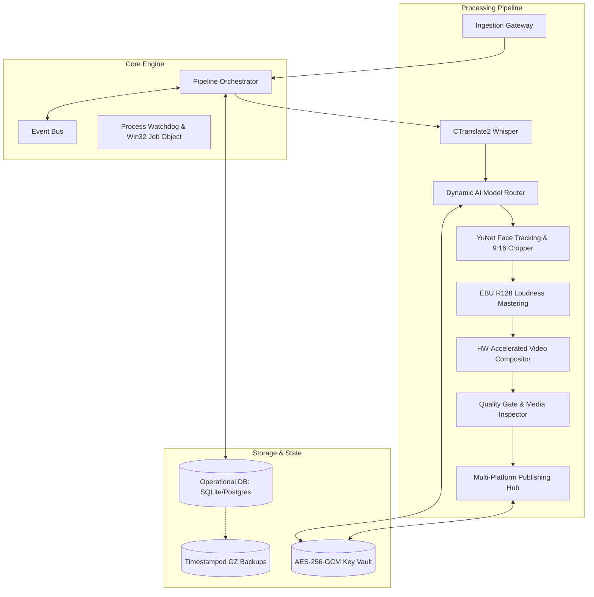

# 🏛️ System Architecture Specification

## 1. Executive Summary & Design Tenets

The **YouTube Shorts Autonomous Production & Syndication Engine** is engineered as a resilient, horizontally scalable micro-pipeline for automated video repurposing and broadcast.

### Core Architectural Principles:
1. **Decoupled Event-Driven Core**: Modules communicate via an internal pub/sub event bus (`shorts_engine/services/events/bus.py`). No module directly mutates downstream state without emitting typed events.
2. **Defensive Pipeline Boundaries**: Every pipeline transition (Ingestion → Transcription → AI Boundary Selection → Reframing → Rendering → Quality Assurance → Publishing) is guarded by strict technical invariants.
3. **Graceful Degradation & Multi-Tier Fallback**:
   - AI Model Router falls back dynamically: `Gemini 3.8 Flash` → `Groq LPU (LFM 2.5)` → `OpenRouter API Pool`.
   - Render Compositor falls back dynamically: `NVIDIA NVENC` → `Intel QuickSync (QSV)` → `AMD AMF` → `CPU libx264`.
4. **Idempotence & Crash Resilience**: All video jobs maintain atomic database states. Interrupted jobs resume from the nearest completed milestone without re-rendering or re-transcribing from scratch.
5. **Zero-Leakage Security Vault**: Master cryptographic keys encrypt credentials, OAuth tokens, and session cookies at rest via AES-256-GCM.

---

## 2. High-Level Subsystem Breakdown

---

## 3. Subsystem Deep-Dive

### 3.1. Ingestion Subsystem (`shorts_engine/services/ingestion/`)
- **WatchFolderWatcher**: Employs Windows ReadDirectoryChangesW via watchdog to detect file writes, applying a stabilization hysteresis filter (ensures file handle is unlocked and size is stationary before processing).
- **SessionHarvester**: Manages session cookies (`storage/harvester_cookies.txt`), automating refresh cycles to ensure continuous access to source streams.
- **LocalLoader & Win32 Integration**: Handles direct operator inputs via CLI or Windows File Explorer context menus.

### 3.2. Transcription & Word Snapping (`shorts_engine/services/transcription/`)
- **faster-whisper Engine**: Utilizes `CTranslate2` optimized kernels. Models are loaded with FP16 weights on GPU, or INT8 on CPU.
- **Timestamp Formatter**: Formats word-level timestamps (`FormattedTranscript`). Malformed tokens and non-speech artifacts are filtered prior to boundary calculation.
- **Micro-Silence Snapper**: Uses acoustic envelope analysis to snap clip start/end boundaries to natural pauses, preventing word cutoffs.

### 3.3. AI Intelligence & Dynamic Model Router (`shorts_engine/services/ai/`, `shorts_engine/services/clip_selection/`)
- **KeyVault**: Manages API key pools, tracking per-key tokens, request rate limits, and quota resets.
- **Prompt Architectures**: Ingests full transcripts, applying multi-shot viral hook extraction prompts.
- **Fallback Circuit Breaker**: Wraps requests in exponential backoff retry wrappers; transitions to secondary providers if error rates exceed 15% in a 60-second sliding window.

### 3.4. Vision & Dynamic Reframing (`shorts_engine/services/reframing/`)
- **YuNet Face Detector**: Real-time ONNX face detector running on OpenCV DNN. Detects facial landmarks to identify active speakers.
- **Camera Panning Interpolator**: Calculates bounding-box centroids and applies exponential moving average (EMA) smoothing to pan smoothly across a 16:9 canvas into 9:16 vertical crop.

### 3.5. Rendering & Compositing Engine (`shorts_engine/services/rendering/`)
- **HW Acceleration Module**: Tests hardware encoder capabilities dynamically (`ffmpeg -encoders`) and builds hardware-specific filter graphs.
- **ASS Subtitle Generator**: Assembles karaoke word highlighting with millisecond precision, styling fonts, colors, and shadows according to channel templates.
- **Loudness Mastering**: Applies dual-pass EBU R128 loudness normalization (`loudnorm`) targeting -14 LUFS, true peak -1.0 dBFS, LRA 7.

### 3.6. Quality Gate & Assurance (`shorts_engine/services/quality_gate/`)
- **RenderInspector**: Probes output MP4 container parameters, validating:
  - Resolution exact match: `1080x1920` (9:16).
  - Bitrate range: 8 Mbps to 15 Mbps.
  - Absence of pure black frames (`blackdetect`).
  - Absence of frozen video frames (`freezedetect`).
  - Audio sync alignment and zero-drop audio frames.
- **Dead-Letter Queue (DLQ)**: Non-compliant renders are routed to the quarantine queue for automatic re-render with fallback parameters or human review.

### 3.7. Publishing Hub & Syndication (`shorts_engine/services/publishing/`)
- **YouTube Resumable Publishing**: Implements RFC-compliant HTTP resumable upload protocol. Upload sessions survive connection resets, resuming at the exact byte offset.
- **Multi-Platform Adapters**: Modular interface for TikTok Direct Post and Instagram Reels Graph API.
- **Drip Feed Scheduler**: Schedules releases based on channel velocity configurations, enforcing minimum spacing windows between posts.
- **A/B Testing Bandit Engine**: Runs epsilon-greedy multi-armed bandit experiments on video titles and thumbnails.

---

## 4. Concurrency & Resource Governance

- **Win32 Job Objects**: Under Windows, all subprocesses (FFmpeg, Whisper, OpenCV) are assigned to an OS Job Object (`shorts_engine/services/execution/win32_job.py`) configured with `JOB_OBJECT_LIMIT_KILL_ON_JOB_CLOSE`. This guarantees zero orphan processes on engine termination.
- **Thread Pool Executors**: CPU-bound rendering jobs and I/O-bound network requests are partitioned into isolated worker pools to prevent event loop starvation.
- **SQLite Concurrency**: Uses Write-Ahead Logging (`WAL`) mode, busy timeouts of 5000ms, and structured mutex locks around database writes.
