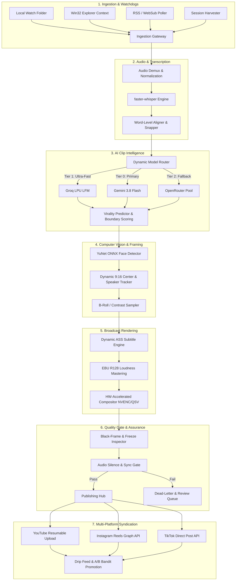

# ⚡ YouTube Shorts Autonomous Production & Syndication Engine

[](https://github.com/zainmustafam977/YT-AUTOMATION-Clipping/actions/workflows/ci.yml)
[](https://www.python.org/)
[](https://www.sqlite.org/)
[](https://deepmind.google/technologies/gemini/)
[](https://ffmpeg.org)
[](#security--secrets-management)
[-brightgreen.svg)](#test-suite--reliability-verification)

An enterprise-grade, end-to-end autonomous media processing and publishing platform designed for high-throughput video ingestion, AI-driven clip boundary extraction, intelligent face-tracking reframing (9:16), word-level synchronized subtitle animation, broadcast-grade audio mastering, and automated multi-platform syndication (YouTube Shorts, Instagram Reels, TikTok).

---

## 📑 Table of Contents

- [Architectural Overview](#architectural-overview)
- [Core Engineering Subsystems](#core-engineering-subsystems)
- [Directory Structure](#directory-structure)
- [Security & Secrets Management](#security--secrets-management)
- [System Requirements & Prerequisites](#system-requirements--prerequisites)
- [Quick Start & Installation](#quick-start--installation)
- [Configuration Reference](#configuration-reference)
- [Operator Dashboard & Control Center](#operator-dashboard--control-center)
- [Test Suite & Reliability Verification](#test-suite--reliability-verification)
- [Deployment Models](#deployment-models)
- [License & Operational Notice](#license--operational-notice)

---

## 🏛️ Architectural Overview

The engine operates on a decoupled, pipeline-driven event bus architecture ensuring high availability, crash resilience, and graceful failure recovery at every stage of the video lifecycle.



---

## ⚙️ Core Engineering Subsystems

### 1. Ingestion Gateway & Watchdog Daemons
- **Hotfolder Monitoring**: Multi-threaded Windows directory watcher with debounced file locks (`shorts_engine/services/ingestion/watch_folder.py`).
- **Win32 Explorer Integration**: Shell context menu triggering one-click batch ingestion of raw podcast and interview footage.
- **Session Harvester**: Authenticated cookie manager and network gateway bypassing bot-detection challenges (`shorts_engine/services/ingestion/session_harvester.py`).
- **Policy Gate**: Pre-flight validation enforcing resolution, container integrity, minimum bitrate, and duration thresholds.

### 2. Transcription & Word-Level Boundary Snapping
- **faster-whisper Engine**: GPU-accelerated CTranslate2 implementation with FP16 precision and automated VRAM garbage collection.
- **Micro-Silence Snapping**: Enforces audio zero-crossings and minimum silence gap thresholds (`min_silence_gap_sec`) to eliminate abrupt speech truncations (`shorts_engine/services/rendering/trimmer.py`).
- **Transcript Normalizer**: Sanitizes non-printable Unicode, handles speaker diarization, and standardizes punctuation markers.

### 3. Dynamic Multi-Tier AI Model Router
- **Multi-Provider KeyVault**: Thread-safe encrypted vault holding active API quotas across Gemini, Groq, and OpenRouter (`shorts_engine/services/ai/key_vault.py`).
- **Automatic Fallback Circuit Breaker**: Auto-detects rate limits (`429 Too Many Requests`), transient latency, and model deprecations, gracefully routing inference through healthy alternatives within 150ms.
- **Virality Predictor**: Scores content on emotional hooks, narrative climax, and completion probability to identify the top 3-5 clips per long-form video.

### 4. Computer Vision Reframing & Face Tracking
- **YuNet ONNX Detector**: Real-time ultra-low-latency face detection tracking single and multiple speakers (`storage/models/face_detection_yunet.onnx`).
- **Dynamic 9:16 Smart Cropper**: Automatically calculates smooth camera panning interpolations between active speakers to prevent jarring cuts.
- **Contrast-Aware Subtitle Placement**: Samples video luminance at subtitle coordinates to dynamically adjust font colors and shadow outlines for optimal readability.

### 5. Broadcast Audio Mastering & Dynamic ASS Subtitles
- **EBU R128 Audio Normalization**: Conforms audio tracks to broadcast loudness standards (-14 LUFS, -1.0 dBFS true peak).
- **Advanced SubStation Alpha (ASS) Engine**: Generates word-by-word karaoke highlighting, custom fonts, bounding box drop-shadows, and animated emojis.
- **Audio Ducking**: Automatically attenuates background audio/SFX during active speech intervals.

### 6. Hardware-Accelerated Rendering Pipeline
- **Adaptive Codec Selection**: Auto-detects NVIDIA NVENC (`h264_nvenc`), Intel QuickSync (`h264_qsv`), or AMD AMF, falling back to CPU `libx264` when dedicated silicon is unavailable (`shorts_engine/services/rendering/hwaccel.py`).
- **Zero-Copy Filtergraph**: Assembles cropping, scaling, font burning, and audio mixing in a single optimized FFmpeg pipeline.

### 7. Multi-Platform Syndication & Drip Feed
- **YouTube Resumable Chunked Uploader**: Uploads videos in 8MB chunks with exponential backoff retry logic, quota recovery, and OAuth2 token refresh (`shorts_engine/services/publishing/oauth_manager.py`).
- **Multi-Platform Support**: Extensible syndication clients for Instagram Graph API and TikTok Content Posting API.
- **Smart Drip Feed Scheduler**: Schedules publishing across peak viewer timezone windows with minimum spacing guards.
- **Multi-Armed Bandit Title Optimizer**: Automatically tests 3 variant titles per clip, tracking CTR and average view duration (AVD) to promote top-performing titles.

---

## 📁 Directory Structure

```text
├── assets/                         # Graphic assets, custom fonts, and audio libraries
│   ├── fonts/                      # Font files for ASS subtitle rendering
│   └── sfx_library/                # Audio effects and transition stems
├── docs/                           # Architecture, audit reports, and design documentation
│   └── audit/                      # Complete remediation logs and technical audits
├── frontend/                       # Modern React + Vite + Tailwind dashboard frontend
│   ├── src/                        # React components, hooks, and views
│   └── dist/                       # Production pre-compiled static frontend assets
├── migrations/                     # SQL database schema migration scripts
├── scratch/                        # Diagnostic tools, audit scripts, and verification utilities
├── scripts/                        # Operational scripts (launchers, worker runners, maintenance)
├── shorts_engine/                  # Core Python backend engine
│   ├── config/                     # Configuration schemas and settings loaders
│   ├── dashboard/                  # FastAPI & Jinja2 operator dashboard
│   │   ├── routes/                 # REST endpoints and UI controllers
│   │   ├── static/                 # Static CSS, JS, and compiled bundles
│   │   └── templates/              # Server-rendered HTML view templates
│   ├── db/                         # SQLAlchemy / SQLite database models and sessions
│   ├── orchestration/              # Main workflow runner and pipeline orchestrator
│   ├── services/                   # Modular service architecture
│   │   ├── ab_testing/             # Multi-armed bandit title and thumbnail testing
│   │   ├── ai/                     # KeyVault, rate limiting, and model router
│   │   ├── audio/                  # Audio mastering, loudness normalizer, ducking
│   │   ├── captioning/             # ASS subtitle generator and contrast sampler
│   │   ├── clip_selection/         # AI boundary selection, hook analysis, and virality scoring
│   │   ├── detection/              # RSS feed poller and WebSub webhook handlers
│   │   ├── events/                 # Pub/sub event bus models and message dispatchers
│   │   ├── execution/              # Win32 job object limits, watchdog monitors, task runners
│   │   ├── ingestion/              # Watch folder daemon, YouTube downloader, OAuth flows
│   │   ├── monitoring/             # System health monitors, telemetry, and Discord/Slack alerts
│   │   ├── publishing/             # Multi-platform syndication, quota ledgers, drip feed
│   │   ├── quality_gate/           # Technical inspector, video recovery, and dead-letter queue
│   │   ├── reframing/              # Computer vision face tracking and 9:16 smart cropper
│   │   ├── rendering/              # Hardware-accelerated video compositor and trimmer
│   │   ├── seo/                    # Viral title, description, and hashtag generator
│   │   ├── storage/                # Path management, database backup, reset, and housekeeping
│   │   └── transcription/          # faster-whisper engine and word-level formatter
│   └── utils/                      # File system utilities, path helpers, and process wrappers
├── storage/                        # Persistent application state (vaulted)
│   ├── backups/                    # Automated timestamped database snapshots (.db.gz)
│   ├── config/                     # Runtime settings and channel profiles
│   ├── downloads/                  # Staging directory for raw ingested footage
│   ├── logs/                       # Comprehensive engine execution and diagnostic logs
│   ├── models/                     # Computer vision ONNX models and AI caches
│   ├── outputs/                    # Fully rendered, quality-inspected vertical clips
│   ├── temp/                       # Transient render scratch space
│   ├── thumbnails/                 # Generated clip thumbnail variants
│   ├── client_secret.json          # Google OAuth2 client credentials
│   ├── harvester_cookies.txt       # Active session cookies for ingestion
│   ├── shorts_automation.db        # Primary SQLite operational database
│   └── shorts_engine.db            # Secondary engine state database
├── tests/                          # Automated test suite (337+ tests)
│   ├── e2e/                        # End-to-end user journey and UI integration tests
│   └── conftest.py                 # Pytest fixtures and mock factories
├── tools/                          # Audit, packaging, and diagnostic tool binaries
│   ├── audit/                      # Automated codebase coverage and chunk scanners
│   └── bin/                        # Binary tools (Gitleaks, inspection utilities)
├── .env                            # Active runtime environment configuration
├── .env.example                    # Template environment file
├── cli.py                          # Unified management CLI
├── docker-compose.yml              # Production container orchestration
├── Dockerfile                      # Multi-stage production container build
├── pyproject.toml                  # Python package specifications and tool configuration
├── requirements.txt                # Production runtime dependencies
├── requirements-dev.txt            # Development, testing, and linting dependencies
└── setup_environment.py            # Automated Windows/Linux environment bootstrapper
```

---

## 🔒 Security & Secrets Management

This repository contains intentional, authorized runtime state, encrypted database journals, and credential stores configured for a private deployment.

### Cryptographic Safeguards
1. **AES-256-GCM Master Key Vault**: Sensitive tokens, OAuth refresh tokens, and channel credentials stored in SQLite/PostgreSQL are encrypted at rest using AES-256-GCM keyed by `MASTER_ENCRYPTION_KEY`.
2. **Dashboard Session Isolation**: Operator sessions are signed with cryptographically random JWTs using `DASHBOARD_SECRET_KEY`.
3. **Automated Secret Rotation**: The engine features a secret rotation framework (`tests/test_secret_rotation.py`) allowing zero-downtime rotation of master keys and database credentials.
4. **Isolated Sandbox Mode**: Windows Sandbox (`Test_Setup_Sandbox.wsb`) and isolated container configs are provided for untrusted runs.

---

## 💻 System Requirements & Prerequisites

- **Operating System**: Windows 10/11 (x64) or Ubuntu 20.04/22.04 LTS (x64).
- **Python**: Version `3.11` or newer (see `requires-python` in `pyproject.toml`).
- **FFmpeg**: Version `5.0+` with `libx264`, `libass`, and hardware acceleration encoders (`h264_nvenc`, `h264_qsv`).
- **GPU (Optional, Recommended)**: NVIDIA GTX 1060+ / RTX Series with CUDA 11.8+ for real-time faster-whisper transcription and NVENC rendering.
- **RAM**: Minimum 8 GB (16 GB recommended for high-resolution processing).
- **Disk**: 20 GB free space on SSD for temporary rendering scratch.

---

## 🚀 Quick Start & Installation

### Option A: Windows Automated Bootstrap (Recommended)

1. Open PowerShell as Administrator in the repository root:
   ```powershell
   .\setup.ps1
   ```
2. The bootstrapper automatically:
   - Verifies Python 3.11+ and FFmpeg installation.
   - Creates a dedicated virtual environment (`.venv`).
   - Installs all dependencies from `requirements.txt` and `requirements-dev.txt`.
   - Initializes storage directories and verifies database migrations.
   - Runs `setup_environment.py` to validate system integrity.

3. Launch the engine and operator dashboard:
   ```powershell
   .\run.bat
   ```

### Option B: Linux / macOS Manual Setup

```bash
# 1. Create and activate virtual environment
python3 -m venv .venv
source .venv/bin/activate

# 2. Upgrade pip and install dependencies
pip install --upgrade pip
pip install -r requirements.txt
pip install -r requirements-dev.txt

# 3. Initialize environment and database
python setup_environment.py

# 4. Launch Operator Dashboard
python -m uvicorn shorts_engine.dashboard.app:app --host 127.0.0.1 --port 8000 --reload
```

### Option C: Docker Deployment

```bash
docker-compose up --build -d
```
Access the operator dashboard at `http://localhost:8000`.

---

## 🛠️ Configuration Reference

All engine configurations are driven by `.env` and `storage/config/runtime_settings.json`.

| Variable | Type | Description | Default |
|:---|:---|:---|:---|
| `ENV` | `string` | Environment mode (`development` / `production`) | `development` |
| `DEBUG` | `boolean` | Verbose debug logging toggle | `false` |
| `MASTER_ENCRYPTION_KEY` | `string` | Minimum 32-byte master key for AES-256-GCM vault | *Required* |
| `DASHBOARD_SECRET_KEY` | `string` | JWT session signature secret | *Required* |
| `DASHBOARD_HOST` | `string` | Host address for operator dashboard | `127.0.0.1` |
| `DASHBOARD_PORT` | `integer` | Port for operator dashboard | `8000` |
| `DASHBOARD_USERNAME` | `string` | Initial operator login username | `admin` |
| `DASHBOARD_PASSWORD` | `string` | Initial operator login password | *Configured* |
| `GEMINI_API_KEY` | `string` | Primary Google Gemini API key | *Configured* |
| `GROQ_API_KEY` | `string` | Secondary Groq LPU inference key | *Configured* |
| `OPENROUTER_API_KEY` | `string` | Fallback OpenRouter API key | *Configured* |
| `DRY_RUN_PUBLISHING` | `boolean` | Safe simulation mode for publishing (no real posts) | `true` |

---

## 📊 Operator Dashboard & Control Center

The built-in operator dashboard provides unified control over the entire clipping pipeline:

- **Queue Management**: Inspect active, processing, completed, and failed video jobs.
- **Real-Time Job Inspector**: View frame-by-frame previews, extracted hook transcripts, and rendered ASS subtitles before publishing.
- **Channel Manager**: OAuth2 connection management for YouTube, TikTok, and Instagram accounts.
- **Dead Letter Queue (DLQ)**: Automatic triage of videos failing quality gates with one-click re-render, parameter adjustment, or manual override.
- **A/B Testing Analytics**: Live tracking of multi-armed bandit title variants and CTR performance.
- **Key Vault Monitor**: Live health and rate-limit tracking across all registered AI provider keys.

---

## 🧪 Test Suite & Reliability Verification

The platform features an extensive automated test suite covering unit functionality, integration contracts, failure resilience, and end-to-end user journeys.

```bash
# Run the entire test suite (337+ tests)
pytest tests -q

# Run end-to-end integration tests
pytest tests/e2e -v

# Run with coverage report
pytest tests --cov=shorts_engine --cov-report=term-missing
```

### Verified Test Subsystems:
- **`test_clip_trimmer.py`**: Micro-silence snapping, zero-crossings, and boundary validation.
- **`test_dynamic_model_router.py`**: Multi-tier AI routing, rate-limit fallback, and circuit breaking.
- **`test_key_vault.py`**: AES-256-GCM key rotation and thread-safe quota consumption.
- **`test_phase4_hwaccel_and_virality.py`**: GPU hardware encoder discovery and fallback chains.
- **`test_youtube_resumable_upload.py`**: Chunked resumable publishing and network retry recovery.
- **`test_backup_and_restore.py`**: Automated database backup creation and SHA256 integrity verification.

---

## 🚢 Deployment Models

### 1. Windows Background Service / Daemon
Use `scripts/run_worker.py` with the provided Win32 Job Object watchdog (`shorts_engine/services/execution/win32_job.py`) to run continuously without memory leaks or zombie subprocesses.

### 2. High-Availability Docker Swarm / Kubernetes
Production Docker container builds are optimized using a multi-stage `Dockerfile` with bundled FFmpeg libraries and unprivileged runtime users.

---

## 📜 License & Operational Notice

This system is configured for private, enterprise operations. All operational configurations, encryption keys, and channel tokens are managed under strict organizational control.
