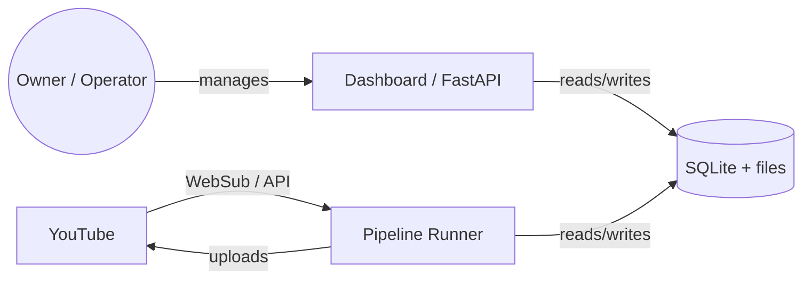
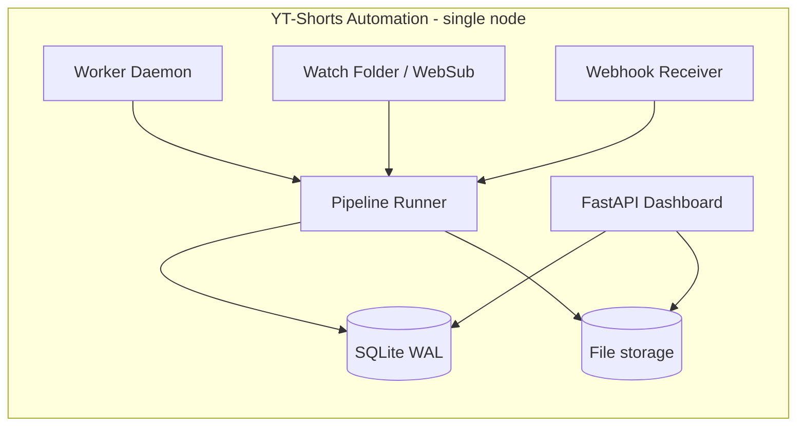

# Architecture (R4-7.1)

YT-Shorts Automation is a single-node, async, queue-driven pipeline that
takes a YouTube source video, finds the best 30–60 second moments, and
publishes them as Shorts on the same channel. A FastAPI dashboard gives
the operator visibility and control.

## C4 — System Context



## C4 — Containers



## C4 — Components

```mermaid
flowchart LR
    subgraph Ingestion
        WS[WebSub Listener]
        Polling[YouTube Polling]
        LF[Local File Ingestion]
    end
    subgraph Selection
        CS[Clip Selection - LLM]
        RG[Reframe / Refocus]
    end
    subgraph Render
        Render[ffmpeg Pipeline]
        Caption[Caption / Overlay]
        Audio[Audio Mastering]
    end
    subgraph Publish
        OAuth[OAuth / Quota]
        Slot[Slot Scheduler]
        UP[YouTube Upload]
    end
    WS --> CS
    Polling --> CS
    LF --> CS
    CS --> RG
    RG --> Render
    Render --> Caption
    Render --> Audio
    Caption --> Slot
    Audio --> Slot
    Slot --> OAuth
    OAuth --> UP
```

## Process model

* **Worker daemon** — long-running process that polls the durable
  pipeline_jobs queue and dispatches to the runner.
* **Pipeline runner** — Python coroutine / thread that executes the
  ordered stages for one job. Has checkpoints so a crash mid-pipeline
  resumes from the last persisted state.
* **Dashboard** — FastAPI; serves Jinja2 + a built React SPA under
  `/app/`. Stateless.
* **Webhook receiver** — under `/api/webhooks/...`; HMAC-signed;
  pulls events into the pipeline.

## Data flow

1. A new source video is detected (WebSub push or polling).
2. Clip Selection (LLM) produces N candidates.
3. Candidates are re-rendered to portrait, captioned, mixed.
4. A human (or auto-approval on green path) approves a candidate.
5. The publisher schedules a slot and uploads via the YouTube API.
6. Webhooks from YouTube (upload complete, processing done) update
   the clip state.

## Failure model

* Worker is idempotent — every state transition is CAS-arbitrated.
* Webhooks are retried with backoff; persistent failures go to a
  dead-letter table that triage surfaces.
* The pipeline stores its `pipeline_jobs` table durably; the worker
  re-claims any jobs that exceed a max-runtime.
* STRICT_MODE (R4-5.2) controls whether silent fallbacks are allowed.
