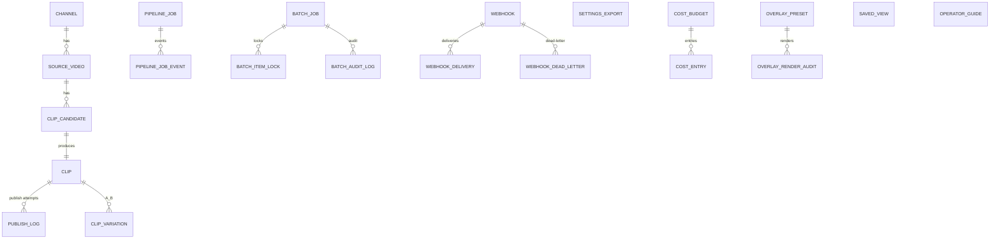

# Data Model (R4-7.1)

The persistent data model lives in `shorts_engine/db/models.py` and is
managed by Alembic / the custom migration registry. WAL-mode SQLite is
the default; PostgreSQL is supported via the same SQLAlchemy models
(R4-2.3).

## Entity-relationship diagram (top-level)

## Tables (selected)

| Table | Purpose | Notes |
|-------|---------|-------|
| `channels` | YouTube channels we manage | holds encrypted OAuth tokens (R4-4.7) |
| `source_videos` | videos detected from channels | drives the pipeline |
| `clip_candidates` | LLM-suggested segments | with `caption_words_json` for editor |
| `clips` | rendered, approved Shorts | +draft fields +variations |
| `pipeline_jobs` | durable job queue | unique (entity_id, stage) |
| `pipeline_job_events` | per-job event log | used for visibility |
| `publish_logs` | per-publish attempt log | YouTube API responses |
| `quota_ledger` | daily API quota usage | per (channel, day) |
| `webhook_dead_letter` | webhook deliveries that exhausted retries | |
| `overlay_preset` + `overlay_render_audit` | overlay engine (R3 R3.1) | SHA-256 tamper detection |
| `operator_guides` | inline help text in dashboard | |
| `saved_views` | operator saved filters (EASE-02) | |

## Migration discipline

* Every schema change has a forward SQL in `migrations/NNN_*.sql` and a
  rollback in `migrations/NNN_*_rollback.sql`.
* The migration registry in `shorts_engine/db/migrations.py` records
  every applied version.
* A pre-upgrade backup is required (R4-6.2).
* Schema drift is checked in CI.
