# System Context & External Boundaries

> **Path:** `docs/architecture/01_system_context.md`  
> **Source Files:**
> - [`shorts_engine/config/settings.py`](file:///d:/Projects/YT%20AUTOMATION/shorts_engine/config/settings.py)
> - [`shorts_engine/services/llm/router.py`](file:///d:/Projects/YT%20AUTOMATION/shorts_engine/services/llm/router.py)
> - [`shorts_engine/services/publishing/manager.py`](file:///d:/Projects/YT%20AUTOMATION/shorts_engine/services/publishing/manager.py)
> - [`shorts_engine/services/monitoring/alerter.py`](file:///d:/Projects/YT%20AUTOMATION/shorts_engine/services/monitoring/alerter.py)

---

## 1. System Boundary Definition

The **YouTube Shorts Automation Platform (Shorts Engine)** is an autonomous, self-hosted content ingestion, analysis, computer vision reframing, audio mastering, and syndication system. 

It ingests long-form video content from YouTube channels, uses artificial intelligence to identify viral narrative moments, reframes horizontal footage into 9:16 portrait video with deep-learning face tracking, applies broadcast audio mastering with dynamic ducking, generates kinetic karaoke subtitles, enforces strict automated quality gates, and syndicates finished clips across YouTube Shorts, TikTok, and Instagram Reels.

```mermaid
flowchart TB
    subgraph External_Actors [Human Operators & Actors]
        ADMIN[System Administrator\nCLI / User Management]
        OPERATOR[Dashboard Operator\nReview Queue / Recovery]
        CREATOR[Channel Creator / Viewer\nAudience on Social Platforms]
    end

    subgraph System_Boundary [Shorts Engine Autonomous Boundary]
        DASHBOARD[FastAPI Dashboard & SSE Server\n:8000 / Session RBAC]
        WORKER[Decoupled Headless Worker\nGPU / CPU Rendering]
        DAEMONS[Background Daemons\nRSS Poller / Drip-Feed / A/B Bandit]
        DB[(Relational DB\nSQLite WAL / PostgreSQL)]
        STORAGE[(Hierarchical Storage\nMedia / Models / Temp / Backups)]
    end

    subgraph External_YouTube [Google & YouTube Services]
        YT_PUSH[WebSub PubSubHubbub Hub\nPush Notifications]
        YT_RSS[YouTube Atom Feeds\nXML Polling]
        YT_DATA[YouTube Data API v3\nOAuth2 / Video Upload / Title Update]
        YT_ANALYTICS[YouTube Analytics API\nDeep Retention Metrics]
        YT_CDN[YouTube Streaming CDN\nyt-dlp Stream Download]
    end

    subgraph External_AI [AI LLM & Speech Providers]
        GROQ[Groq Cloud LPU\nWhisper Turbo / Llama 3.3 70B]
        GEMINI[Google Gemini API\nGemini 3.8 Flash / 2.5 Flash]
        OPENROUTER[OpenRouter Gateway\nDeepSeek / Claude / Llama]
        OPENAI[OpenAI API\nGPT-4o-mini]
    end

    subgraph External_Social [Social Video Syndication]
        TIKTOK[TikTok Content Posting API v2\nChunked Uploads]
        INSTAGRAM[Meta Graph API v19.0\nInstagram Reels Containers]
    end

    subgraph External_Ops [Monitoring & External Assets]
        SLACK[Slack Incoming Webhooks]
        DISCORD[Discord Webhooks]
        TELEGRAM[Telegram Bot API]
        SENTRY[Sentry Error Monitoring]
        PEXELS[Pexels Video Search API\nStock B-Roll]
        OPENCV_ZOO[OpenCV Zoo GitHub\nYuNet ONNX Model Download]
    end

    %% Interactions
    ADMIN -->|CLI / Control Scripts| System_Boundary
    OPERATOR -->|HTTPS Web UI| DASHBOARD
    
    YT_PUSH -->|HMAC-SHA1 Push| DASHBOARD
    DAEMONS -->|HTTP GET| YT_RSS
    DAEMONS -->|HTTP GET / POST| YT_DATA
    DAEMONS -->|HTTP GET| YT_ANALYTICS
    WORKER -->|HTTPS Video Streams| YT_CDN
    
    WORKER -->|gRPC / REST API| GROQ
    WORKER -->|REST API| GEMINI
    WORKER -->|REST API| OPENROUTER
    WORKER -->|REST API| OPENAI
    
    DAEMONS -->|REST API| TIKTOK
    DAEMONS -->|REST API| INSTAGRAM
    
    DAEMONS -->|HTTPS Webhooks| SLACK
    DAEMONS -->|HTTPS Webhooks| DISCORD
    DAEMONS -->|HTTPS Webhooks| TELEGRAM
    System_Boundary -->|HTTPS SDK| SENTRY
    
    WORKER -->|REST API| PEXELS
    WORKER -->|HTTPS Download| OPENCV_ZOO

    CREATOR -.->|Watches Published Content| External_YouTube
    CREATOR -.->|Watches Published Content| External_Social
```

---

## 2. Actors & User Personas

| Actor | Access Mode | Privileges & Responsibilities | Key Touchpoints |
| :--- | :--- | :--- | :--- |
| **System Administrator** | Local Terminal, SSH, CLI (`run.py`, `cli.py`), Windows Control Center | Full access. Initializes database, provisions operator accounts, configures API credentials, manages secret key rotations, performs database hot backups and restorations. | `cli.py:cmd_init_db`, `cmd_rotate_secrets`, `cmd_backup_db`, `cmd_create_user`. |
| **Dashboard Operator** | Web Browser (`http://<host>:8000`) | Authenticated via session cookie. Manages watched channels, triggers manual video ingestion, reviews pending clips in card/flat views, applies caption styles, executes recovery auto-fixes, and schedules publishing drip-feed times. | `routes/status.py`, `routes/queue.py`, `routes/channels.py`, `routes/settings.py`. |
| **Viewer / Auditor** | Web Browser (`http://<host>:8000`) | Read-only authenticated role. Inspects processing pipelines, reads real-time logs, audits published clip performance, and reviews system health probes. | `auth.py:require_viewer`, `routes/health.py`, `routes/metrics.py`. |
| **End-User / Audience** | YouTube, TikTok, Instagram | Consumes published Short videos on social media platforms. Generated views, likes, and watch-time retention feed back into the Bayesian optimization engine. | YouTube Shorts Player, TikTok Feed, Instagram Reels. |

---

## 3. External Systems & Cloud API Ledger

### 3.1 Google & YouTube
- **YouTube Data API v3 (`https://www.googleapis.com/youtube/v3`)**:
  - Resumable video upload (`videos().insert()`, consumes 1,600 quota units).
  - Video title dynamic updates (`videos().update()`, consumes 50 quota units).
  - Video and playlist metadata inspection (`videos().list()`, `channels().list()`).
  - Authentication: AES-256-GCM encrypted OAuth2 refresh tokens stored per-channel.
- **YouTube WebSub Hub (`https://pubsubhubbub.appspot.com/subscribe`)**:
  - PubSubHubbub protocol push notifications for instant video uploads.
  - Authentication: Timing-safe HMAC-SHA1 signature verification (`X-Hub-Signature`).
- **YouTube Public Atom Feeds (`https://www.youtube.com/feeds/videos.xml?channel_id={id}`)**:
  - Fallback polling using standard XML parsing without API key quota cost.
- **YouTube Analytics API (`https://youtubeanalytics.googleapis.com/v2`)**:
  - Tier 2 deep audience retention metrics (`averageViewPercentage`, `averageViewDuration`).

### 3.2 AI & Large Language Model Providers
- **Groq Cloud API (`https://api.groq.com/openai/v1`)**:
  - Primary high-speed LLM inference (`llama-3.3-70b-versatile`) via ultra-fast LPU.
  - High-speed ASR speech transcription (`whisper-large-v3-turbo`).
  - Auth: `GROQ_API_KEY`, rate-limit tracking via response header parsing (`x-ratelimit-*`).
- **Google Gemini API (`google-genai` SDK)**:
  - Multi-tier structured JSON extraction (`gemini-3.8-flash`, `gemini-2.5-flash`).
  - Auth: `GEMINI_API_KEY`.
- **OpenRouter API (`https://openrouter.ai/api/v1`)**:
  - Multi-model failover aggregator (`deepseek/deepseek-chat`, `meta-llama/llama-3.3-70b-instruct`).
  - Auth: `OPENROUTER_API_KEY`.
- **OpenAI API (`https://api.openai.com/v1`)**:
  - Emergency fallback provider (`gpt-4o-mini`).
  - Auth: `OPENAI_API_KEY`.

### 3.3 Social Media Syndication
- **TikTok Content Posting API v2 (`https://open.tiktokapis.com/v2`)**:
  - Chunked resumable video uploads (10MB chunks), creator info privacy checks, async status polling.
  - Auth: Bearer `TIKTOK_ACCESS_TOKEN`.
- **Meta Graph API v19.0 (`https://graph.facebook.com/v19.0`)**:
  - Instagram Reels media container lifecycle management and feed publishing.
  - Auth: `INSTAGRAM_ACCESS_TOKEN`, `INSTAGRAM_USER_ID`.

### 3.4 Monitoring & Telemetry
- **Slack & Discord Webhooks**:
  - Formatted JSON failure and quota exhaustion alerts.
- **Telegram Bot API (`https://api.telegram.org/bot<token>/sendMessage`)**:
  - Real-time mobile push notifications.
- **Sentry (`https://sentry.io`)**:
  - Cloud error tracking, stack traces, and release telemetry (`release="shorts-engine@2.0.0"`).

### 3.5 External Asset Sources
- **Pexels Video API (`https://api.pexels.com/videos/search`)**:
  - Stock video B-roll cutaway acquisition with local file caching.
  - Auth: `PEXELS_API_KEY`.
- **OpenCV Zoo GitHub Repository**:
  - Automated initial download of YuNet ONNX face detection model (`face_detection_yunet_2023mar.onnx`, ~300KB).
