# 02 Component Architecture & Module Decomposition

> **As-Implemented Component Architecture**  
> Evidence-grounded breakdown of all modules, domain boundaries, and dependencies in `shorts-engine`.  
> Source of Truth: Python AST import graph and package structure as of 2026-09-24.

---

## 1. Executive Summary

The `shorts-engine` system is decomposed into 7 primary architectural layers containing 23 domain packages and 99 Python modules. The system follows a layered pipes-and-filters architecture, transitioning from source video ingestion to transcription, multimodal LLM clip selection, 9:16 computer vision reframing, ASS subtitle compositing, dual-stage quality gating (media + semantic), and multi-platform publishing.

```mermaid
graph TD
    classDef l6 fill:#1e1e2e,stroke:#f38ba8,stroke-width:2px,color:#cdd6f4;
    classDef l5 fill:#1e1e2e,stroke:#cba6f7,stroke-width:2px,color:#cdd6f4;
    classDef l4 fill:#1e1e2e,stroke:#fab387,stroke-width:2px,color:#cdd6f4;
    classDef l3 fill:#1e1e2e,stroke:#f9e2af,stroke-width:2px,color:#cdd6f4;
    classDef l2 fill:#1e1e2e,stroke:#a6e3a1,stroke-width:2px,color:#cdd6f4;
    classDef l1 fill:#1e1e2e,stroke:#89dceb,stroke-width:2px,color:#cdd6f4;
    classDef l0 fill:#1e1e2e,stroke:#89b4fa,stroke-width:2px,color:#cdd6f4;

    subgraph Presentation_Layer [Presentation & Control Layer]
        CLI[Typer CLI<br/>cli.py / run.py]:::l6
        DASH[FastAPI Dashboard<br/>shorts_engine.dashboard]:::l6
    end

    subgraph Coordination_Layer [Pipeline & Worker Coordination]
        ORCH[Monolithic Pipeline Runner<br/>shorts_engine.orchestration.runner]:::l5
        WORKER[Distributed Queue Worker<br/>shorts_engine.services.worker.runner]:::l5
    end

    subgraph Assembly_and_QA [Rendering & Quality Gates]
        COMPOSITOR[FFmpeg Video Compositor<br/>services.rendering.compositor]:::l4
        TRIMMER[Sub-frame Re-timer & Trimmer<br/>services.rendering.trimmer]:::l4
        MEDIA_QA[Computer Vision / Acoustic QA Gate<br/>services.quality.media_qa]:::l4
        SEM_QA[Multimodal / Semantic Quality Gate<br/>services.quality_gate]:::l4
    end

    subgraph Domain_Pipelines [Domain Feature Pipelines]
        DETECTION[Channel Detection & RSS Poller<br/>services.detection]:::l3
        INGESTION[yt-dlp Video & Audio Downloader<br/>services.ingestion.downloader]:::l3
        TRANSCRIPTION[Faster-Whisper & Silero VAD<br/>services.transcription]:::l3
        CLIP_SELECT[Virality Scoring & Selection<br/>services.clip_selection]:::l3
        REFRAMING[Active Speaker 9:16 Cropper<br/>services.reframing]:::l3
        CAPTIONING[ASS Kinetic Subtitle Engine<br/>services.captioning]:::l3
        AUDIO_ENG[LUFS Mastering & Ducking<br/>services.audio.mastering]:::l3
        PUBLISHING[Syndication & Quota Tracking<br/>services.publishing]:::l3
        AB_TESTING[Multi-Armed Bandit & Promotion<br/>services.ab_testing]:::l3
    end

    subgraph Infrastructure_Core [Foundation & Data Persistence]
        DB[(SQLAlchemy ORM & WAL Session<br/>shorts_engine.db)]:::l1
        BACKUP[Disaster Recovery & Hot Backup<br/>services.storage.backup_manager]:::l1
        WATCHDOG[Subprocess Watchdog & Tree Killer<br/>services.execution.watchdog]:::l0
        ROUTER[LLM Multi-Key Router & Quotas<br/>services.llm.router]:::l2
        SETTINGS[Pydantic Typed Configuration<br/>shorts_engine.config.settings]:::l0
    end

    CLI --> DASH
    CLI --> ORCH
    CLI --> WORKER
    CLI --> BACKUP

    DASH --> DB
    DASH --> ORCH
    DASH --> PUBLISHING
    DASH --> SEM_QA

    ORCH --> INGESTION
    ORCH --> TRANSCRIPTION
    ORCH --> CLIP_SELECT
    ORCH --> REFRAMING
    ORCH --> CAPTIONING
    ORCH --> COMPOSITOR
    ORCH --> MEDIA_QA
    ORCH --> SEM_QA
    ORCH --> PUBLISHING

    WORKER --> DB
    WORKER --> REFRAMING
    WORKER --> CAPTIONING
    WORKER --> COMPOSITOR
    WORKER --> MEDIA_QA
    WORKER --> SEM_QA

    COMPOSITOR --> WATCHDOG
    COMPOSITOR --> AUDIO_ENG
    INGESTION --> WATCHDOG
    MEDIA_QA --> WATCHDOG
    BACKUP --> WATCHDOG

    CLIP_SELECT --> ROUTER
    SEM_QA --> ROUTER
    AB_TESTING --> ROUTER

    DB --> SETTINGS
    ROUTER --> SETTINGS
    WATCHDOG --> SETTINGS
```

---

## 2. Component Directory & Module Responsibilities

### 2.1 Layer 0: System Foundation
- **`shorts_engine.config.settings`** ([`shorts_engine/config/settings.py:1-260`](file:///d:/Projects/YT%20AUTOMATION/shorts_engine/config/settings.py)):
  - Singleton `Settings(BaseSettings)` reading environment variables with cryptographic key handling, path resolution, and clamp functions (`get_clamped_bounds()`).
- **`shorts_engine.config.logging_config`** ([`shorts_engine/config/logging_config.py:1-55`](file:///d:/Projects/YT%20AUTOMATION/shorts_engine/config/logging_config.py)):
  - Dual-output logging configuration (Rich colorized terminal handler + rotating file handler in `storage/logs/shorts_engine.log`).
- **`shorts_engine.services.execution.watchdog`** ([`shorts_engine/services/execution/watchdog.py:1-300`](file:///d:/Projects/YT%20AUTOMATION/shorts_engine/services/execution/watchdog.py)):
  - External process supervisor providing hard execution timeouts, recursive descendant PID discovery via `psutil`, guaranteed tree termination (SIGTERM -> SIGKILL), corrupted partial artifact purging, and transparent mock passthrough for test harnesses.
- **`shorts_engine.services.telemetry.progress_tracker`** ([`shorts_engine/services/telemetry/progress_tracker.py:1-120`](file:///d:/Projects/YT%20AUTOMATION/shorts_engine/services/telemetry/progress_tracker.py)):
  - In-memory event hub maintaining per-video stage percentages (0-100%) and feeding Server-Sent Events (SSE) to the dashboard.

### 2.2 Layer 1: Data Persistence & Storage
- **`shorts_engine.db.models`** ([`shorts_engine/db/models.py:1-480`](file:///d:/Projects/YT%20AUTOMATION/shorts_engine/db/models.py)):
  - Declarative SQLAlchemy models: `Channel`, `SourceVideo`, `Transcript`, `ClipCandidate`, `Clip`, `PublishLog`, `PlatformPublishLog`, `ABTestGroup`, `ABVariant`, `AdminUser`, `DeadLetterJob`.
- **`shorts_engine.db.session`** ([`shorts_engine/db/session.py:1-135`](file:///d:/Projects/YT%20AUTOMATION/shorts_engine/db/session.py)):
  - Database engine provider configuring SQLite WAL mode, busy timeouts (30.0s), foreign key pragma, and connection pool sizing. Also provisions `AsyncSession` for asyncpg/aiosqlite.
- **`shorts_engine.db.security`** ([`shorts_engine/db/security.py:1-60`](file:///d:/Projects/YT%20AUTOMATION/shorts_engine/db/security.py)):
  - Fernet symmetric encryption helper encrypting OAuth tokens, client secrets, and sensitive credentials in database columns.
- **`shorts_engine.services.storage.backup_manager`** ([`shorts_engine/services/storage/backup_manager.py:1-180`](file:///d:/Projects/YT%20AUTOMATION/shorts_engine/services/storage/backup_manager.py)):
  - Non-blocking online hot SQLite backup manager using `sqlite3.Connection.backup()`, streaming gzip compression, SHA-256 verification, and auto-rotation (retains 30 backups).
- **`shorts_engine.services.storage.path_manager`** ([`shorts_engine/services/storage/path_manager.py:1-95`](file:///d:/Projects/YT%20AUTOMATION/shorts_engine/services/storage/path_manager.py)):
  - Deterministic filesystem path generator for downloads, cropped frames, temporary audio stems, ASS subtitles, thumbnails, and final rendered clips.

### 2.3 Layer 2: Core Domain Leaf Services
- **`shorts_engine.services.llm.router`** ([`shorts_engine/services/llm/router.py:1-250`](file:///d:/Projects/YT%20AUTOMATION/shorts_engine/services/llm/router.py)):
  - Unified multi-provider LLM gateway supporting Groq LPU (`llama-3.3-70b-versatile`), Google Gemini (`gemini-2.0-flash`, `gemini-1.5-pro`), and OpenRouter (`deepseek-r1`). Implements automatic failover, exponential backoff, and JSON response schema enforcement.
- **`shorts_engine.services.llm.quota_tracker`** ([`shorts_engine/services/llm/quota_tracker.py:1-180`](file:///d:/Projects/YT%20AUTOMATION/shorts_engine/services/llm/quota_tracker.py)):
  - Multi-key rotation and rate-limit tracker managing TPM (tokens per minute) and RPM (requests per minute) sliding windows across multiple provider API keys.
- **`shorts_engine.services.transcription.engine`** ([`shorts_engine/services/transcription/engine.py:1-160`](file:///d:/Projects/YT%20AUTOMATION/shorts_engine/services/transcription/engine.py)):
  - Faster-Whisper wrapper performing local audio transcription with CTranslate2 GPU/CPU compute, beam search tuning, temperature scheduling, and Silero VAD speech filtering.
- **`shorts_engine.services.transcription.formatter`** ([`shorts_engine/services/transcription/formatter.py:1-90`](file:///d:/Projects/YT%20AUTOMATION/shorts_engine/services/transcription/formatter.py)):
  - Converts raw Whisper transcription segments into normalized `WordSegment` tokens with millisecond-precision `start` and `end` offsets.
- **`shorts_engine.services.reframing.detector`** ([`shorts_engine/services/reframing/detector.py:1-140`](file:///d:/Projects/YT%20AUTOMATION/shorts_engine/services/reframing/detector.py)):
  - Computer vision face and saliency detector using Haar cascades and DNN models to detect human subject bounding boxes in 16:9 landscape frames.
- **`shorts_engine.services.reframing.active_speaker`** ([`shorts_engine/services/reframing/active_speaker.py:1-120`](file:///d:/Projects/YT%20AUTOMATION/shorts_engine/services/reframing/active_speaker.py)):
  - Correlates visual mouth movements or audio amplitude peaks to identify the primary active speaker when multiple faces appear in a shot.
- **`shorts_engine.services.reframing.smoothing`** ([`shorts_engine/services/reframing/smoothing.py:1-110`](file:///d:/Projects/YT%20AUTOMATION/shorts_engine/services/reframing/smoothing.py)):
  - Applies rolling Kalman filtering or moving-average trajectory interpolation to prevent jittery camera panning across frames.
- **`shorts_engine.services.reframing.cropper`** ([`shorts_engine/services/reframing/cropper.py:1-180`](file:///d:/Projects/YT%20AUTOMATION/shorts_engine/services/reframing/cropper.py)):
  - Generates the finalized `CropPlan` containing pan-and-scan keypoints and translates them into FFmpeg `crop=w:h:x:y` filter strings.
- **`shorts_engine.services.audio.mastering`** ([`shorts_engine/services/audio/mastering.py:1-240`](file:///d:/Projects/YT%20AUTOMATION/shorts_engine/services/audio/mastering.py)):
  - EBU R128 (-14.0 LUFS) two-pass loudness normalizer, high-pass vocal filter, and sidechain ducking filter graph generator (`asplit`, `sidechaincompress`).
- **`shorts_engine.services.quality.media_qa`** ([`shorts_engine/services/quality/media_qa.py:1-260`](file:///d:/Projects/YT%20AUTOMATION/shorts_engine/services/quality/media_qa.py)):
  - Computer vision black frame detection (`blackdetect`) and acoustic silence dropout detection (`silencedetect`) enforcing physical rendering integrity before approval.

### 2.4 Layer 3: Composite Domain Services
- **`shorts_engine.services.captioning.ass_generator`** ([`shorts_engine/services/captioning/ass_generator.py:1-320`](file:///d:/Projects/YT%20AUTOMATION/shorts_engine/services/captioning/ass_generator.py)):
  - Advanced ASS subtitle generator producing kinetic, animated, word-level highlighted captions with customizable fonts, primary/secondary colors, bounding boxes, and karaoke timing (`\k`).
- **`shorts_engine.services.captioning.templates`** ([`shorts_engine/services/captioning/templates.py:1-190`](file:///d:/Projects/YT%20AUTOMATION/shorts_engine/services/captioning/templates.py)):
  - Predefined aesthetic caption presets: Alex Hormozi Viral, MrBeast Impact, Cyberpunk Neon, Minimalist Editorial, High Contrast Box.
- **`shorts_engine.services.clip_selection.selector`** ([`shorts_engine/services/clip_selection/selector.py:1-290`](file:///d:/Projects/YT%20AUTOMATION/shorts_engine/services/clip_selection/selector.py)):
  - Evaluates full transcripts with LLMs using zero-shot viral evaluation prompts to select high-engagement candidate segments (hook score, coherence, emotional spike, standalone value).
- **`shorts_engine.services.clip_selection.boundaries`** ([`shorts_engine/services/clip_selection/boundaries.py:1-140`](file:///d:/Projects/YT%20AUTOMATION/shorts_engine/services/clip_selection/boundaries.py)):
  - Snaps proposed clip boundaries to natural sentence pauses, silence gaps, and punctuation marks to prevent cut-off words.
- **`shorts_engine.services.ingestion.downloader`** ([`shorts_engine/services/ingestion/downloader.py:1-180`](file:///d:/Projects/YT%20AUTOMATION/shorts_engine/services/ingestion/downloader.py)):
  - Downloads source video and best-quality audio using `yt-dlp`, probes duration via `ffprobe`, and extracts 16kHz mono WAV audio stems under `SubprocessWatchdog`.
- **`shorts_engine.services.publishing.manager`** ([`shorts_engine/services/publishing/manager.py:1-150`](file:///d:/Projects/YT%20AUTOMATION/shorts_engine/services/publishing/manager.py)):
  - MultiPlatformSyndicator managing parallel dispatch across YouTube, TikTok, and Instagram Reels with unified logging into `PlatformPublishLog`.
- **`shorts_engine.services.publishing.quota`** ([`shorts_engine/services/publishing/quota.py:1-99`](file:///d:/Projects/YT%20AUTOMATION/shorts_engine/services/publishing/quota.py)):
  - YouTube Data API quota manager tracking daily 10,000 unit allowance (~1,600 units per upload) and enforcing safety cutoffs.
- **`shorts_engine.services.publishing.drip_feed`** ([`shorts_engine/services/publishing/drip_feed.py:1-140`](file:///d:/Projects/YT%20AUTOMATION/shorts_engine/services/publishing/drip_feed.py)):
  - Automated scheduling engine releasing approved clips in intervals (e.g. 2-4 hours apart) to maximize algorithmic discovery.
- **`shorts_engine.services.ab_testing.bandit`** ([`shorts_engine/services/ab_testing/bandit.py:1-150`](file:///d:/Projects/YT%20AUTOMATION/shorts_engine/services/ab_testing/bandit.py)):
  - Multi-armed bandit algorithm (Epsilon-Greedy / Upper Confidence Bound) allocating impressions across generated title and thumbnail variants.
- **`shorts_engine.services.ab_testing.winner_daemon`** ([`shorts_engine/services/ab_testing/winner_daemon.py:1-130`](file:///d:/Projects/YT%20AUTOMATION/shorts_engine/services/ab_testing/winner_daemon.py)):
  - Polling daemon that monitors performance analytics after 24-48 hours, declares the winning title/thumbnail, and promotes it via YouTube API.

### 2.5 Layer 4: Rendering & Quality Gates
- **`shorts_engine.services.rendering.compositor`** ([`shorts_engine/services/rendering/compositor.py:1-500`](file:///d:/Projects/YT%20AUTOMATION/shorts_engine/services/rendering/compositor.py)):
  - High-performance FFmpeg rendering engine. Detects available hardware encoders (NVIDIA NVENC, Intel QSV, AMD AMF) with automatic fallback to CPU `libx264`. Assembles video crop, B-roll overlays, kinetic ASS subtitles, and sidechain ducked audio under `SubprocessWatchdog`.
- **`shorts_engine.services.rendering.trimmer`** ([`shorts_engine/services/rendering/trimmer.py:1-260`](file:///d:/Projects/YT%20AUTOMATION/shorts_engine/services/rendering/trimmer.py)):
  - Sub-frame precision trimming service recalculating crop trajectories, shifting subtitle timestamps, and re-rendering without re-downloading source video.
- **`shorts_engine.services.quality_gate.review_queue`** ([`shorts_engine/services/quality_gate/review_queue.py:1-210`](file:///d:/Projects/YT%20AUTOMATION/shorts_engine/services/quality_gate/review_queue.py)):
  - Composite quality gate orchestrator coordinating technical checks, render inspections, and semantic evaluations to determine approval/rejection status.
- **`shorts_engine.services.quality_gate.recovery`** ([`shorts_engine/services/quality_gate/recovery.py:1-410`](file:///d:/Projects/YT%20AUTOMATION/shorts_engine/services/quality_gate/recovery.py)):
  - Universal failure diagnosis and auto-fixing service: clamps out-of-bound durations, shifts subtitle margins away from UI deadzones, and triggers re-renders.

### 2.6 Layer 5: Orchestration & Distributed Workers
- **`shorts_engine.services.worker.runner`** ([`shorts_engine/services/worker/runner.py:1-500`](file:///d:/Projects/YT%20AUTOMATION/shorts_engine/services/worker/runner.py)):
  - Decoupled worker daemon executing `claim_next_clip()` using atomic optimistic locking (`status='RENDERING'`, `rendered_path='CLAIMED:worker_id'`), rendering clips, running media QA, evaluating quality gates, and clearing GPU CUDA caches (`torch.cuda.empty_cache()`).
- **`shorts_engine.orchestration.runner`** ([`shorts_engine/orchestration/runner.py:1-898`](file:///d:/Projects/YT%20AUTOMATION/shorts_engine/orchestration/runner.py)):
  - Standalone monolithic pipeline coordinator (`PipelineRunner`) executing linear stages: Video Ingestion -> Audio Extraction -> Transcription -> LLM Selection -> Reframing -> Captioning -> Compositing -> Quality Check -> Publishing.

### 2.7 Layer 6: Presentation & Interfaces
- **`shorts_engine.dashboard.app`** ([`shorts_engine/dashboard/app.py:1-180`](file:///d:/Projects/YT%20AUTOMATION/shorts_engine/dashboard/app.py)):
  - Main FastAPI application mounting static assets, template routes, authentication middleware, error handlers, and probe endpoints.
- **`shorts_engine.dashboard.routes.*`**:
  - `status.py`: Status dashboard, manual video ingestion, force re-run, active pipeline table, universal delete modal.
  - `queue.py`: Review queue, video player preview, clip approval/rejection, style modal, recovery modal.
  - `channels.py`: Monitored channels, watch toggles, channel videos explorer drawer.
  - `settings.py`: Engine configuration form, bounds management, API key rotation.
  - `health.py`: Cloud-native `/livez`, `/readyz`, and `/healthz` probes.
  - `metrics.py`: `/metrics` Prometheus OpenMetrics exposition.
  - `logs.py`: Live log viewer reading `storage/logs/shorts_engine.log`.
  - `calendar.py`: Visual publishing schedule calendar.
- **`cli.py`** ([`cli.py:1-490`](file:///d:/Projects/YT%20AUTOMATION/cli.py)):
  - Typer CLI providing subcommands: `dashboard`, `worker`, `poll`, `ingest`, `backup-db`, `list-backups`, `restore-db`, `create-user`, `run-pipeline`.
