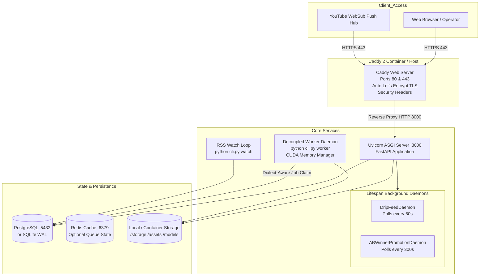
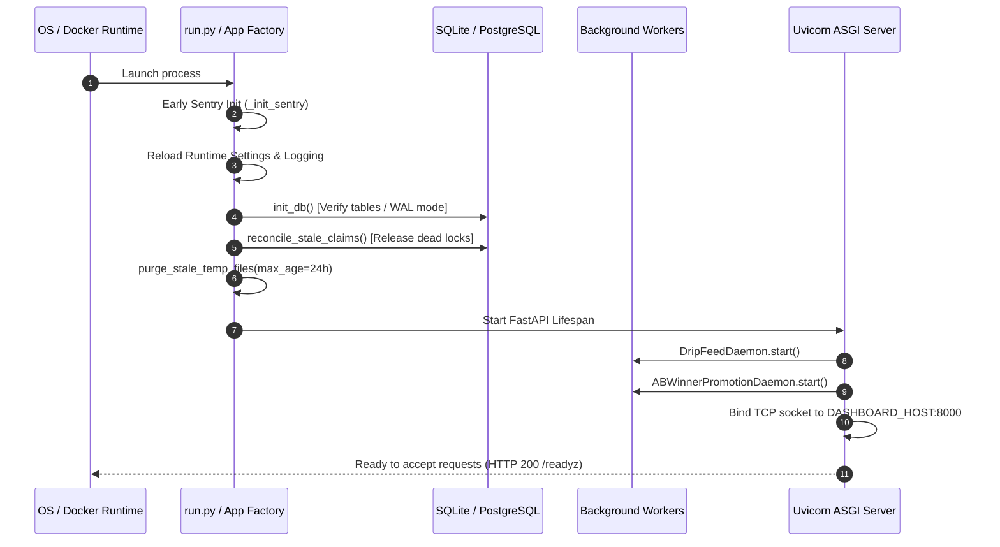

# Runtime Architecture, Processes & Deployment Model

> **Path:** `docs/architecture/03_runtime_and_deployment.md`  
> **Source Files:**
> - [`Dockerfile`](file:///d:/Projects/YT%20AUTOMATION/Dockerfile)
> - [`docker-compose.yml`](file:///d:/Projects/YT%20AUTOMATION/docker-compose.yml)
> - [`Caddyfile`](file:///d:/Projects/YT%20AUTOMATION/Caddyfile)
> - [`run.py`](file:///d:/Projects/YT%20AUTOMATION/run.py)
> - [`shorts_engine/dashboard/app.py`](file:///d:/Projects/YT%20AUTOMATION/shorts_engine/dashboard/app.py)
> - [`shorts_engine/services/worker/runner.py`](file:///d:/Projects/YT%20AUTOMATION/shorts_engine/services/worker/runner.py)

---

## 1. Runtime Process Model

The Shorts Engine runs across four primary process archetypes:
1. **Web Dashboard & API Process (`uvicorn`):**
   - ASGI server running FastAPI application (`shorts_engine.dashboard.app:app`).
   - Serves human operator UI routes, Server-Sent Events (`/events`), and WebSub webhooks.
   - Manages in-process lifespan background daemons (`DripFeedDaemon`, `ABWinnerPromotionDaemon`).
   - Network binding: `DASHBOARD_HOST` (default `127.0.0.1` locally, `0.0.0.0` in Docker), port `8000`.
2. **Headless Background Worker Process (`cli.py worker`):**
   - Independent daemon executing decoupled video rendering and quality checks.
   - Runs in a continuous polling loop (`poll_interval=5.0s`), claiming pending clips via dialect-aware locking (`SELECT ... FOR UPDATE SKIP LOCKED` or SQLite atomic CAS).
   - Clears CUDA VRAM and IPC caches between rendering jobs (`clear_cuda_cache()`).
3. **RSS Fallback Poller Process (`cli.py watch`):**
   - Blocking daemon polling YouTube Atom XML feeds (`https://www.youtube.com/feeds/videos.xml?channel_id={id}`) on configured intervals (default `30` minutes).
   - Idempotently creates `SourceVideo` records in `DETECTED` status.
4. **Desktop Control Center (`START_HERE.bat`):**
   - Native Windows batch launcher orchestrating foreground/background uvicorn instances, worker loops, test suites, and admin provisioning tools.

---

## 2. Ports & Networking Layout

| Service | Container / Process | Port | Binding | Public Access | Purpose |
| :--- | :--- | :--- | :--- | :--- | :--- |
| **Caddy HTTP** | `yt-shorts-caddy` | `80` | `0.0.0.0` | Yes | HTTP to HTTPS redirection, ACME challenge verification (`Caddyfile:1-21`). |
| **Caddy HTTPS** | `yt-shorts-caddy` | `443` | `0.0.0.0` | Yes | Secure TLS termination, HSTS injection, reverse proxy to dashboard (`Caddyfile:6-20`). |
| **Dashboard API** | `yt-shorts-dashboard` | `8000` | `127.0.0.1` / `0.0.0.0` | No (behind Caddy in prod) | FastAPI UI, REST API, SSE telemetry stream, WebSub callbacks (`app.py:61-124`). |
| **PostgreSQL** | `yt-shorts-postgres` | `5432` | Internal Docker Network | No (host unmapped) | Production relational database, row-level locks (`docker-compose.yml:43-59`). |
| **Redis** | `yt-shorts-redis` | `6379` | Internal Docker Network | No (host unmapped) | Optional distributed lock state and cache (`docker-compose.yml:61-71`). |

---

## 3. Container & Docker Infrastructure

### 3.1 `Dockerfile` (Multi-Stage Production Build)
- **Stage 1 (Builder):**
  - Base: `python:3.11-slim` (`Dockerfile:4`).
  - Installs system build tools (`build-essential`, `ffmpeg`, `libass-dev`, `git`, `curl`) (`Dockerfile:12-18`).
  - Utilizes Astral `uv` binary to install Python dependencies into system site-packages (`Dockerfile:20-43`).
- **Stage 2 (Runner):**
  - Base: `python:3.11-slim` (`Dockerfile:46`).
  - Installs runtime `ffmpeg` and `libass9` shared libraries (`Dockerfile:53-57`).
  - Copies pre-built site-packages and binaries from builder stage (`Dockerfile:60-61`).
  - Creates unprivileged system user `appuser` (`UID/GID`) (`Dockerfile:66`).
  - Mounts `/app/storage` (temp, downloads, outputs, models) with `appuser` ownership (`Dockerfile:75-76`).
  - Drops root privileges (`USER appuser`) and exposes port 8000 (`Dockerfile:78-80`).

### 3.2 `docker-compose.yml` (Service Mesh)
- **Production Isolation:** PostgreSQL and Redis ports are unmapped from the host network, accessible strictly via internal container networking (`docker-compose.yml:14-15`).
- **Health Checks:** PostgreSQL (`pg_isready`), Redis (`redis-cli ping`), with `condition: service_healthy` dependencies on the dashboard and worker services (`docker-compose.yml:54-58, 66-70, 78-82, 107-111`).
- **Data Volumes:** Named persistent volumes `postgres_data`, `redis_data`, `caddy_data`, and bind mounts for `./storage` and `./assets` (`docker-compose.yml:92-94, 145-150`).

---

## 4. Startup & Shutdown Sequences

### 4.1 Process Startup Sequence

### 4.2 Graceful Shutdown Sequence
1. **SIGTERM / SIGINT Received:** Captured by Uvicorn and Python signal handlers.
2. **Lifespan Teardown (`app.py:38-40`):**
   - Awaits `ABWinnerPromotionDaemon.stop()`.
   - Awaits `DripFeedDaemon.stop()`.
3. **Worker Teardown (`worker/runner.py`):**
   - Active render finishes current frame execution or is interrupted via cooperative watchdog.
   - Clears GPU memory via `clear_cuda_cache()`.
4. **Database Teardown:** Closes active SQLAlchemy connection pool.
