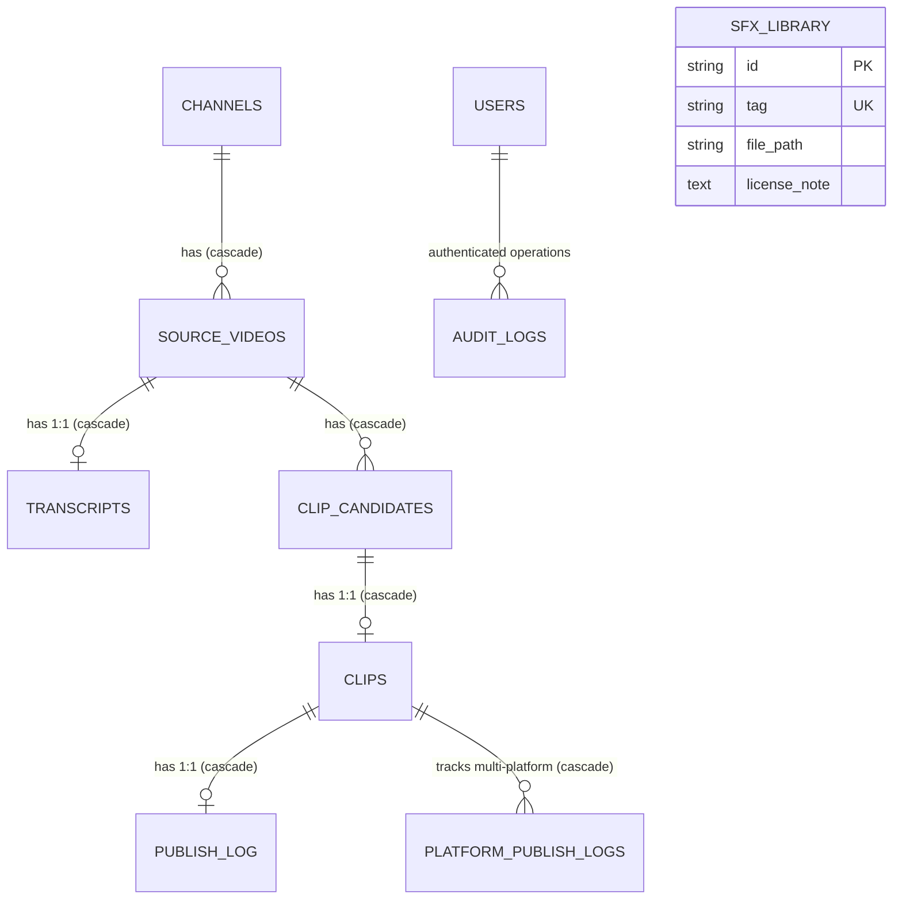

# 04 Data Architecture & Persistence Ledger

**Document Version:** 1.0.0  
**Status:** Verified Complete  
**Last Updated:** 2026-09-24  
**Primary Sources:** [`shorts_engine/db/models.py`](file:///d:/Projects/YT%20AUTOMATION/shorts_engine/db/models.py), [`shorts_engine/db/session.py`](file:///d:/Projects/YT%20AUTOMATION/shorts_engine/db/session.py), [`shorts_engine/services/storage/path_manager.py`](file:///d:/Projects/YT%20AUTOMATION/shorts_engine/services/storage/path_manager.py)

---

## 1. Relational Database Architecture

The Shorts Engine supports dual relational backends configured via the `DATABASE_URL` setting ([`shorts_engine/config/settings.py:46`](file:///d:/Projects/YT%20AUTOMATION/shorts_engine/config/settings.py#L46)):
1. **SQLite 3 (Default Embedded):** Configured with Write-Ahead Logging (`PRAGMA journal_mode=WAL`), 60-second busy timeout (`PRAGMA busy_timeout=60000`), foreign key enforcement (`PRAGMA foreign_keys=ON`), and normal synchronous writes (`PRAGMA synchronous=NORMAL`) via SQLAlchemy engine connect listeners ([`shorts_engine/db/session.py:34-45`](file:///d:/Projects/YT%20AUTOMATION/shorts_engine/db/session.py#L34-L45)).
2. **PostgreSQL 16+ (Production Enterprise):** Managed via `QueuePool` with `pool_size=10`, `max_overflow=20`, and `pool_pre_ping=True` ([`shorts_engine/db/session.py:47-53`](file:///d:/Projects/YT%20AUTOMATION/shorts_engine/db/session.py#L47-L53)).



---

## 2. Table-by-Table Schema Specification

### 2.1 `channels`
Represents monitored source YouTube channels or publishing destinations ([`shorts_engine/db/models.py:58-73`](file:///d:/Projects/YT%20AUTOMATION/shorts_engine/db/models.py#L58-L73)).

| Column Name | SQL Type (SQLite / Postgres) | Nullable | Default | Constraints & Indexes | Description |
| :--- | :--- | :--- | :--- | :--- | :--- |
| `id` | `VARCHAR(36)` | `NOT NULL` | `uuid4()` | `PRIMARY KEY` | Unique UUIDv4 identifier |
| `youtube_channel_id` | `VARCHAR(64)` | `NOT NULL` | - | `UNIQUE`, `INDEX` | Canonical YouTube Channel ID (`UC...`) |
| `name` | `VARCHAR(255)` | `NOT NULL` | - | - | Display channel title |
| `watch_enabled` | `BOOLEAN` | `NOT NULL` | `True` | - | Ingestion poller toggle |
| `last_seen_video_id` | `VARCHAR(64)` | `NULL` | `None` | - | Last processed YouTube video ID |
| `publish_target_channel_id` | `VARCHAR(64)` | `NULL` | `None` | - | Target channel for syndication |
| `human_review_required` | `BOOLEAN` | `NOT NULL` | `True` | - | Approval gate enforcement toggle |
| `encrypted_oauth_token` | `TEXT` | `NULL` | `None` | - | Envelope-encrypted JSON token blob |
| `created_at` | `DATETIME` / `TIMESTAMPTZ` | `NOT NULL` | `utcnow()` | - | Ingestion record creation timestamp |
| `updated_at` | `DATETIME` / `TIMESTAMPTZ` | `NOT NULL` | `utcnow()` | `ON UPDATE utcnow()` | Last modification timestamp |

**Foreign Keys & Cascades:**
- `source_videos` child relationship with `cascade="all, delete-orphan"`.

---

### 2.2 `source_videos`
Represents downloaded and ingested long-form videos ([`shorts_engine/db/models.py:75-122`](file:///d:/Projects/YT%20AUTOMATION/shorts_engine/db/models.py#L75-L122)).

| Column Name | SQL Type (SQLite / Postgres) | Nullable | Default | Constraints & Indexes | Description |
| :--- | :--- | :--- | :--- | :--- | :--- |
| `id` | `VARCHAR(36)` | `NOT NULL` | `uuid4()` | `PRIMARY KEY` | Unique UUIDv4 identifier |
| `channel_id` | `VARCHAR(36)` | `NOT NULL` | - | `FK -> channels.id ON DELETE CASCADE`, `INDEX` | Associated parent channel |
| `youtube_video_id` | `VARCHAR(64)` | `NOT NULL` | - | `INDEX` | YouTube video ID (11 chars) |
| `title` | `VARCHAR(500)` | `NOT NULL` | - | - | Video title string |
| `duration_sec` | `INTEGER` | `NOT NULL` | `0` | - | Total runtime in seconds |
| `status` | `VARCHAR(32)` / `SQLEnum` | `NOT NULL` | `DETECTED` | `INDEX` | State machine enum: `SourceVideoStatus` |
| `downloaded_path` | `VARCHAR(1024)` | `NULL` | `None` | - | Absolute or relative path to MP4 |
| `audio_path` | `VARCHAR(1024)` | `NULL` | `None` | - | Absolute or relative path to WAV |
| `error_message` | `TEXT` | `NULL` | `None` | - | Pipeline failure diagnostic traceback |
| `runtime_overrides_json` | `TEXT` | `NULL` | `None` | - | Per-video JSON settings overrides |
| `retry_count` | `INTEGER` | `NOT NULL` | `0` | - | Automatic retry counter |
| `created_at` | `DATETIME` / `TIMESTAMPTZ` | `NOT NULL` | `utcnow()` | - | Record creation timestamp |
| `updated_at` | `DATETIME` / `TIMESTAMPTZ` | `NOT NULL` | `utcnow()` | `ON UPDATE utcnow()` | Last status update timestamp |

**Table Constraints & Cascades:**
- Unique Constraint: `uq_channel_source_video` on `(channel_id, youtube_video_id)` ([`shorts_engine/db/models.py:120`](file:///d:/Projects/YT%20AUTOMATION/shorts_engine/db/models.py#L120)).
- Cascades: `transcript` (1:1 orphan delete), `candidates` (1:N orphan delete).

---

### 2.3 `transcripts`
Stores word-level aligned timestamps generated by Faster-Whisper or Groq ([`shorts_engine/db/models.py:124-135`](file:///d:/Projects/YT%20AUTOMATION/shorts_engine/db/models.py#L124-L135)).

| Column Name | SQL Type (SQLite / Postgres) | Nullable | Default | Constraints & Indexes | Description |
| :--- | :--- | :--- | :--- | :--- | :--- |
| `id` | `VARCHAR(36)` | `NOT NULL` | `uuid4()` | `PRIMARY KEY` | Unique UUIDv4 identifier |
| `source_video_id` | `VARCHAR(36)` | `NOT NULL` | - | `FK -> source_videos.id ON DELETE CASCADE`, `UNIQUE`, `INDEX` | 1:1 source video parent |
| `word_level_json` | `TEXT` | `NOT NULL` | - | - | Serialized array of word timestamp objects |
| `language` | `VARCHAR(16)` | `NOT NULL` | `"en"` | - | Detected ISO 639-1 language code |
| `created_at` | `DATETIME` / `TIMESTAMPTZ` | `NOT NULL` | `utcnow()` | - | Timestamp of transcription |

---

### 2.4 `clip_candidates`
Represents segment candidates identified by AI selection or heuristics ([`shorts_engine/db/models.py:137-170`](file:///d:/Projects/YT%20AUTOMATION/shorts_engine/db/models.py#L137-L170)).

| Column Name | SQL Type (SQLite / Postgres) | Nullable | Default | Constraints & Indexes | Description |
| :--- | :--- | :--- | :--- | :--- | :--- |
| `id` | `VARCHAR(36)` | `NOT NULL` | `uuid4()` | `PRIMARY KEY` | Unique UUIDv4 identifier |
| `source_video_id` | `VARCHAR(36)` | `NOT NULL` | - | `FK -> source_videos.id ON DELETE CASCADE`, `INDEX` | Source video reference |
| `start_ms` | `INTEGER` | `NOT NULL` | - | - | Snapped segment start (milliseconds) |
| `end_ms` | `INTEGER` | `NOT NULL` | - | - | Snapped segment end (milliseconds) |
| `score` | `FLOAT` | `NOT NULL` | - | - | Virality rating score (0.00 to 1.00) |
| `reason` | `TEXT` | `NOT NULL` | - | - | Justification from LLM critic or heuristic |
| `hook_text` | `TEXT` | `NULL` | `None` | - | Opening hook caption / headline |
| `payoff_text` | `TEXT` | `NULL` | `None` | - | Climax / closing punchline text |
| `variations_json` | `TEXT` | `NULL` | `None` | - | Candidate A/B headline/title variants |
| `selected` | `BOOLEAN` | `NOT NULL` | `False` | `INDEX` | Selected for rendering flag |
| `created_at` | `DATETIME` / `TIMESTAMPTZ` | `NOT NULL` | `utcnow()` | - | Discovery timestamp |

---

### 2.5 `clips`
Represents fully rendered Short assets undergoing QA, review, or syndication ([`shorts_engine/db/models.py:172-237`](file:///d:/Projects/YT%20AUTOMATION/shorts_engine/db/models.py#L172-L237)).

| Column Name | SQL Type (SQLite / Postgres) | Nullable | Default | Constraints & Indexes | Description |
| :--- | :--- | :--- | :--- | :--- | :--- |
| `id` | `VARCHAR(36)` | `NOT NULL` | `uuid4()` | `PRIMARY KEY` | Unique UUIDv4 identifier |
| `clip_candidate_id` | `VARCHAR(36)` | `NOT NULL` | - | `FK -> clip_candidates.id ON DELETE CASCADE`, `UNIQUE`, `INDEX` | 1:1 candidate reference |
| `rendered_path` | `VARCHAR(1024)` | `NULL` | `None` | - | Path to rendered 9:16 vertical MP4 |
| `caption_style` | `TEXT` | `NULL` | `None` | - | Serialized typography & color styling |
| `sfx_tags_json` | `TEXT` | `NULL` | `None` | - | Serialized sound effect cues |
| `status` | `VARCHAR(32)` / `SQLEnum` | `NOT NULL` | `RENDERING` | `INDEX` | State machine enum: `ClipStatus` |
| `quality_check_result`| `TEXT` | `NULL` | `None` | - | Serialized QA gate report (black/mute/CV) |
| `generated_title` | `VARCHAR(100)` | `NULL` | `None` | - | Target syndication title (<100 chars) |
| `generated_description`| `VARCHAR(5000)`| `NULL` | `None` | - | Target syndication description |
| `generated_tags` | `TEXT` | `NULL` | `None` | - | Serialized array of hashtags |
| `scheduled_publish_at`| `DATETIME` / `TIMESTAMPTZ` | `NULL`| `None` | `INDEX` | Drip-feed syndication schedule |
| `analytics_json` | `TEXT` | `NULL` | `None` | - | Serialized views, retention, likes |
| `variations_json` | `TEXT` | `NULL` | `None` | - | Active A/B testing variants |
| `retry_count` | `INTEGER` | `NOT NULL` | `0` | - | Render / publish retry counter |
| `created_at` | `DATETIME` / `TIMESTAMPTZ` | `NOT NULL` | `utcnow()` | - | Render initialization timestamp |
| `updated_at` | `DATETIME` / `TIMESTAMPTZ` | `NOT NULL` | `utcnow()` | `ON UPDATE utcnow()` | Last state transition timestamp |

---

### 2.6 `publish_log`
Canonical YouTube publication audit ledger ([`shorts_engine/db/models.py:239-257`](file:///d:/Projects/YT%20AUTOMATION/shorts_engine/db/models.py#L239-L257)).

| Column Name | SQL Type (SQLite / Postgres) | Nullable | Default | Constraints & Indexes | Description |
| :--- | :--- | :--- | :--- | :--- | :--- |
| `id` | `VARCHAR(36)` | `NOT NULL` | `uuid4()` | `PRIMARY KEY` | Unique UUIDv4 identifier |
| `clip_id` | `VARCHAR(36)` | `NOT NULL` | - | `FK -> clips.id ON DELETE CASCADE`, `UNIQUE`, `INDEX` | 1:1 parent clip |
| `youtube_video_id` | `VARCHAR(64)` | `NULL` | `None` | `INDEX` | Published YouTube video ID |
| `published_at` | `DATETIME` / `TIMESTAMPTZ` | `NOT NULL` | `utcnow()` | - | Publication timestamp |
| `title` | `TEXT` | `NOT NULL` | - | - | Live published title string |
| `description` | `TEXT` | `NOT NULL` | - | - | Live published description |
| `tags_json` | `TEXT` | `NULL` | `None` | - | JSON array of published tags |
| `status` | `VARCHAR(32)` | `NOT NULL` | `"SUCCESS"` | - | `SUCCESS`, `FAILED`, `DRY_RUN` |
| `error_message` | `TEXT` | `NULL` | `None` | - | Publication error diagnostic |

**Table Constraints:**
- Unique Constraint: `uq_clip_publish` on `(clip_id, youtube_video_id)`.

---

### 2.7 `platform_publish_logs`
Omnichannel syndication ledger tracking YouTube, TikTok, and Instagram Reels ([`shorts_engine/db/models.py:259-277`](file:///d:/Projects/YT%20AUTOMATION/shorts_engine/db/models.py#L259-L277)).

| Column Name | SQL Type (SQLite / Postgres) | Nullable | Default | Constraints & Indexes | Description |
| :--- | :--- | :--- | :--- | :--- | :--- |
| `id` | `VARCHAR(36)` | `NOT NULL` | `uuid4()` | `PRIMARY KEY` | Unique UUIDv4 identifier |
| `clip_id` | `VARCHAR(36)` | `NOT NULL` | - | `FK -> clips.id ON DELETE CASCADE`, `INDEX` | Parent clip |
| `platform` | `VARCHAR(32)` | `NOT NULL` | - | `INDEX` | Platform identifier (`youtube`, `tiktok`, `instagram`) |
| `status` | `VARCHAR(32)` | `NOT NULL` | `"SUCCESS"` | - | Outcome status (`SUCCESS`, `FAILED`, `DRY_RUN`) |
| `platform_post_id` | `VARCHAR(128)` | `NULL` | `None` | `INDEX` | External platform video/share identifier |
| `permalink` | `VARCHAR(512)` | `NULL` | `None` | - | Public web URL to published short |
| `error_message` | `TEXT` | `NULL` | `None` | - | Remote API failure diagnostic |
| `metadata_json` | `TEXT` | `NULL` | `None` | - | Arbitrary platform metadata |
| `published_at` | `DATETIME` / `TIMESTAMPTZ` | `NOT NULL` | `utcnow()` | - | Syndication timestamp |

---

### 2.8 `sfx_library`
Sound effect assets catalogue ([`shorts_engine/db/models.py:279-287`](file:///d:/Projects/YT%20AUTOMATION/shorts_engine/db/models.py#L279-L287)).

| Column Name | SQL Type (SQLite / Postgres) | Nullable | Default | Constraints & Indexes | Description |
| :--- | :--- | :--- | :--- | :--- | :--- |
| `id` | `VARCHAR(36)` | `NOT NULL` | `uuid4()` | `PRIMARY KEY` | Unique UUIDv4 identifier |
| `tag` | `VARCHAR(64)` | `NOT NULL` | - | `UNIQUE`, `INDEX` | Sound effect semantic trigger |
| `file_path` | `VARCHAR(1024)` | `NOT NULL` | - | - | Path to WAV/MP3 sound asset |
| `license_note` | `TEXT` | `NOT NULL` | - | - | Attribution / commercial usage note |
| `created_at` | `DATETIME` / `TIMESTAMPTZ` | `NOT NULL` | `utcnow()` | - | Asset registration timestamp |

---

### 2.9 `users`
Dashboard authentication and RBAC user store ([`shorts_engine/db/models.py:289-299`](file:///d:/Projects/YT%20AUTOMATION/shorts_engine/db/models.py#L289-L299)).

| Column Name | SQL Type (SQLite / Postgres) | Nullable | Default | Constraints & Indexes | Description |
| :--- | :--- | :--- | :--- | :--- | :--- |
| `id` | `VARCHAR(36)` | `NOT NULL` | `uuid4()` | `PRIMARY KEY` | Unique UUIDv4 identifier |
| `username` | `VARCHAR(64)` | `NOT NULL` | - | `UNIQUE`, `INDEX` | Unique login username |
| `password_hash` | `VARCHAR(256)` | `NOT NULL` | - | - | PBKDF2-HMAC-SHA256 hashed password string |
| `role` | `VARCHAR(32)` / `SQLEnum` | `NOT NULL` | `operator` | - | `UserRole`: `admin`, `operator`, `viewer` |
| `is_active` | `BOOLEAN` | `NOT NULL` | `True` | - | Active account toggle |
| `created_at` | `DATETIME` / `TIMESTAMPTZ` | `NOT NULL` | `utcnow()` | - | Account creation timestamp |
| `updated_at` | `DATETIME` / `TIMESTAMPTZ` | `NOT NULL` | `utcnow()` | `ON UPDATE utcnow()` | Last modification timestamp |

---

## 3. Filesystem Hierarchy & Canonical Path Layout

Managed by `PathManager` ([`shorts_engine/services/storage/path_manager.py:39-215`](file:///d:/Projects/YT%20AUTOMATION/shorts_engine/services/storage/path_manager.py#L39-L215)):
- **Slugification Constraints:** Text normalized via NFKD, non-ASCII stripped, characters constrained to `[a-zA-Z0-9\s_-]`, spaces collapsed to underscores, length capped to $\le 35$ characters to strictly avoid Windows `MAX_PATH` (260 characters) overflows ([`path_manager.py:20-37`](file:///d:/Projects/YT%20AUTOMATION/shorts_engine/services/storage/path_manager.py#L20-L37)).

```
storage/
├── shorts_engine.db                     # Primary SQLite database (or Postgres external)
├── shorts_engine.db-wal                 # Write-Ahead Log
├── shorts_engine.db-shm                 # Shared Memory Index
├── backups/                             # Automated and pre-migration database dumps
│   └── shorts_engine_backup_*.db
├── downloads/                           # Downloaded source assets
│   └── <channel_slug>_<channel_id>/
│       └── <video_slug>_<video_id>/
│           ├── <video_slug>_<video_id>.mp4       # Video stream
│           └── <video_slug>_<video_id>_audio.wav # Extracted 16kHz mono audio
├── outputs/                             # Final rendered products
│   └── <channel_slug>_<channel_id>/
│       └── <video_slug>_<video_id>/
│           ├── clips/
│           │   └── <hook_slug>_<start_ms>_<end_ms>.mp4
│           └── thumbnails/
│               └── <hook_slug>_<start_ms>_<end_ms>_thumb.jpg
├── temp/                                # Temporary workspace (scrubbed automatically)
│   └── <video_id>/
│       ├── subtitles/
│       │   └── <video_id>_<start_ms>_<end_ms>.ass
│       └── frames/
│           └── frame_*.jpg
└── models/                              # Local model checkpoints
    ├── faster-whisper-large-v3/
    └── face_detection_yunet_2023mar.onnx
```

---

## 4. Serialization Schemas

### 4.1 Word-Level Transcript JSON (`transcripts.word_level_json`)
```json
[
  {
    "word": "Artificial",
    "start": 1.240,
    "end": 1.820,
    "probability": 0.985
  },
  {
    "word": "Intelligence",
    "start": 1.840,
    "end": 2.450,
    "probability": 0.992
  }
]
```

### 4.2 Runtime Overrides JSON (`source_videos.runtime_overrides_json`)
```json
{
  "min_duration": 30,
  "max_duration": 60,
  "target_duration": 45,
  "caption_preset": "alex_hormozi",
  "video_crf": 18,
  "video_preset": "slow",
  "silero_vad_filter": true,
  "whisper_beam_size": 5,
  "whisper_temperature": 0.0,
  "whisper_language": "en"
}
```

### 4.3 Candidate & Clip Variations JSON (`clip_candidates.variations_json`, `clips.variations_json`)
```json
[
  {
    "title": "Why AI Will Replace Junior Engineers In 2026",
    "hook": "You won't believe what AI just did to code reviews.",
    "rationale": "High contrast curiosity hook targeting tech demographic."
  },
  {
    "title": "The End Of Coding As We Know It? (Shocking Truth)",
    "hook": "Stop learning to code right now before watching this.",
    "rationale": "Direct contra-trend warning triggering loss aversion."
  }
]
```

### 4.4 Caption Style Preset JSON (`clips.caption_style`)
```json
{
  "font_name": "Montserrat ExtraBold",
  "font_size": 22,
  "primary_color": "#FFFFFF",
  "highlight_color": "#FFEB3B",
  "outline_color": "#000000",
  "back_color": "#000000",
  "bold": 1,
  "italic": 0,
  "alignment": 2,
  "margin_v": 280,
  "outline_width": 3,
  "shadow_depth": 0,
  "max_words_per_line": 3
}
```

### 4.5 Quality Check Result JSON (`clips.quality_check_result`)
```json
{
  "fatal_checks_passed": true,
  "cv_passed": true,
  "semantic_passed": true,
  "black_frame_count": 0,
  "silence_detected": false,
  "duration_sec": 42.5,
  "failures": [],
  "advisories": [
    "Borderline high contrast margin detected at frame 320"
  ]
}
```

### 4.6 Performance Analytics JSON (`clips.analytics_json`)
```json
{
  "views": 14250,
  "likes": 890,
  "comments": 112,
  "shares": 54,
  "average_view_duration_seconds": 38.2,
  "retention_rate": 0.898,
  "fetched_at": "2026-09-24T12:00:00Z"
}
```
