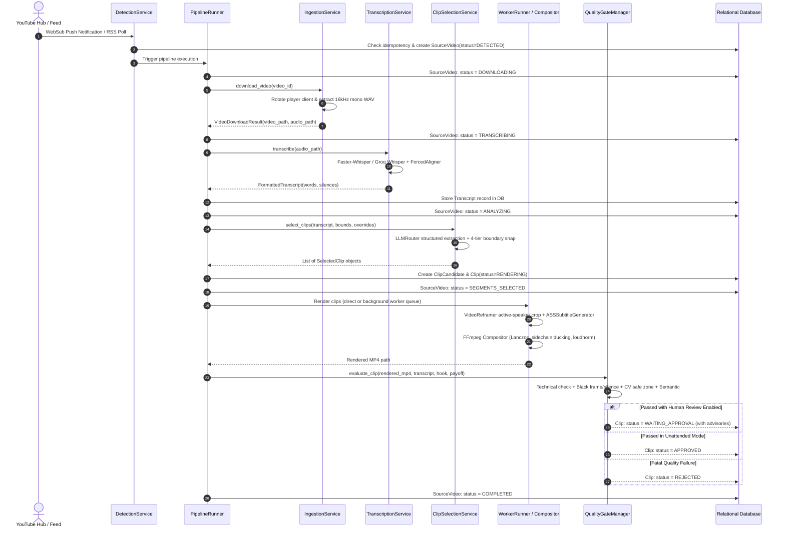
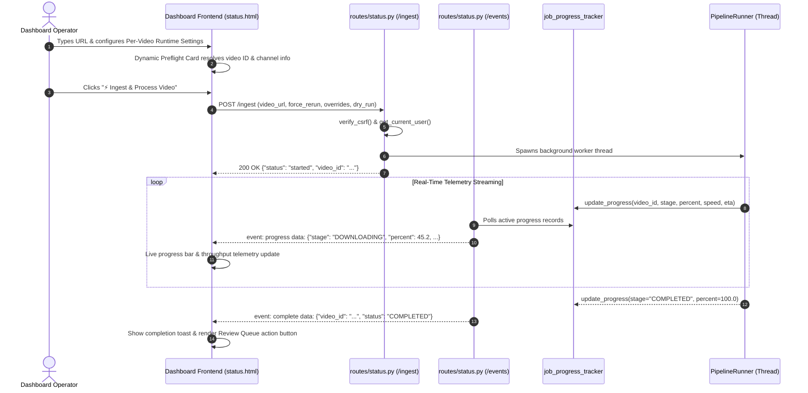
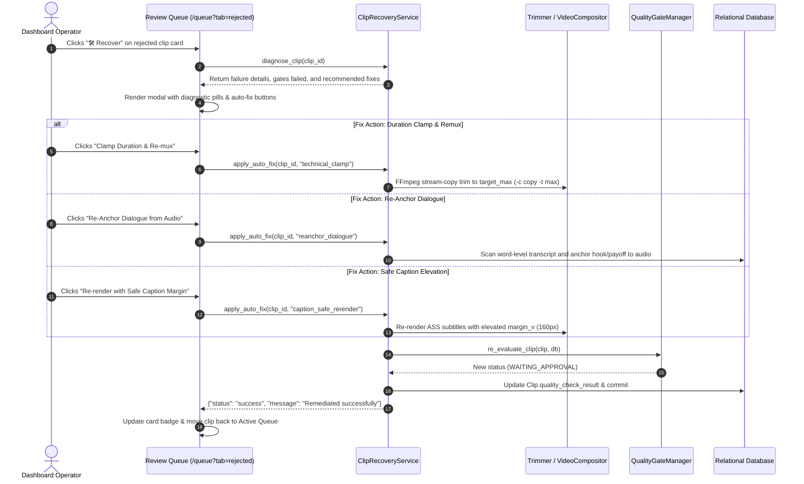

# Execution Flows & Pipeline Logic

> **Path:** `docs/architecture/05_flows_and_logic.md`  
> **Source Files:**
> - [`shorts_engine/orchestration/runner.py`](file:///d:/Projects/YT%20AUTOMATION/shorts_engine/orchestration/runner.py)
> - [`shorts_engine/dashboard/routes/status.py`](file:///d:/Projects/YT%20AUTOMATION/shorts_engine/dashboard/routes/status.py)
> - [`shorts_engine/services/quality_gate/recovery.py`](file:///d:/Projects/YT%20AUTOMATION/shorts_engine/services/quality_gate/recovery.py)
> - [`shorts_engine/services/ab_testing/winner_daemon.py`](file:///d:/Projects/YT%20AUTOMATION/shorts_engine/services/ab_testing/winner_daemon.py)

---

## 1. Flow 1: End-to-End Autonomous Pipeline

The core autonomous pipeline transforms an incoming YouTube video alert into fully rendered, mastered vertical clips ready for operator review or automated syndication:



---

## 2. Flow 2: Manual Video Ingestion & Real-Time Telemetry

When an operator manually inputs a YouTube URL or video ID into the dashboard, the system conducts pre-flight validation, allows per-video runtime overrides, and streams live progress via Server-Sent Events (SSE):



---

## 3. Flow 3: Universal Clip Recovery & Auto-Fix Remediation

Clips flagged with fatal failures or non-fatal quality warnings can be diagnosed and remediated directly through the universal recovery modal:



---

## 4. Flow 4: Closed-Loop Bayesian A/B Title Promotion

The Bayesian title promotion daemon optimizes headline Click-Through Rates (CTR) post-publication:

```mermaid
sequenceDiagram
    autonumber
    participant DAEMON as ABWinnerPromotionDaemon
    participant DB as Relational Database
    participant SYNC as YouTubeAnalyticsSync
    participant OPT as BayesianVariantOptimizer
    participant PUB as YouTubePublisher

    DAEMON->>DB: Query published clips with >= 2 title variations
    loop For each multi-variant clip
        DAEMON->>SYNC: Ingest latest view counts, CTR, and view velocity
        DAEMON->>OPT: evaluate_variations(variations, analytics, baseline_vel, current_vel)
        OPT->>OPT: Beta-Binomial conjugate update: alpha = 1 + clicks, beta = 19 + (impr - clicks)
        OPT->>OPT: 15,000 Monte Carlo draws to compute P(B > A)
        
        alt Confidence >= 95% (Winner Detected)
            OPT-->>DAEMON: Action = PROMOTE (winning_title, confidence)
            DAEMON->>PUB: update_video_title(youtube_id, winning_title)
            PUB->>PUB: Decrypt OAuth token & call YouTube API videos().update()
            DAEMON->>DB: Set winner variation is_active=True, update generated_title
        else Velocity Drop > 50% (Circuit Breaker)
            OPT-->>DAEMON: Action = ROLLBACK (circuit_breaker_triggered=True)
            DAEMON->>PUB: update_video_title(youtube_id, baseline_title)
            DAEMON->>DB: Reset active title to baseline & log emergency rollback
        else Statistical Inconclusive
            OPT-->>DAEMON: Action = MAINTAIN (keep current variant active)
        end
    end
```
