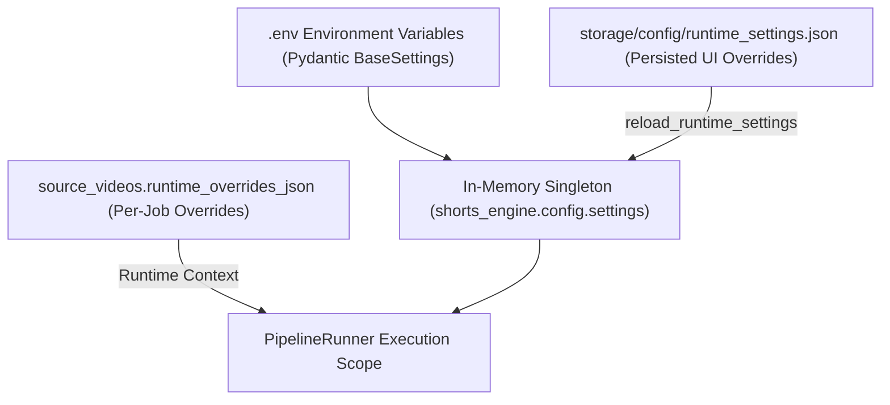

# 07 Configuration & Runtime Parameter Reference

**Document Version:** 1.0.0  
**Status:** Verified Complete  
**Last Updated:** 2026-09-24  
**Primary Sources:** [`shorts_engine/config/settings.py`](file:///d:/Projects/YT%20AUTOMATION/shorts_engine/config/settings.py), [`shorts_engine/config/logging_config.py`](file:///d:/Projects/YT%20AUTOMATION/shorts_engine/config/logging_config.py)

---

## 1. Multi-Tier Configuration Architecture

The Shorts Engine implements a 4-tier hierarchical configuration model:

1. **Base Environment & Defaults:** Loaded via Pydantic `SettingsConfigDict` reading from `.env` and host environment variables ([`shorts_engine/config/settings.py:13-18`](file:///d:/Projects/YT%20AUTOMATION/shorts_engine/config/settings.py#L13-L18)).
2. **Persistent Runtime Overrides:** Stored at `storage/config/runtime_settings.json`. Applied via `reload_runtime_settings()` and updated via `save_runtime_settings()` without process restarts ([`shorts_engine/config/logging_config.py:90-154`](file:///d:/Projects/YT%20AUTOMATION/shorts_engine/config/logging_config.py#L90-L154)).
3. **Per-Video Overrides:** Stored as JSON on `source_videos.runtime_overrides_json`. Takes ultimate precedence for duration limits, subtitle presets, and encoder parameters during pipeline execution ([`shorts_engine/db/models.py:101-118`](file:///d:/Projects/YT%20AUTOMATION/shorts_engine/db/models.py#L101-L118)).
4. **Environment Integrity Validation:** In `production` and `staging`, `validate_bounds` strictly rejects default passwords, weak passwords (<12 chars), or weak dashboard secret keys (<32 chars) ([`shorts_engine/config/settings.py:342-394`](file:///d:/Projects/YT%20AUTOMATION/shorts_engine/config/settings.py#L342-L394)).

---

## 2. Configuration Parameter Ledger

### 2.1 General & Infrastructure Settings

| Variable Name | Python Type | Default Value | Constraints / Valid Range | Hot Reloadable | Impact & Purpose | Code Citation |
| :--- | :--- | :--- | :--- | :--- | :--- | :--- |
| `APP_NAME` | `str` | `"YouTube Shorts Automation"` | Non-empty | No | Application branding banner | [`settings.py:21`](file:///d:/Projects/YT%20AUTOMATION/shorts_engine/config/settings.py#L21) |
| `ENV` | `str` | `"development"` | `development`, `staging`, `production` | No | Environment mode. Controls strict password enforcement | [`settings.py:22`](file:///d:/Projects/YT%20AUTOMATION/shorts_engine/config/settings.py#L22) |
| `DEBUG` | `bool` | `False` | Boolean | Yes | Verbose debug logging | [`settings.py:23`](file:///d:/Projects/YT%20AUTOMATION/shorts_engine/config/settings.py#L23) |
| `DATABASE_URL` | `str` | `"sqlite:///./storage/shorts_automation.db"` | Valid SQLite / PostgreSQL URI | No | Relational database connection string | [`settings.py:36`](file:///d:/Projects/YT%20AUTOMATION/shorts_engine/config/settings.py#L36) |
| `POSTGRES_PASSWORD` | `Optional[str]` | `None` | Min 12 chars in prod | No | Dedicated PostgreSQL password for container/orchestrator | [`settings.py:37`](file:///d:/Projects/YT%20AUTOMATION/shorts_engine/config/settings.py#L37) |
| `MASTER_ENCRYPTION_KEY` | `str` | `"yt_shorts_dev_master_secret_key_32_bytes_min!"` | $\ge 32$ chars recommended | No | KDF source for AES-256-GCM envelope encryption | [`settings.py:40`](file:///d:/Projects/YT%20AUTOMATION/shorts_engine/config/settings.py#L40) |
| `ENCRYPTION_SALT` | `str` | `"yt_shorts_kdf_salt_2026_secure!"` | Non-empty string | No | Salt used for PBKDF2 key derivation | [`settings.py:44`](file:///d:/Projects/YT%20AUTOMATION/shorts_engine/config/settings.py#L44) |
| `MAX_RETRY_COUNT` | `int` | `3` | $1 \le x \le 10$ | Yes | Max automated retry attempts for failed pipeline steps | [`settings.py:325`](file:///d:/Projects/YT%20AUTOMATION/shorts_engine/config/settings.py#L325) |

---

### 2.2 LLM & Artificial Intelligence Router

| Variable Name | Python Type | Default Value | Constraints / Valid Range | Hot Reloadable | Impact & Purpose | Code Citation |
| :--- | :--- | :--- | :--- | :--- | :--- | :--- |
| `LLM_PROVIDER` | `str` | `"auto"` | `auto`, `groq`, `gemini`, `openrouter`, `openai` | Yes | Routing strategy mode for AI candidate selection | [`settings.py:50`](file:///d:/Projects/YT%20AUTOMATION/shorts_engine/config/settings.py#L50) |
| `LLM_MODEL_NAME` | `str` | `"gemini-3.8-flash"` | Valid Google Gemini model | Yes | Primary model ID for Gemini client calls | [`settings.py:54`](file:///d:/Projects/YT%20AUTOMATION/shorts_engine/config/settings.py#L54) |
| `GEMINI_PACING_SEC` | `float` | `4.0` | $1.0 \le x \le 10.0$ | Yes | Minimum interval per key to prevent RPM quota trips | [`settings.py:58`](file:///d:/Projects/YT%20AUTOMATION/shorts_engine/config/settings.py#L58) |
| `GEMINI_TIMEOUT_SEC` | `float` | `25.0` | $5.0 \le x \le 120.0$ | Yes | Socket and completion timeout for Gemini API calls | [`settings.py:64`](file:///d:/Projects/YT%20AUTOMATION/shorts_engine/config/settings.py#L64) |
| `USE_GROQ_WHISPER` | `bool` | `False` | Boolean | Yes | If True, uses cloud Groq `whisper-large-v3-turbo` | [`settings.py:70`](file:///d:/Projects/YT%20AUTOMATION/shorts_engine/config/settings.py#L70) |
| `GEMINI_API_KEY` | `Optional[str]` | `None` | Redacted | Yes | Single primary Gemini API key | [`settings.py:74`](file:///d:/Projects/YT%20AUTOMATION/shorts_engine/config/settings.py#L74) |
| `GEMINI_API_KEYS` | `List[str]` | `[]` | Redacted | Yes | Pool of Gemini API keys for rotation & 429 failover | [`settings.py:75`](file:///d:/Projects/YT%20AUTOMATION/shorts_engine/config/settings.py#L75) |
| `GROQ_API_KEY` | `Optional[str]` | `None` | Redacted | Yes | Single primary Groq API key | [`settings.py:76`](file:///d:/Projects/YT%20AUTOMATION/shorts_engine/config/settings.py#L76) |
| `GROQ_API_KEYS` | `List[str]` | `[]` | Redacted | Yes | Pool of Groq API keys for rotation & 429 failover | [`settings.py:77`](file:///d:/Projects/YT%20AUTOMATION/shorts_engine/config/settings.py#L77) |
| `GROQ_MODEL_NAME` | `str` | `"openai/gpt-oss-120b"` | Valid Groq model ID | Yes | Primary model ID for Groq LPU inference | [`settings.py:78`](file:///d:/Projects/YT%20AUTOMATION/shorts_engine/config/settings.py#L78) |
| `OPENROUTER_API_KEY` | `Optional[str]` | `None` | Redacted | Yes | Single primary OpenRouter API key | [`settings.py:82`](file:///d:/Projects/YT%20AUTOMATION/shorts_engine/config/settings.py#L82) |
| `OPENROUTER_API_KEYS` | `List[str]` | `[]` | Redacted | Yes | Pool of OpenRouter API keys | [`settings.py:83`](file:///d:/Projects/YT%20AUTOMATION/shorts_engine/config/settings.py#L83) |
| `OPENROUTER_MODEL_NAME` | `str` | `"meta-llama/llama-3.3-70b-instruct:free"` | Valid OpenRouter model ID | Yes | Fallback model ID for OpenRouter | [`settings.py:84`](file:///d:/Projects/YT%20AUTOMATION/shorts_engine/config/settings.py#L84) |
| `OPENAI_API_KEY` | `Optional[str]` | `None` | Redacted | Yes | Single primary OpenAI API key | [`settings.py:88`](file:///d:/Projects/YT%20AUTOMATION/shorts_engine/config/settings.py#L88) |
| `OPENAI_API_KEYS` | `List[str]` | `[]` | Redacted | Yes | Pool of OpenAI API keys | [`settings.py:89`](file:///d:/Projects/YT%20AUTOMATION/shorts_engine/config/settings.py#L89) |
| `OPENAI_MODEL_NAME` | `str` | `"gpt-4o-mini"` | Valid OpenAI model ID | Yes | Fallback model ID for OpenAI | [`settings.py:90`](file:///d:/Projects/YT%20AUTOMATION/shorts_engine/config/settings.py#L90) |
| `GROQ_TOKEN_THRESHOLD` | `int` | `5500` | $1000 \le x \le 32000$ | Yes | Prompt token limit above which Groq bypasses to Gemini | [`settings.py:94`](file:///d:/Projects/YT%20AUTOMATION/shorts_engine/config/settings.py#L94) |
| `LLM_FALLBACK_ON_RATE_LIMIT`| `bool` | `True` | Boolean | Yes | Auto-switches provider upon encountering HTTP 429 | [`settings.py:100`](file:///d:/Projects/YT%20AUTOMATION/shorts_engine/config/settings.py#L100) |
| `LLM_TEMPERATURE` | `float` | `0.2` | $0.0 \le x \le 1.0$ | Yes | Sampling temperature for AI generation | [`settings.py:104`](file:///d:/Projects/YT%20AUTOMATION/shorts_engine/config/settings.py#L104) |

---

### 2.3 Transcription, Reframing & Computer Vision

| Variable Name | Python Type | Default Value | Constraints / Valid Range | Hot Reloadable | Impact & Purpose | Code Citation |
| :--- | :--- | :--- | :--- | :--- | :--- | :--- |
| `WHISPER_MODEL_SIZE` | `str` | `"base"` | `tiny`, `base`, `small`, `medium`, `large-v3` | Yes | Local CTranslate2 Faster-Whisper model checkpoint | [`settings.py:112`](file:///d:/Projects/YT%20AUTOMATION/shorts_engine/config/settings.py#L112) |
| `WHISPER_BEAM_SIZE` | `int` | `5` | $1 \le x \le 10$ | Yes | Beam search decode width | [`settings.py:116`](file:///d:/Projects/YT%20AUTOMATION/shorts_engine/config/settings.py#L116) |
| `WHISPER_VAD_FILTER` | `bool` | `True` | Boolean | Yes | Silero VAD speech detection filter toggle | [`settings.py:122`](file:///d:/Projects/YT%20AUTOMATION/shorts_engine/config/settings.py#L122) |
| `WHISPER_LANGUAGE` | `str` | `"en"` | ISO 639-1 or `"auto"` | Yes | Spoken audio language override | [`settings.py:126`](file:///d:/Projects/YT%20AUTOMATION/shorts_engine/config/settings.py#L126) |
| `WHISPER_TEMPERATURE` | `float` | `0.0` | $0.0 \le x \le 1.0$ | Yes | Whisper decode temperature | [`settings.py:130`](file:///d:/Projects/YT%20AUTOMATION/shorts_engine/config/settings.py#L130) |
| `FACE_TRACKING_CONFIDENCE`| `float` | `0.6` | $0.1 \le x \le 1.0$ | Yes | YuNet ONNX face detection score threshold | [`settings.py:136`](file:///d:/Projects/YT%20AUTOMATION/shorts_engine/config/settings.py#L136) |
| `SMOOTHING_FACTOR` | `float` | `0.85` | $0.1 \le x \le 0.99$ | Yes | Exponential moving average crop bounding filter | [`settings.py:176`](file:///d:/Projects/YT%20AUTOMATION/shorts_engine/config/settings.py#L176) |
| `SAFE_ZONE_MIN_X` | `float` | `0.15` | Frame ratio | Yes | Left horizontal safety margin | [`settings.py:177`](file:///d:/Projects/YT%20AUTOMATION/shorts_engine/config/settings.py#L177) |
| `SAFE_ZONE_MAX_X` | `float` | `0.85` | Frame ratio | Yes | Right horizontal safety margin | [`settings.py:178`](file:///d:/Projects/YT%20AUTOMATION/shorts_engine/config/settings.py#L178) |

---

### 2.4 Rendering, Duration & Safe Zones

| Variable Name | Python Type | Default Value | Constraints / Valid Range | Hot Reloadable | Impact & Purpose | Code Citation |
| :--- | :--- | :--- | :--- | :--- | :--- | :--- |
| `TARGET_WIDTH` | `int` | `1080` | Pixels | No | Canvas width for 9:16 vertical video | [`settings.py:154`](file:///d:/Projects/YT%20AUTOMATION/shorts_engine/config/settings.py#L154) |
| `TARGET_HEIGHT` | `int` | `1920` | Pixels | No | Canvas height for 9:16 vertical video | [`settings.py:155`](file:///d:/Projects/YT%20AUTOMATION/shorts_engine/config/settings.py#L155) |
| `VIDEO_SCALE_ALGORITHM` | `str` | `"lanczos"` | `lanczos`, `bicubic`, `spline`, `bilinear` | Yes | FFmpeg software / hardware scaling filter | [`settings.py:156`](file:///d:/Projects/YT%20AUTOMATION/shorts_engine/config/settings.py#L156) |
| `VIDEO_ENCODING_CRF` | `int` | `18` | $15 \le x \le 28$ | Yes | H.264 Constant Rate Factor (18 = visually lossless) | [`settings.py:160`](file:///d:/Projects/YT%20AUTOMATION/shorts_engine/config/settings.py#L160) |
| `VIDEO_ENCODING_PRESET` | `str` | `"medium"` | `ultrafast`, `fast`, `medium`, `slow` | Yes | FFmpeg CPU/NVENC speed preset | [`settings.py:166`](file:///d:/Projects/YT%20AUTOMATION/shorts_engine/config/settings.py#L166) |
| `VIDEO_TARGET_FPS` | `int` | `30` | $24 \le x \le 60$ | Yes | Framerate for rendered Short video | [`settings.py:170`](file:///d:/Projects/YT%20AUTOMATION/shorts_engine/config/settings.py#L170) |
| `MIN_SEGMENTS_PER_VIDEO`| `int` | `3` | $1 \le x \le 20$ | Yes | Minimum clips selected per source video | [`settings.py:144`](file:///d:/Projects/YT%20AUTOMATION/shorts_engine/config/settings.py#L144) |
| `MAX_SEGMENTS_PER_VIDEO`| `int` | `5` | $1 \le x \le 20$ | Yes | Maximum clips selected per source video | [`settings.py:145`](file:///d:/Projects/YT%20AUTOMATION/shorts_engine/config/settings.py#L145) |
| `TARGET_DURATION_MIN_SEC`| `int`| `15` | $5 \le x \le 180$ | Yes | Minimum clip duration in seconds | [`settings.py:148`](file:///d:/Projects/YT%20AUTOMATION/shorts_engine/config/settings.py#L148) |
| `TARGET_DURATION_MAX_SEC`| `int`| `58` | $10 \le x \le 180$ | Yes | Maximum clip duration (under 60s hard ceiling) | [`settings.py:149`](file:///d:/Projects/YT%20AUTOMATION/shorts_engine/config/settings.py#L149) |
| `UI_DEADZONE_BOTTOM_Y_RATIO`| `float` | `0.80` | Frame ratio | Yes | Rejection boundary: bottom 384px (Y > 1536px) | [`settings.py:182`](file:///d:/Projects/YT%20AUTOMATION/shorts_engine/config/settings.py#L182) |
| `UI_DEADZONE_RIGHT_X_RATIO` | `float` | `0.85` | Frame ratio | Yes | Rejection boundary: right 15% (X > 918px) | [`settings.py:186`](file:///d:/Projects/YT%20AUTOMATION/shorts_engine/config/settings.py#L186) |
| `CAPTION_MARGIN_VERTICAL`| `int` | `420` | Pixels | Yes | Vertical ASS subtitle bottom margin | [`settings.py:190`](file:///d:/Projects/YT%20AUTOMATION/shorts_engine/config/settings.py#L190) |

---

### 2.5 Typography & Audio Mastering

| Variable Name | Python Type | Default Value | Constraints / Valid Range | Hot Reloadable | Impact & Purpose | Code Citation |
| :--- | :--- | :--- | :--- | :--- | :--- | :--- |
| `DEFAULT_CAPTION_PRESET`| `str` | `"hormozi"` | `hormozi`, `mrbeast`, `neon`, `minimalist`, `high_contrast_box` | Yes | Default subtitle styling template | [`settings.py:196`](file:///d:/Projects/YT%20AUTOMATION/shorts_engine/config/settings.py#L196) |
| `CAPTION_FONT_NAME` | `str` | `"Arial Black"` | Available OS font | Yes | Fallback font name for ASS subtitles | [`settings.py:200`](file:///d:/Projects/YT%20AUTOMATION/shorts_engine/config/settings.py#L200) |
| `CAPTION_FONT_SIZE` | `int` | `24` | Pixels | Yes | Fallback font size | [`settings.py:201`](file:///d:/Projects/YT%20AUTOMATION/shorts_engine/config/settings.py#L201) |
| `AUDIO_BITRATE` | `str` | `"320k"` | `128k`, `192k`, `256k`, `320k` | Yes | Audio encoding bitrate | [`settings.py:214`](file:///d:/Projects/YT%20AUTOMATION/shorts_engine/config/settings.py#L214) |
| `AUDIO_SAMPLE_RATE` | `int` | `48000` | `44100`, `48000` | Yes | Master audio sampling frequency (Hz) | [`settings.py:218`](file:///d:/Projects/YT%20AUTOMATION/shorts_engine/config/settings.py#L218) |
| `TARGET_LUFS` | `float` | `-14.0` | EBU R128 standard | Yes | Integrated loudness normalization target | [`settings.py:222`](file:///d:/Projects/YT%20AUTOMATION/shorts_engine/config/settings.py#L222) |
| `TRUE_PEAK_DBFS` | `float` | `-1.0` | dBFS ceiling | Yes | Inter-sample peak limiter ceiling | [`settings.py:223`](file:///d:/Projects/YT%20AUTOMATION/shorts_engine/config/settings.py#L223) |
| `ENABLE_AUDIO_DUCKING` | `bool` | `True` | Boolean | Yes | Speech-activated background music sidechain ducking | [`settings.py:226`](file:///d:/Projects/YT%20AUTOMATION/shorts_engine/config/settings.py#L226) |
| `DUCKING_ATTENUATION_DB`| `float`| `-14.0` | dB | Yes | Music volume reduction during speech | [`settings.py:230`](file:///d:/Projects/YT%20AUTOMATION/shorts_engine/config/settings.py#L230) |
| `SPEECH_HPF_CUTOFF_HZ` | `int` | `80` | $20 \le x \le 300$ | Yes | High-pass filter cutoff to remove rumble | [`settings.py:246`](file:///d:/Projects/YT%20AUTOMATION/shorts_engine/config/settings.py#L246) |

---

### 2.6 Publishing, Syndication & A/B Bandit Optimization

| Variable Name | Python Type | Default Value | Constraints / Valid Range | Hot Reloadable | Impact & Purpose | Code Citation |
| :--- | :--- | :--- | :--- | :--- | :--- | :--- |
| `DRY_RUN_PUBLISHING` | `bool` | `True` | Boolean | Yes | Simulates publication without external API dispatch | [`settings.py:255`](file:///d:/Projects/YT%20AUTOMATION/shorts_engine/config/settings.py#L255) |
| `DEFAULT_PRIVACY_STATUS`| `str` | `"unlisted"` | `unlisted`, `private`, `public` | Yes | YouTube default video privacy level | [`settings.py:256`](file:///d:/Projects/YT%20AUTOMATION/shorts_engine/config/settings.py#L256) |
| `DAILY_QUOTA_LIMIT` | `int` | `10000` | Units | Yes | YouTube Data API v3 daily cost ceiling | [`settings.py:257`](file:///d:/Projects/YT%20AUTOMATION/shorts_engine/config/settings.py#L257) |
| `DRIP_FEED_ENABLED` | `bool` | `True` | Boolean | Yes | Background auto-publishing loop for scheduled clips | [`settings.py:259`](file:///d:/Projects/YT%20AUTOMATION/shorts_engine/config/settings.py#L259) |
| `ENABLED_SYNDICATION_PLATFORMS` | `list` | `["youtube"]` | `youtube`, `tiktok`, `instagram` | Yes | Active multi-platform publishing targets | [`settings.py:285`](file:///d:/Projects/YT%20AUTOMATION/shorts_engine/config/settings.py#L285) |
| `AB_WINNER_CHECK_INTERVAL_SECONDS`| `int` | `120` | $30 \le x \le 3600$ | Yes | Polling cycle for Bayesian winner daemon | [`settings.py:291`](file:///d:/Projects/YT%20AUTOMATION/shorts_engine/config/settings.py#L291) |
| `AB_MIN_IMPRESSIONS` | `int` | `100` | $\ge 10$ | Yes | Minimum impressions before evaluating variant | [`settings.py:297`](file:///d:/Projects/YT%20AUTOMATION/shorts_engine/config/settings.py#L297) |
| `AB_CONFIDENCE_THRESHOLD`| `float` | `0.95` | $0.80 \le x \le 0.999$ | Yes | Posterior threshold $P(B > A)$ to declare winner | [`settings.py:302`](file:///d:/Projects/YT%20AUTOMATION/shorts_engine/config/settings.py#L302) |
| `AB_ROLLBACK_VELOCITY_DROP`| `float` | `0.50` | $0.10 \le x \le 0.90$ | Yes | Velocity collapse ratio triggering auto-rollback | [`settings.py:308`](file:///d:/Projects/YT%20AUTOMATION/shorts_engine/config/settings.py#L308) |

---

### 2.7 Dashboard, Alerts & Ingestion

| Variable Name | Python Type | Default Value | Constraints / Valid Range | Hot Reloadable | Impact & Purpose | Code Citation |
| :--- | :--- | :--- | :--- | :--- | :--- | :--- |
| `DASHBOARD_HOST` | `str` | `"127.0.0.1"` | IP or hostname | No | Bind address for Uvicorn web server | [`settings.py:328`](file:///d:/Projects/YT%20AUTOMATION/shorts_engine/config/settings.py#L328) |
| `DASHBOARD_PORT` | `int` | `8080` | Port number ($1-65535$) | No | Listening port for Uvicorn | [`settings.py:329`](file:///d:/Projects/YT%20AUTOMATION/shorts_engine/config/settings.py#L329) |
| `DASHBOARD_SECRET_KEY` | `str` | `"change-me-in-prod"` | $\ge 32$ chars in prod | No | HMAC key for session cookies & CSRF tokens | [`settings.py:330`](file:///d:/Projects/YT%20AUTOMATION/shorts_engine/config/settings.py#L330) |
| `RSS_POLL_INTERVAL_MINUTES`| `int` | `10` | Minutes | Yes | YouTube RSS fallback polling interval | [`settings.py:317`](file:///d:/Projects/YT%20AUTOMATION/shorts_engine/config/settings.py#L317) |
| `WEBSUB_HUB_URL` | `str` | `"https://pubsubhubbub.appspot.com/subscribe"` | Valid URL | Yes | Google PubSubHubbub subscription hub | [`settings.py:318`](file:///d:/Projects/YT%20AUTOMATION/shorts_engine/config/settings.py#L318) |
| `WEBSUB_CALLBACK_URL` | `Optional[str]` | `None` | Public HTTPS URL | Yes | Public webhook URL for YouTube push notifications | [`settings.py:321`](file:///d:/Projects/YT%20AUTOMATION/shorts_engine/config/settings.py#L321) |
| `SLACK_WEBHOOK_URL` | `Optional[str]` | `None` | Webhook URL | Yes | Slack incoming webhook for pipeline alerts | [`settings.py:335`](file:///d:/Projects/YT%20AUTOMATION/shorts_engine/config/settings.py#L335) |
| `DISCORD_WEBHOOK_URL` | `Optional[str]` | `None` | Webhook URL | Yes | Discord incoming webhook for pipeline alerts | [`settings.py:336`](file:///d:/Projects/YT%20AUTOMATION/shorts_engine/config/settings.py#L336) |
| `TELEGRAM_BOT_TOKEN` | `Optional[str]` | `None` | Bot token | Yes | Telegram bot token for alerting | [`settings.py:337`](file:///d:/Projects/YT%20AUTOMATION/shorts_engine/config/settings.py#L337) |
| `TELEGRAM_CHAT_ID` | `Optional[str]` | `None` | Chat ID | Yes | Target Telegram recipient chat ID | [`settings.py:338`](file:///d:/Projects/YT%20AUTOMATION/shorts_engine/config/settings.py#L338) |
| `SENTRY_DSN` | `Optional[str]` | `None` | Sentry DSN URL | No | Application crash reporting and error telemetry | [`settings.py:339`](file:///d:/Projects/YT%20AUTOMATION/shorts_engine/config/settings.py#L339) |
