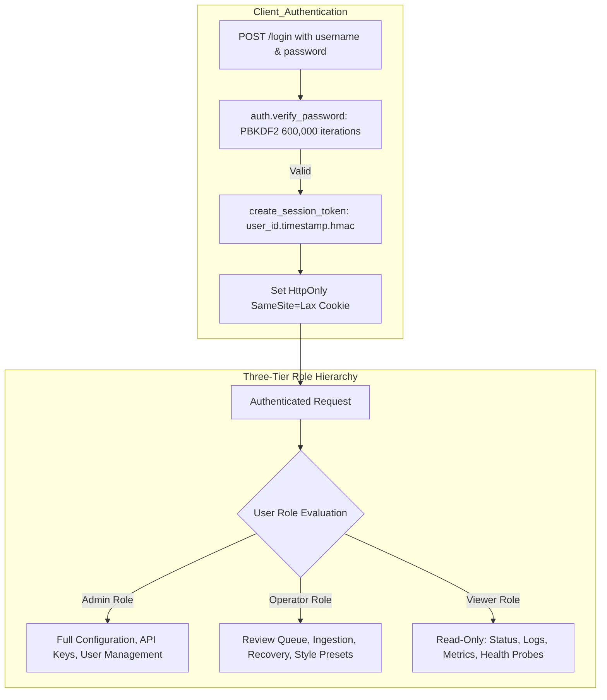
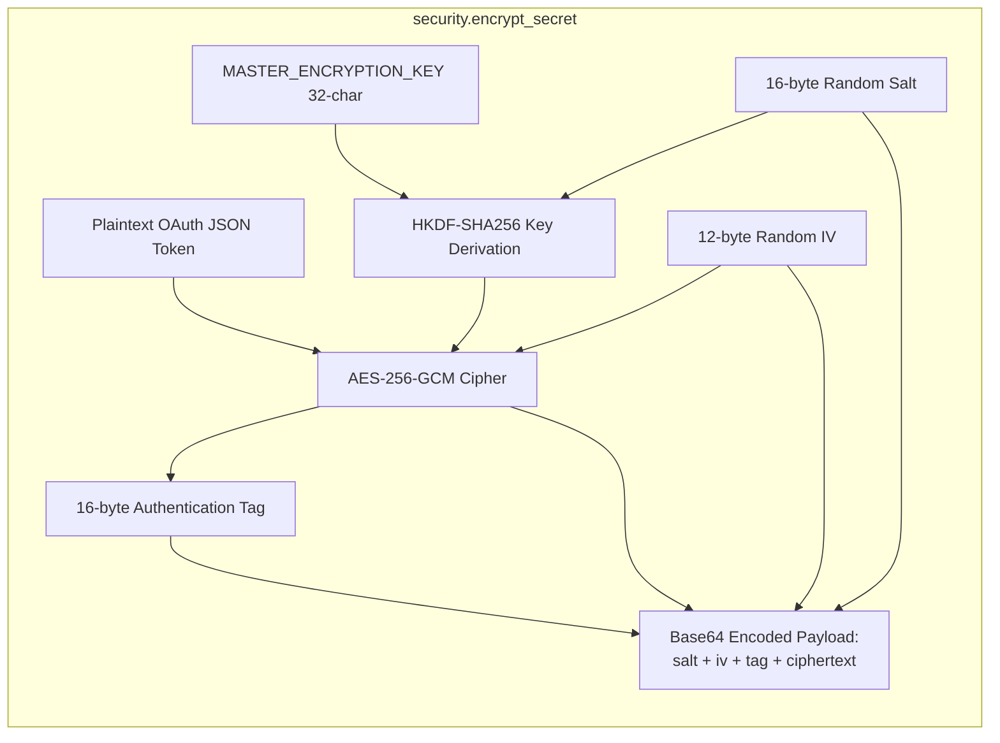
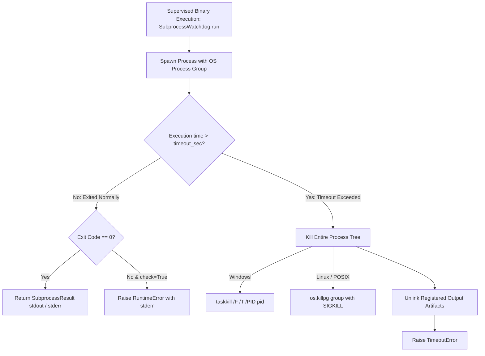

# Security Architecture, Cryptography & Failure Modes

> **Path:** `docs/architecture/08_security_and_errors.md`  
> **Source Files:**
> - [`shorts_engine/db/security.py`](file:///d:/Projects/YT%20AUTOMATION/shorts_engine/db/security.py)
> - [`shorts_engine/dashboard/auth.py`](file:///d:/Projects/YT%20AUTOMATION/shorts_engine/dashboard/auth.py)
> - [`shorts_engine/services/execution/watchdog.py`](file:///d:/Projects/YT%20AUTOMATION/shorts_engine/services/execution/watchdog.py)
> - [`shorts_engine/services/detection/websub.py`](file:///d:/Projects/YT%20AUTOMATION/shorts_engine/services/detection/websub.py)
> - [`shorts_engine/services/monitoring/alerter.py`](file:///d:/Projects/YT%20AUTOMATION/shorts_engine/services/monitoring/alerter.py)

---

## 1. Authentication & Role-Based Access Control (RBAC)

The Shorts Engine implements strict multi-user session-based authentication. All shared hardcoded credentials and legacy HTTP Basic Auth headers have been completely decommissioned.

### 1.1 Password Hashing Specification
- **Algorithm:** PBKDF2-HMAC-SHA256 (`auth.py:30-41`).
- **Work Factor:** 600,000 iterations (OWASP recommended standard).
- **Salt:** 16-byte cryptographically secure random bytes generated via `secrets.token_hex(16)`.
- **Serialized Format:** `pbkdf2_sha256$<iterations>$<salt_hex>$<hash_hex>`.
- **Verification:** Constant-time equality comparison via `secrets.compare_digest()` (`auth.py:56`).

### 1.2 Session Token & Cookie Security
- **Token Structure:** `<user_id>.<timestamp>.<signature_hex>` (`auth.py:66-77`).
- **Signature:** `hmac.new(DASHBOARD_SECRET_KEY, f"{user_id}.{timestamp}", sha256).hexdigest()`.
- **TTL Expiration:** Hard 7-day expiration ceiling (`max_age_secs = 604,800`) (`auth.py:98-100`).
- **Cookie Flags:** `HttpOnly=True`, `SameSite="Lax"`, `Secure` when `ENV` is `production` or `staging` (`auth.py:108-115`).
- **Browser Cache Protection:** Middleware injects `Cache-Control: no-store, no-cache, must-revalidate, max-age=0` on all HTML responses to prevent back-forward cache leaks after logout (`app.py:95-104`).

---

## 2. Cryptography & Data Protection at Rest

Sensitive external platform credentials (OAuth2 refresh tokens for YouTube, TikTok tokens, Instagram keys) are encrypted at rest using AES-256-GCM authenticated encryption.

### 2.1 AES-256-GCM Envelope Encryption

- **Cipher:** AES-256 in Galois/Counter Mode (GCM), providing confidentiality and cryptographic integrity verification (`security.py:46-60`).
- **Key Derivation:** HKDF-SHA256 with 16-byte random salt and application info tag `b"shorts-engine-key-derivation-v1"` (`security.py:27-38`).
- **IV / Tag Length:** 12-byte initialization vector, 16-byte authentication tag (`security.py:51-54`).
- **Encrypted Payload Format:** `base64(salt[16] + iv[12] + tag[16] + ciphertext[N])` (`security.py:57-59`).
- **Tampering Detection:** Decryption fails with `InvalidTag` if the ciphertext, IV, or salt has been altered in the database (`security.py:77-80`).

### 2.2 Atomic Secret Rotation
- Command: `python cli.py rotate-secrets --old-key <OLD> --new-key <NEW>` (`cli.py:44-66`).
- Implementation: `rotate_all_channel_tokens()` decrypts all stored secrets using the old key and re-encrypts under the new key inside a single atomic database transaction. If any token fails verification, the transaction automatically rolls back, preventing partial secret corruption (`security.py:83-118`).

---

## 3. Web & Network Security Boundaries

### 3.1 CSRF (Cross-Site Request Forgery)
- **Token Generation:** Cryptographically derived from the session token:
  $$\text{CSRF Token} = \text{HMAC-SHA256}(\text{DASHBOARD\_SECRET\_KEY}, \text{"csrf:"} + \text{session\_token})$$
- **Enforcement:** Verified on all mutating HTTP requests (`POST`, `PUT`, `DELETE`, `PATCH`) via header `X-CSRF-Token` or form field `csrf_token` (`auth.py:151-184`).
- **API Exemption:** Non-cookie requests (e.g. CLI scripts transmitting `Authorization: Bearer <token>`) are exempt from CSRF since web browsers do not automatically attach Bearer headers across cross-origin requests (`auth.py:161-164`).

### 3.2 WebSub PubSubHubbub Push Authentication
- Incoming WebSub push notifications from YouTube are signed with `X-Hub-Signature: sha1=<hex_digest>` (`websub.py:140-168`).
- Verified using constant-time comparison via `hmac.compare_digest()` to eliminate timing attack vectors (`websub.py:163`).

---

## 4. Subprocess Execution & Resource Protection

External CLI binaries (`ffmpeg`, `ffprobe`, `yt-dlp`) are executed under the supervision of `SubprocessWatchdog` to guarantee resource reclamation:

- **Process Tree Termination:**
  - Windows: Executes `taskkill /F /T /PID <pid>` to terminate child processes spawned by shell wrappers (`watchdog.py:35-37`).
  - POSIX: Spawns processes in their own session (`preexec_fn=os.setsid`) and sends `SIGKILL` to the process group (`os.killpg`) (`watchdog.py:40-43`).
- **Artifact Auto-Cleanup:** Callers register pending output paths (`artifacts_to_cleanup=[output_mp4]`). If a process times out or fails, partial or corrupted media files are unlinked from disk automatically (`watchdog.py:112-117`).

---

## 5. Failure Modes, Retries & Circuit Breakers

| Failure Mode | Trigger / Detection | System Response & Remediation | Source Reference |
| :--- | :--- | :--- | :--- |
| **YouTube Anti-Bot Challenge** | yt-dlp receives `confirm you're not a bot` or `Sign in to confirm` | Rotates player client strategy across `android`, `ios`, and `creator`, adds randomized backoff jitter, and resets byte range. | `downloader.py:220-224, 376-384` |
| **HTTP 416 Range Error** | YouTube CDN stream token expires mid-download | Purges all partial `*.part*` and `*.temp*` fragments across storage, forces fresh download with `continuedl=False`. | `downloader.py:355-367` |
| **Windows File Lock Collision** | `WinError 32` (file used by another process) during `shutil.move()` | Performs garbage collection (`gc.collect()`), waits $2.0 - 4.0$s for handle release, and retries move operation up to 3 times. | `downloader.py:298-306, 370-375` |
| **GPU Hardware Encoder Crash** | FFmpeg exits non-zero while using `h264_nvenc`, `h264_qsv`, or `h264_amf` | Dynamically catches exit code, switches `_CACHED_ENCODER = ('libx264', ...)`, and re-renders immediately on CPU. | `compositor.py:356-414` |
| **LLM Provider Quota Exhaustion** | HTTP 429 Too Many Requests or quota depletion | Cooldown tracker trips circuit breaker, automatically fails over across Groq $\to$ Gemini $\to$ OpenRouter $\to$ OpenAI $\to$ Heuristic Fallback. | `router.py:118-185, 230-295` |
| **Daily YouTube Upload Quota Depleted** | API usage reaches 10,000 units/day limit ($<1,600$ units remain) | Refuses publishing requests (`can_pub = False`), logs warning, alerts Slack/Discord/Telegram, and defers clips until midnight quota reset. | `quota.py:63-70` |
| **View Velocity Collapse Post-Publication** | Hourly view velocity drops $>50\%$ after headline switch | Bayesian A/B circuit breaker trips (`circuit_breaker_triggered = True`) and immediately calls `videos().update()` to revert to baseline title. | `bandit.py:71-75`, `winner_daemon.py:102-140` |
| **Dead Worker Abandoned Locks** | Worker process crashed mid-render (stale claim $>15$ minutes or dead PID) | `reconcile_stale_claims()` unlinks `CLAIMED:<worker_id>` markers and restores clips to pending rendering queue. | `worker/runner.py:127-185` |
