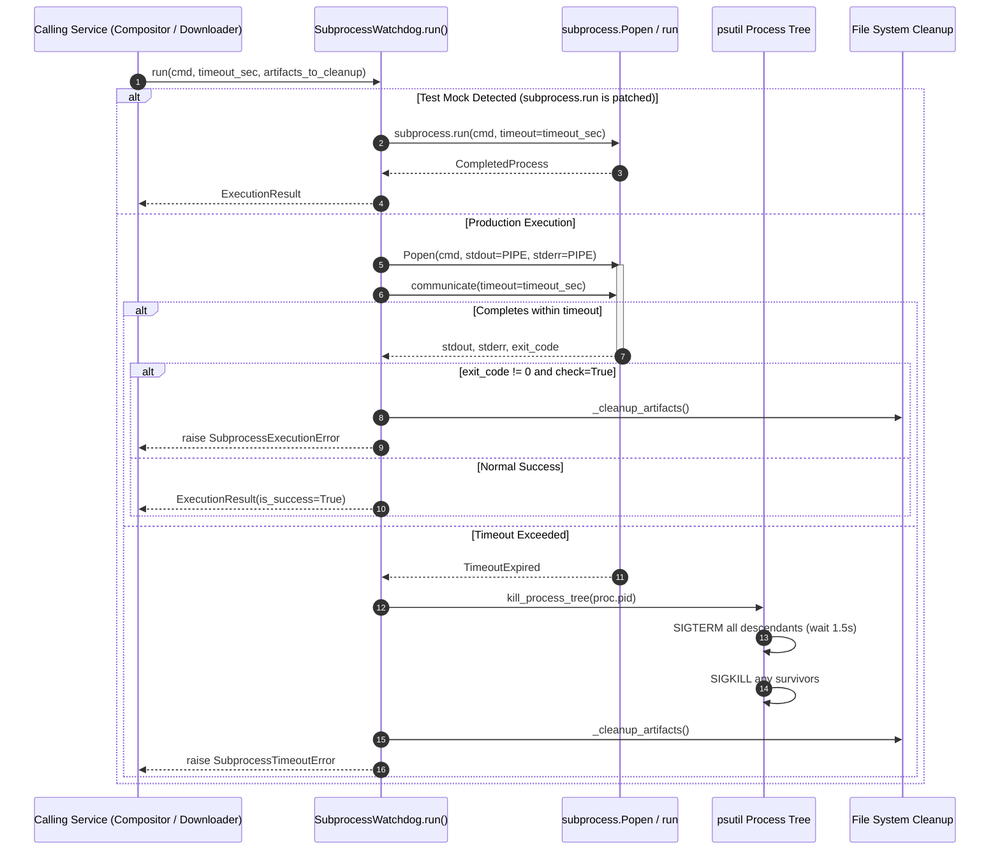
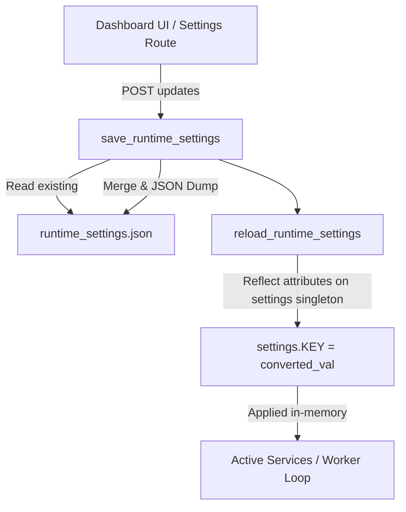

# Module Reference: 01 Configuration, Execution Watchdog & Foundation

> **Path:** `shorts_engine/config/`, `shorts_engine/services/execution/`, `shorts_engine/services/telemetry/`  
> **Source Files:**
> - [`shorts_engine/config/settings.py`](file:///d:/Projects/YT%20AUTOMATION/shorts_engine/config/settings.py)
> - [`shorts_engine/config/logging_config.py`](file:///d:/Projects/YT%20AUTOMATION/shorts_engine/config/logging_config.py)
> - [`shorts_engine/services/execution/watchdog.py`](file:///d:/Projects/YT%20AUTOMATION/shorts_engine/services/execution/watchdog.py)
> - [`shorts_engine/services/telemetry/progress_tracker.py`](file:///d:/Projects/YT%20AUTOMATION/shorts_engine/services/telemetry/progress_tracker.py)

---

## 1. Module Purpose & Responsibilities

This foundation subsystem establishes:
1. **Single Source of Truth for Configuration:** Strongly-typed Pydantic settings with environment variable loading, bounds clamping, production credential entropy validation, and runtime override management.
2. **Supervised Subprocess Execution:** Industrial-grade execution manager enforcing hard timeouts, tree-wide recursive PID discovery via `psutil`, guaranteed process termination (`SIGTERM` -> `SIGKILL`), corrupted partial artifact cleanup, and test-mock passthrough.
3. **Dual-Sink Centralized Logging:** Structured logging with console output and rotating file storage in `storage/logs/shorts_engine.log` (10 MB x 5 backups).
4. **Real-Time Job Telemetry:** Thread-safe in-memory state tracking for stage percentages (0-100%), ETA, and speed across all pipeline jobs.

---

## 2. Public Interfaces & Signatures

### 2.1 `shorts_engine.config.settings.PipelineSettings`
Class inheriting from `pydantic_settings.BaseSettings`:
- `validate_bounds() -> PipelineSettings`: Model validator checking duration limits and production entropy.
- `get_gemini_keys() -> List[str]`: Parses primary and pooled Gemini API keys.
- `get_groq_keys() -> List[str]`: Parses primary and pooled Groq API keys.
- `get_openrouter_keys() -> List[str]`: Parses primary and pooled OpenRouter API keys.
- `get_openai_keys() -> List[str]`: Parses primary and pooled OpenAI API keys.
- `add_api_key(provider: str, new_key: str) -> bool`: Appends a new API key for a provider.
- `remove_api_key(provider: str, key_hash: str) -> Optional[str]`: Removes an API key by SHA-256 hash prefix.
- `settings`: Global singleton instance.

### 2.2 `shorts_engine.config.logging_config`
- `setup_logging(level: int = logging.INFO) -> None`: Configures console and `RotatingFileHandler`.
- `reload_runtime_settings() -> Dict[str, Any]`: Loads overrides from `storage/config/runtime_settings.json` and updates `settings`.
- `save_runtime_settings(updates: Dict[str, Any]) -> Dict[str, Any]`: Merges and persists updates to `runtime_settings.json`.
- `is_test_environment() -> bool`: Returns `True` if running under pytest.

### 2.3 `shorts_engine.services.execution.watchdog.SubprocessWatchdog`
- `kill_process_tree(pid: int, grace_period_sec: float = 1.5) -> List[int]`: Discovers and kills all descendants of `pid`.
- `run(cmd: List[Union[str, Path]], timeout_sec: float = 180.0, cwd: Optional[Union[str, Path]] = None, env: Optional[Dict[str, str]] = None, check: bool = True, artifacts_to_cleanup: Optional[List[Union[str, Path]]] = None, log_stdout: bool = False) -> ExecutionResult`: Executes command with watchdog supervision.

### 2.4 `shorts_engine.services.telemetry.progress_tracker.JobProgressTracker`
- `update_progress(video_id: str, stage: str, percent: float, detail: str, speed: Optional[str] = None, eta_seconds: Optional[float] = None) -> None`: Thread-safe progress update.
- `get_progress(video_id: str) -> Optional[Dict[str, Any]]`: Retrieves snapshot for a video ID.
- `clear_progress(video_id: str) -> None`: Deletes progress tracking entry.
- `get_all_active_progress() -> Dict[str, Dict[str, Any]]`: Returns all active progress entries.
- `job_progress_tracker`: Global singleton instance.

---

## 3. Internal Logic & Control Flow

### 3.1 Subprocess Watchdog Execution Flow

### 3.2 Runtime Configuration Override Cycle

---

## 4. State & Lifecycle

| Component | State Stored | Storage Location | Concurrency / Lifecycle |
| :--- | :--- | :--- | :--- |
| `PipelineSettings` | Application configuration & keys | In-memory singleton (`settings`) | Read-heavy, updated via `reload_runtime_settings()` on dashboard changes. |
| `runtime_settings.json` | Persistent operator overrides | `storage/config/runtime_settings.json` | Persisted on disk, survives engine restarts. |
| `SubprocessWatchdog` | Running PID and process tree | Host OS process table & `psutil` | Ephemeral; lifetime of external command. |
| `JobProgressTracker` | Live stage percentages, speed, ETA | In-memory `Dict[str, Dict]` with `threading.Lock` | Ephemeral; purged on job completion or restart. |

---

## 5. Security & Invariants

1. **Production Credential Entropy:** In `validate_bounds()` ([`shorts_engine/config/settings.py:355-379`](file:///d:/Projects/YT%20AUTOMATION/shorts_engine/config/settings.py#L355-L379)), when `ENV in ("staging", "production")`, the engine enforces:
   - `DASHBOARD_PASSWORD`: Minimum 12 characters, no default passwords allowed (`change-me`, `admin`, `123456`, etc.).
   - `DASHBOARD_SECRET_KEY`: Minimum 32 characters, no default keys.
   - `POSTGRES_PASSWORD`: Minimum 12 characters.
   - `DATABASE_URL`: Strict ban on embedded default passwords.
2. **Secret Redaction:** Key getters (`get_gemini_keys()`, `get_groq_keys()`) sanitize whitespace and delimiters. Key deletion uses SHA-256 prefix hashing to avoid transmitting plaintext keys in HTTP URLs.
3. **Corrupted File Cleanup:** `SubprocessWatchdog._cleanup_artifacts()` physically deletes unplayable `.mp4` or partial `.wav` files if FFmpeg crashes or times out.
