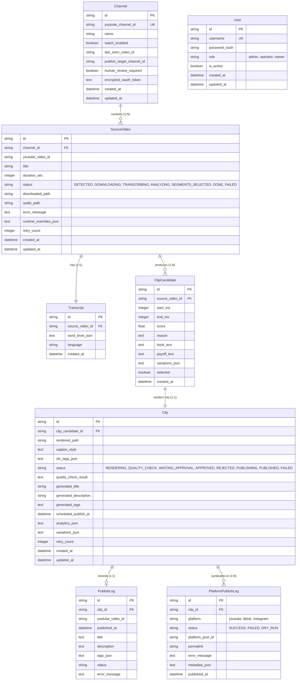
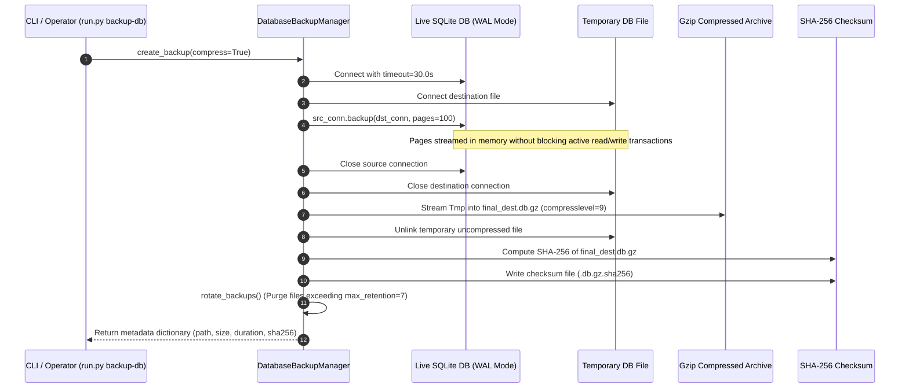

# Module Reference: 02 Database, Storage & Cryptography

> **Path:** `shorts_engine/db/`, `shorts_engine/services/storage/`  
> **Source Files:**
> - [`shorts_engine/db/models.py`](file:///d:/Projects/YT%20AUTOMATION/shorts_engine/db/models.py)
> - [`shorts_engine/db/session.py`](file:///d:/Projects/YT%20AUTOMATION/shorts_engine/db/session.py)
> - [`shorts_engine/db/security.py`](file:///d:/Projects/YT%20AUTOMATION/shorts_engine/db/security.py)
> - [`shorts_engine/services/storage/backup_manager.py`](file:///d:/Projects/YT%20AUTOMATION/shorts_engine/services/storage/backup_manager.py)
> - [`shorts_engine/services/storage/path_manager.py`](file:///d:/Projects/YT%20AUTOMATION/shorts_engine/services/storage/path_manager.py)

---

## 1. Module Purpose & Responsibilities

This subsystem provides:
1. **Relational Data Persistence:** SQLAlchemy 2.0 ORM models representing the complete YouTube automation lifecycle (`Channel`, `SourceVideo`, `Transcript`, `ClipCandidate`, `Clip`, `PublishLog`, `PlatformPublishLog`, `SFXLibrary`, `User`).
2. **High-Concurrency Database Connection Management:** WAL-mode SQLite with 30-second busy timeouts and automatic pragma tuning; PostgreSQL engine with connection pooling (`pool_size=10, max_overflow=20`) and automated timestamp triggers (`apply_m3_01_triggers()`).
3. **Cryptographic Protection at Rest:** Authenticated AES-256-GCM encryption with PBKDF2-HMAC-SHA256 key derivation (600,000 iterations) for OAuth tokens and API secrets, with atomic bulk re-encryption (`rotate_all_channel_tokens()`).
4. **Deterministic Storage Architecture:** Windows MAX_PATH-safe hierarchical naming (`PathManager`), slugification, two-tier legacy asset resolution, and lock-safe unlinking.
5. **Non-Blocking Hot Database Backups:** Native SQLite Online Backup API (`sqlite3.Connection.backup()`), streaming gzip compression, SHA-256 integrity verification, auto-rotation retention, and pre-restore safety snapshots.

---

## 2. Public Interfaces & Signatures

### 2.1 `shorts_engine.db.session`
- `engine`: Global SQLAlchemy `Engine` instance.
- `SessionLocal`: Thread-safe `scoped_session` factory.
- `get_db() -> Generator[Session, None, None]`: Context manager / FastAPI dependency.
- `init_db(target_engine=None) -> None`: Creates all tables, runs safe migrations (`ensure_schema_upgrades`), and sets PostgreSQL triggers.
- `is_postgres(target_engine=None) -> bool`: Checks whether dialect is PostgreSQL.
- `ensure_schema_upgrades(target_engine=None) -> None`: Non-breaking column additions (`ALTER TABLE`).

### 2.2 `shorts_engine.db.security`
- `encrypt_secret(plaintext: str, master_key: Optional[str] = None) -> str`: Returns base64 payload `[16B salt + 12B nonce + ciphertext + 16B tag]`.
- `decrypt_secret(encrypted_b64: str, master_key: Optional[str] = None) -> str`: Decrypts and validates authentication tag.
- `rotate_secret(encrypted_b64: str, old_master_key: str, new_master_key: str) -> str`: Re-encrypts under new key.
- `rotate_all_channel_tokens(db_session, old_master_key: str, new_master_key: str) -> int`: Bulk transaction rotation.
- `mask_secret(secret: Optional[str], show_chars: int = 4) -> str`: Redacts secrets for safe logs.

### 2.3 `shorts_engine.services.storage.backup_manager.DatabaseBackupManager`
- `create_backup(compress: bool = True) -> Dict[str, Any]`: Creates hot backup, generates SHA-256, rotates old backups.
- `list_backups() -> List[Dict[str, Any]]`: Returns sorted list of backup archives with sizes and timestamps.
- `restore_backup(backup_file: Path, target_db_path: Optional[Path] = None) -> bool`: Restores backup after verifying checksum, creating a `.pre_restore_<timestamp>` safety snapshot.
- `rotate_backups() -> int`: Prunes archives exceeding `max_retention`.

### 2.4 `shorts_engine.services.storage.path_manager.PathManager`
- `get_download_video_path(channel_name, channel_id, video_title, video_id) -> Path`: Canonical source video path.
- `get_download_audio_path(...) -> Path`: Extracted 16kHz WAV audio path.
- `get_clip_output_path(..., hook_text, start_ms, end_ms) -> Path`: Final rendered portrait video path.
- `get_thumbnail_output_path(...) -> Path`: 1080x1920 thumbnail JPEG path.
- `get_subtitle_path(video_id, start_ms, end_ms) -> Path`: ASS subtitle file path.
- `resolve_clip_path(clip_or_path: Any) -> Optional[Path]`: Two-tier resolution (hierarchical path, then legacy flat fallback).
- `resolve_download_path(video_or_path: Any) -> Optional[Path]`: Resolves source MP4 path.
- `safe_unlink(file_path, retries=3, delay_sec=0.5) -> bool`: Handles Windows `WinError 32` file locks during deletion.

---

## 3. Data Schema & Relationships

---

## 4. Internal Logic & Control Flow

### 4.1 Non-Blocking Hot SQLite Backup Process

---

## 5. Security & Invariants

1. **Authenticated Key Derivation:** `_derive_key()` uses `PBKDF2HMAC(hashes.SHA256(), length=32, salt=salt, iterations=600000)` conforming to OWASP 2026 cryptographic recommendations.
2. **Tamper Proofing:** AES-256-GCM produces a 16-byte authentication tag appended to the ciphertext. Any modification to encrypted tokens raises `ValueError("Decryption failed: invalid key or corrupted payload")`.
3. **Atomic Rotation:** `rotate_all_channel_tokens()` wraps all channel token re-encryptions in a single DB transaction. If any token fails decryption or re-encryption, the transaction rolls back completely, ensuring no partial token rot.
4. **Pre-Restore Safety Snapshot:** `restore_backup()` automatically makes a duplicate copy of the target database file (`{name}.pre_restore_{timestamp}`) before overwriting it with restored bytes.
