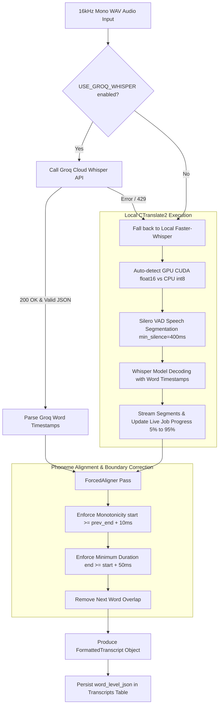

# Module Reference: 04 Transcription & Forced Alignment Engine

> **Path:** `shorts_engine/services/transcription/`  
> **Source Files:**
> - [`shorts_engine/services/transcription/engine.py`](file:///d:/Projects/YT%20AUTOMATION/shorts_engine/services/transcription/engine.py)
> - [`shorts_engine/services/transcription/formatter.py`](file:///d:/Projects/YT%20AUTOMATION/shorts_engine/services/transcription/formatter.py)
> - [`shorts_engine/services/transcription/aligner.py`](file:///d:/Projects/YT%20AUTOMATION/shorts_engine/services/transcription/aligner.py)

---

## 1. Module Purpose & Responsibilities

This subsystem provides:
1. **Local Speech-to-Text with Hardware Auto-Detection:** Faster-Whisper wrapper querying `torch.cuda.is_available()` to dynamically configure `cuda` (`float16`) or `cpu` (`int8`), loading models locally from `storage/models/whisper/`.
2. **Cloud Acceleration Option:** Groq Cloud Whisper API integration (`whisper-large-v3-turbo`) enabling ultra-fast (~2 second) transcriptions with zero GPU utilization when enabled via `USE_GROQ_WHISPER=True`.
3. **Phoneme Forced Alignment:** `ForcedAligner` post-processes word intervals to enforce monotonic timing, remove cross-attention overlap drift, and guarantee minimum 50ms word intervals.
4. **VAD Speech Filtering:** Pre-filters audio using Silero VAD (`vad_filter=True, min_silence_duration_ms=400`) to ignore background noise and prevent hallucinated tokens.
5. **Acoustic Pause Detection:** `FormattedTranscript.find_silences()` extracts inter-word silence gaps (>= 300ms) for natural sentence snapping in clip selection and trimming.

---

## 2. Public Interfaces & Signatures

### 2.1 `shorts_engine.services.transcription.engine.TranscriptionService`
- `__init__(model_size="base", device=None, compute_type=None)`: Configures hardware compute.
- `transcribe(audio_path: Path, language: Optional[str] = None, video_id: Optional[str] = None) -> FormattedTranscript`:
  - Transcribes audio, updates `job_progress_tracker` telemetry (5% -> 100%), applies forced alignment, and returns `FormattedTranscript`.
- `_transcribe_with_groq(audio_path: Path, language: Optional[str] = None) -> Optional[FormattedTranscript]`:
  - Calls Groq Cloud Whisper API (`verbose_json`), with automatic fallback to local Whisper on failure.

### 2.2 `shorts_engine.services.transcription.formatter`
- `WordSegment(word: str, start: float, end: float, probability: float = 1.0)`: Token data container.
  - `to_dict() -> Dict[str, Any]`
  - `from_dict(data: Dict[str, Any]) -> WordSegment`
- `FormattedTranscript(words: List[WordSegment], language: str = "en", full_text: Optional[str] = None)`:
  - `full_text -> str`: Joined text of all words.
  - `find_silences(min_silence_sec: float = 0.3) -> List[Dict[str, float]]`: Discovers silence boundaries.
  - `get_segment_text(start_ms: int, end_ms: int) -> str`: Spoken words inside millisecond window.

### 2.3 `shorts_engine.services.transcription.aligner.ForcedAligner`
- `align(audio_path: Path, words: List[WordSegment]) -> List[WordSegment]`: Enforces monotonicity and overlap removal (+/-50ms precision).

---

## 3. Transcription & Alignment Pipeline

---

## 4. State & Lifecycle

| Component | State Stored | Storage Location | Concurrency / Lifecycle |
| :--- | :--- | :--- | :--- |
| `WhisperModel` | Neural network weights (~140MB - 3GB) | `storage/models/whisper/` | Cached in-memory singleton per process on first call (`self.model`). |
| `FormattedTranscript` | Tokenized words, start/end timestamps, language | Stored as JSON string in `transcripts.word_level_json` | Persisted permanently; loaded during clip selection and rendering. |

---

## 5. Security & Invariants

1. **Hardware Isolation:** Compute device auto-detects `cuda` only when `torch.cuda.is_available()`. In headless or containerized environments without GPU passthrough, it smoothly falls back to `cpu` with `int8` quantization.
2. **Deterministic Monotonicity:** Subtitle drift is prevented by `ForcedAligner.align()`: words can never overlap or travel backward in time, eliminating flickering subtitle glitches in FFmpeg.
3. **PII & Audio Handling:** Audio stems are temporary files created under `storage/temp/` or `storage/downloads/`, protected from external web exposure.
