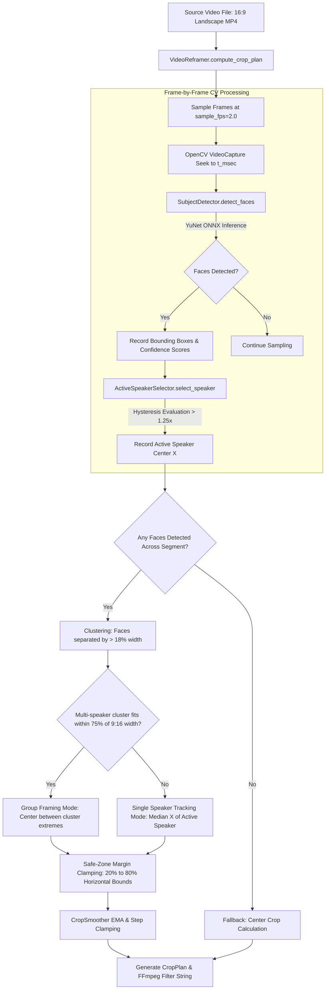

# Module Reference: 05 Visual Reframing & Computer Vision Engine

> **Path:** `shorts_engine/services/reframing/`  
> **Source Files:**
> - [`shorts_engine/services/reframing/detector.py`](file:///d:/Projects/YT%20AUTOMATION/shorts_engine/services/reframing/detector.py)
> - [`shorts_engine/services/reframing/active_speaker.py`](file:///d:/Projects/YT%20AUTOMATION/shorts_engine/services/reframing/active_speaker.py)
> - [`shorts_engine/services/reframing/smoothing.py`](file:///d:/Projects/YT%20AUTOMATION/shorts_engine/services/reframing/smoothing.py)
> - [`shorts_engine/services/reframing/cropper.py`](file:///d:/Projects/YT%20AUTOMATION/shorts_engine/services/reframing/cropper.py)

---

## 1. Module Purpose & Responsibilities

This subsystem provides automated horizontal-to-vertical (16:9 landscape to 9:16 portrait) reframing using deep-learning face detection, multi-speaker clustering, active speaker tracking, and cinematic camera panning:
1. **Deep-Learning Face Detection:** Replaced legacy Haar Cascades with OpenCV's deep-learning YuNet ONNX model (`FaceDetectorYN`), capable of robust detection under extreme angles, occlusion, and lighting variations with ~300KB footprint (`detector.py:43-105`).
2. **Active Speaker Identification & Hysteresis:** Evaluates multiple faces based on bounding box area (proximity to camera), detection confidence, and center-frame bias, applying a 25% switching hysteresis (`switch_hysteresis = 1.25`) to prevent camera oscillation cuts (`active_speaker.py:10-51`).
3. **Multi-Speaker Clustering:** Clusters detected faces across the segment timeline if separated by >18% of frame width. If all speakers fit within 75% of the 9:16 frame width, it frames them as a group; otherwise, it tracks the dominant speaker (`cropper.py:107-134`).
4. **Cinematic Motion Smoothing:** Exponential Moving Average (EMA, `alpha = 0.85`) combined with maximum horizontal step clamping (`max_step_ratio = 0.05` of frame width per step) prevents jumpy cuts and yields smooth pans (`smoothing.py:9-44`).
5. **Safe Margin Clamping & FFmpeg Filter Generation:** Ensures the speaker's face never crosses extreme edge margins (<20% or >80% horizontal crop bounds) and generates 1080x1920 crop-and-scale filter chains with studio-grade Lanczos resampling (`cropper.py:37-41, 141-152`).

---

## 2. Public Interfaces & Signatures

### 2.1 `shorts_engine.services.reframing.detector`
- `DetectedFace(x: int, y: int, w: int, h: int, score: float)`:
  - Properties: `center_x -> float`, `center_y -> float`, `area -> float` (`detector.py:22-41`).
- `SubjectDetector(model_path: Optional[Path] = None, score_threshold: float = 0.6)`:
  - `_ensure_model() -> bool`: Verifies existence (>50KB) or downloads `face_detection_yunet_2023mar.onnx` from OpenCV Zoo (`detector.py:50-61`).
  - `detect_faces(frame: np.ndarray) -> List[DetectedFace]`: Initializes `cv2.FaceDetectorYN` with `nms_threshold=0.3` and returns bounding boxes (`detector.py:62-105`).

### 2.2 `shorts_engine.services.reframing.active_speaker.ActiveSpeakerSelector`
- `__init__(switch_hysteresis: float = 1.25)` (`active_speaker.py:10-17`).
- `select_speaker(faces: List[DetectedFace], frame_width: int) -> Optional[DetectedFace]`:
  - Multi-factor scoring formula:
    $$\text{Score} = \text{area} \times \text{score} \times \left(1.0 - 0.3 \times \frac{|\text{center\_x} - w/2|}{w/2}\right)$$
  - Requires candidate score to exceed current speaker score by $1.25\times$ to switch (`active_speaker.py:19-51`).

### 2.3 `shorts_engine.services.reframing.smoothing.CropSmoother`
- `__init__(alpha: float = 0.85, max_step_ratio: float = 0.05)` (`smoothing.py:9-17`).
- `update(target_center_x: float, frame_width: int) -> float`: Clamps delta to `frame_width * 0.05` and applies EMA smoothing (`smoothing.py:19-33`).
- `smooth_trajectory(trajectory: List[float], frame_width: int) -> List[float]` (`smoothing.py:35-43`).

### 2.4 `shorts_engine.services.reframing.cropper`
- `CropPlan(crop_w: int, crop_h: int, crop_x: int, crop_y: int, mode: str, is_multi_speaker: bool, speaker_count: int)` (`cropper.py:18-44`):
  - `to_ffmpeg_filter(scale_algo: Optional[str] = None) -> str`: Produces `crop=W:H:X:Y,scale=1080:1920:flags=lanczos+accurate_rnd` (`cropper.py:37-41`).
- `VideoReframer()`:
  - `compute_crop_plan(video_path: Path, start_ms: int, end_ms: int, sample_fps: float = 2.0) -> CropPlan`: Samples frames, clusters speakers, and outputs optimal portrait coordinates (`cropper.py:52-166`).
  - `_fallback_center_crop(src_w: int, src_h: int) -> CropPlan`: Fallback when video has no detectable faces (`cropper.py:167-183`).

---

## 3. Computer Vision & Framing Architecture

---

## 4. Edge Cases, Invariants & Failure Handling

1. **Missing Model Auto-Recovery:** If `face_detection_yunet.onnx` is missing from `storage/models/`, `SubjectDetector._ensure_model()` downloads it directly from OpenCV's official GitHub Zoo repository (`detector.py:50-61`).
2. **Missing Source Video:** If the video path does not exist, `compute_crop_plan()` raises `FileNotFoundError` immediately instead of failing silently (`cropper.py:64-66`).
3. **Even Pixel Dimensions:** FFmpeg encoders (e.g. `libx264`) require even coordinate dimensions (divisible by 2). `VideoReframer` forces `crop_w` and `target_x` to even values (`cropper.py:78-80, 149-151, 170-175`).
4. **Subject Edge Pinching:** If the active face is computed within 20% of the left border or 80% of the right border of the crop window, `target_x` is dynamically adjusted to ensure a minimum 25% breathing margin (`cropper.py:141-148`).
