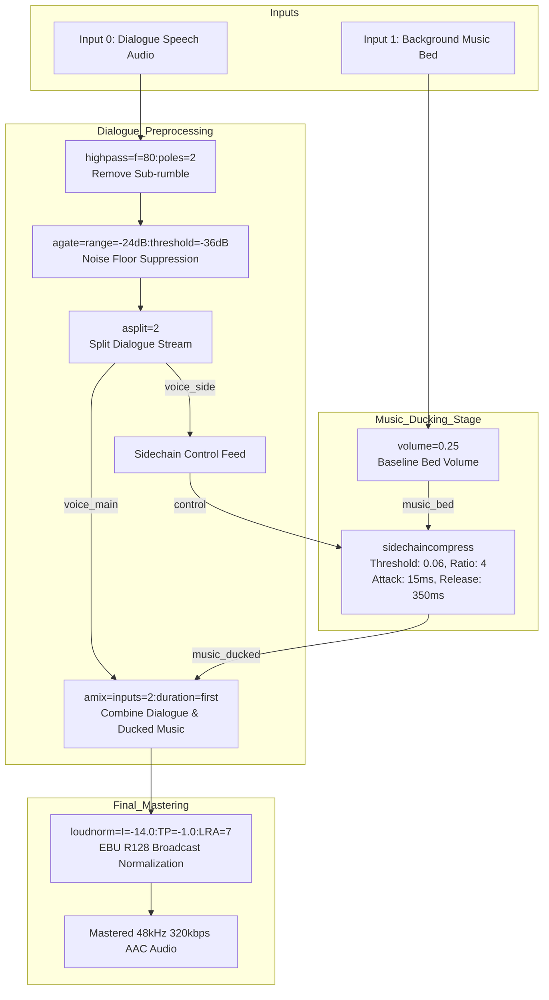

# Module Reference: 06 Broadcast Audio Mastering & Dynamic Sidechain Engine

> **Path:** `shorts_engine/services/audio/` & `shorts_engine/services/broll/`  
> **Source Files:**
> - [`shorts_engine/services/audio/mastering.py`](file:///d:/Projects/YT%20AUTOMATION/shorts_engine/services/audio/mastering.py)
> - [`shorts_engine/services/audio/music_library.py`](file:///d:/Projects/YT%20AUTOMATION/shorts_engine/services/audio/music_library.py)
> - [`shorts_engine/services/broll/client.py`](file:///d:/Projects/YT%20AUTOMATION/shorts_engine/services/broll/client.py)

---

## 1. Module Purpose & Responsibilities

This subsystem implements studio-grade broadcast acoustic mastering and dynamic music ducking for short-form vertical video:
1. **Dialogue Acoustic Cleaning:** Strips HVAC/sub-bass room rumble using an 80Hz 2-pole Butterworth highpass filter (`highpass=f=80:poles=2`) and gates low ambient floor noise (`agate=range=-24dB:threshold=-36dB:attack=10:release=120`) (`mastering.py:45-54`).
2. **Speech-Activated Dynamic Sidechain Ducking:** Splits cleaned dialogue into a broadcast audio stream and an acoustic control stream (`asplit=2`). When dialogue occurs, the background music bed is automatically attenuated by -14dB with a rapid 15ms attack and 350ms natural decay release (`sidechaincompress=threshold=0.06:ratio=4:attack=15:release=350`) (`mastering.py:55-96`).
3. **EBU R128 Loudness Compliance:** Normalizes the mixed audio track to an integrated loudness of -14.0 LUFS and a True Peak of -1.0 dBFS (`loudnorm=I=-14.0:TP=-1.0:LRA=7`), preventing distortion or aggressive platform compression penalties on YouTube, TikTok, and Instagram (`mastering.py:91-95, 104-136`).
4. **Music Asset Catalog Management:** Discovers royalty-free music beds organized across genre folders (`assets/music/<genre>/`) and retrieves tracks via mood matching (`cinematic`, `lofi`, `upbeat`, `suspense`, `epic`) with fallback to general tracks (`music_library.py:19-100`).
5. **Stock B-Roll Cutaway Acquisition:** Integrates with Pexels Video Search API to fetch portrait/HD contextual cutaways with local SHA-safe caching (`broll/client.py:21-124`).

---

## 2. Public Interfaces & Signatures

### 2.1 `shorts_engine.services.audio.mastering.AudioMasteringEngine`
- `__init__(target_lufs=-14.0, true_peak_dbfs=-1.0, hpf_cutoff_hz=80, ducking_db=-14.0, ducking_attack_ms=15, ducking_release_ms=350)` (`mastering.py:29-44`).
- `build_speech_clean_filter(input_label="0:a") -> str`: HPF + dynamic agate filter string (`mastering.py:45-54`).
- `build_sidechain_ducking_filter_graph(speech_input_label="0:a", music_input_label="1:a", output_label="a_out", music_volume_ratio=0.25) -> str`: Full 5-stage FFmpeg filter graph (`mastering.py:55-96`).
- `build_single_stream_master_filter(input_label="0:a", output_label="a_out") -> str`: HPF + Agate + Loudnorm for speech-only clips (`mastering.py:97-103`).
- `measure_loudness(media_path: Path) -> Dict[str, Any]`: Runs FFmpeg loudnorm pass in JSON mode, parsing `input_i`, `input_tp`, `input_lra`, and `target_offset` (`mastering.py:104-136`).
- `master_audio(speech_audio_path: Path, output_path: Path, music_track_path: Optional[Path]=None, duration_sec: Optional[float]=None) -> Path`: Executes supervised FFmpeg mastering with `SubprocessWatchdog` (`mastering.py:137-193`).

### 2.2 `shorts_engine.services.audio.music_library.MusicLibraryManager`
- `__init__(library_dir: Optional[Path] = None)`: Defaults to `assets/music` (`music_library.py:25-27`).
- `scan_tracks() -> Dict[str, List[Path]]`: Recursively scans `.mp3`, `.wav`, `.m4a`, `.aac`, `.flac`, `.ogg` files into genre categories (`music_library.py:33-58`).
- `get_track_for_mood(mood_or_genre: Optional[str] = None) -> Optional[Path]`: Selects matching track by exact or partial genre match, with randomized fallback (`music_library.py:59-85`).
- `list_all_tracks() -> List[Dict[str, Any]]`: Discovers metadata for UI display (`music_library.py:86-100`).

### 2.3 `shorts_engine.services.broll.client.BrollClient`
- `__init__(cache_dir: Optional[Path] = None)`: Defaults to `storage/output/broll_cache/` (`broll/client.py:24-27`).
- `fetch_broll_clip(query: str, orientation="portrait", max_duration_sec=6) -> Optional[Path]`: Checks local cache, executes authorized Pexels API query, and streams download into atomic `.tmp.mp4` before rename (`broll/client.py:28-124`).

---

## 3. Mastering Filter Graph Topology

---

## 4. Invariants & Guardrails

1. **Subprocess Watchdog Integration:** FFmpeg mastering execution is wrapped in `SubprocessWatchdog.run()` with a minimum timeout of 60.0s (or $3\times$ clip duration), auto-registering `output_path` for cleanup on timeout or exit failure (`mastering.py:183-188`).
2. **Infinite Looping of Music Beds:** Music tracks are looped indefinitely (`-stream_loop -1`) during mix generation so that short musical clips never abruptly cut out before dialogue concludes (`mastering.py:159`).
3. **Pexels Query Sanitization:** Search query terms are sanitized with `re.sub(r"[^a-zA-Z0-9_\-]", "_", query.lower().strip())[:40]` to prevent filesystem traversal and cache collisions (`broll/client.py:41`).
4. **Atomic Cache File Downloads:** B-roll video downloads write into temporary files (`.tmp.mp4`) and perform an atomic `replace` only upon complete verification of bytes (>1024 bytes) (`broll/client.py:109-118`).
