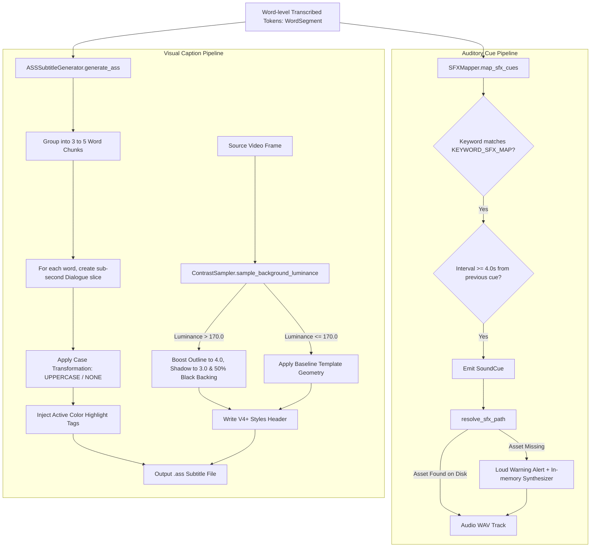

# Module Reference: 07 Typography, Subtitle Formatting & Contextual SFX Engine

> **Path:** `shorts_engine/services/captioning/`  
> **Source Files:**
> - [`shorts_engine/services/captioning/templates.py`](file:///d:/Projects/YT%20AUTOMATION/shorts_engine/services/captioning/templates.py)
> - [`shorts_engine/services/captioning/ass_generator.py`](file:///d:/Projects/YT%20AUTOMATION/shorts_engine/services/captioning/ass_generator.py)
> - [`shorts_engine/services/captioning/contrast_sampler.py`](file:///d:/Projects/YT%20AUTOMATION/shorts_engine/services/captioning/contrast_sampler.py)
> - [`shorts_engine/services/captioning/sfx_mapper.py`](file:///d:/Projects/YT%20AUTOMATION/shorts_engine/services/captioning/sfx_mapper.py)

---

## 1. Module Purpose & Responsibilities

This subsystem formats word-level synchronized vertical subtitles and maps contextual auditory accents for mobile viewers:
1. **Declarative Style Presets:** Houses 5 production typography presets (`hormozi`, `mrbeast`, `neon`, `minimalist`, `high_contrast_box`) specifying font families, sizes, letter-casing, outline widths, shadow depths, and bottom margin offsets (`templates.py:104-180`).
2. **Hex to ASS Color Transcoding:** Translates standard web CSS hexadecimal codes (`#RRGGBB` or `#AARRGGBB`) to Advanced SubStation Alpha format (`&H00BBGGRR` / `&HAABBGGRR`) and vice versa (`templates.py:13-52`).
3. **Word-Level Kinetic Karaoke ASS Generation:** Chunks transcript tokens into mobile-optimized 3-5 word groups. For every spoken token, it creates a subtitle event injecting karaoke override tags (`{\c<highlight>&}ACTIVE_WORD{\c<primary>&}`), synchronized to centisecond precision (`H:MM:SS.cs`) (`ass_generator.py:12-23, 115-150`).
4. **Adaptive Background Contrast Sampling:** Analyzes video luminance in the lower-third caption bounding box (`0.1, 0.65, 0.9, 0.85`). When mean luminance exceeds 170.0 (high glare), it automatically boosts outline thickness to 4.0, shadow depth to 3.0, and injects a 50% semi-transparent black backing box (`&H80000000`) (`contrast_sampler.py:20-70`).
5. **Contextual Sound Effects & Procedural Synthesis:** Scans transcript tokens for psychological triggers across 8 commercial sound categories (`whoosh`, `impact`, `ding`, `pop`, `camera_click`, `glitch`, `sub_bass_drop`, `riser`). If audio sample files are missing from disk, it falls back to in-memory mathematical synthesis of 16-bit 44.1kHz PCM WAV audio with exponential decay while emitting an operator alert (`sfx_mapper.py:19-108, 123-130`).

---

## 2. Public Interfaces & Signatures

### 2.1 `shorts_engine.services.captioning.templates`
- `hex_to_ass_color(hex_str: str) -> str`: Converts CSS hex `#RRGGBB` to ASS format `&H00BBGGRR` (`templates.py:13-40`).
- `ass_to_hex_color(ass_str: str) -> str`: Converts ASS color `&H00BBGGRR` to `#RRGGBB` (`templates.py:42-52`).
- `CaptionStyleTemplate(template_id, name, description, font_name="Arial Black", font_size=56, ...)`:
  - `to_ass_overrides() -> Dict[str, Any]` (`templates.py:69-82`).
  - `to_ui_dict() -> Dict[str, Any]` (`templates.py:84-100`).
- `get_caption_template(preset_or_id: Optional[str] = None) -> CaptionStyleTemplate` (`templates.py:183-187`).
- `list_caption_templates() -> List[Dict[str, Any]]` (`templates.py:189-192`).
- `parse_custom_template(data: Dict[str, Any]) -> CaptionStyleTemplate` (`templates.py:194-215`).

### 2.2 `shorts_engine.services.captioning.ass_generator.ASSSubtitleGenerator`
- `__init__(font_name, font_size=56, primary_color="&H00FFFFFF", highlight_color="&H0000FFFF", outline_color="&H00000000", outline_width=4.0, shadow_depth=2.0, margin_vertical=settings.CAPTION_MARGIN_VERTICAL)` (`ass_generator.py:26-44`).
- `generate_ass(words: List[WordSegment], segment_start_ms: int, segment_end_ms: int, output_path: Path, style_overrides: Optional[dict] = None, max_words_per_line: int = 4) -> Path`: Compiles word-level events into an ASS subtitle file (`ass_generator.py:46-150`).
- `format_ass_timestamp(seconds: float) -> str`: Converts float seconds into `H:MM:SS.cs` (`ass_generator.py:12-23`).

### 2.3 `shorts_engine.services.captioning.contrast_sampler.ContrastSampler`
- `sample_background_luminance(frame: np.ndarray, caption_box_norm=(0.1, 0.65, 0.9, 0.85)) -> float`: Extracts ROI grayscale mean luminance `[0.0, 255.0]` (`contrast_sampler.py:20-42`).
- `compute_style_adjustments(mean_luminance: float) -> dict`: Evaluates luminance thresholds (<60, 60-170, >170) to return outline, shadow, and back_color adjustments (`contrast_sampler.py:43-70`).

### 2.4 `shorts_engine.services.captioning.sfx_mapper`
- `SoundCue(tag: str, offset_sec: float, keyword: str)`: Cue metadata model (`sfx_mapper.py:44-59`).
- `generate_synthetic_sfx(tag: str, duration_sec=0.3, sample_rate=44100, output_dir=None) -> Path`: Mathematical PCM WAV audio synthesizer (`sfx_mapper.py:61-108`).
- `resolve_sfx_path(tag: str, assets_dir=None) -> Path`: Checks disk, increments `SFX_MISSING_ASSET_ALERT_COUNT`, and triggers synthesis on cache miss (`sfx_mapper.py:110-130`).
- `SFXMapper.map_sfx_cues(words: List[WordSegment], segment_start_sec: float, min_interval_sec=4.0) -> List[SoundCue]`: Scans tokens with spacing constraint (`sfx_mapper.py:132-164`).

---

## 3. Subtitle Formatting & Audio Cue Topology

---

## 4. Built-in Style Specifications

| Template ID | Name | Font Family | Size | Primary Hex | Highlight Hex | MarginV | Case Transform |
| :--- | :--- | :--- | :--- | :--- | :--- | :--- | :--- |
| `hormozi` | Alex Hormozi Viral | Arial Black | 58 | `#FFFFFF` | `#FFFF00` (Yellow) | `settings.CAPTION_MARGIN_VERTICAL` (420) | `uppercase` |
| `mrbeast` | MrBeast Impact | Arial Black | 60 | `#FFFFFF` | `#00FFFF` (Cyan) | `settings.CAPTION_MARGIN_VERTICAL` (420) | `uppercase` |
| `neon` | Cyberpunk Neon | Arial Black | 56 | `#FFFFFF` | `#7FFF00` (Spring Green) | `settings.CAPTION_MARGIN_VERTICAL` (420) | `uppercase` |
| `minimalist` | Minimalist Editorial | Arial | 50 | `#F0F0F0` | `#38A8E0` (Amber Gold) | `settings.CAPTION_MARGIN_VERTICAL` (420) | `none` |
| `high_contrast_box` | High Contrast Box | Arial Black | 54 | `#FFFFFF` | `#FFE500` (Amber) | `settings.CAPTION_MARGIN_VERTICAL` (420) | `uppercase` |
