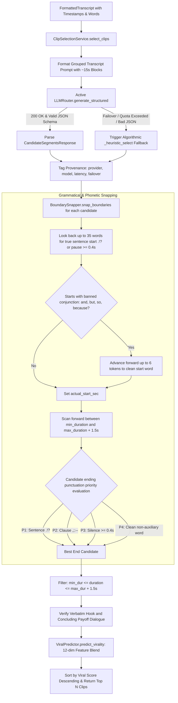

# Module Reference: 08 AI Clip Selection, Semantic Snapping & Virality Prediction

> **Path:** `shorts_engine/services/clip_selection/` & `shorts_engine/services/analytics/`  
> **Source Files:**
> - [`shorts_engine/services/clip_selection/prompts.py`](file:///d:/Projects/YT%20AUTOMATION/shorts_engine/services/clip_selection/prompts.py)
> - [`shorts_engine/services/clip_selection/boundaries.py`](file:///d:/Projects/YT%20AUTOMATION/shorts_engine/services/clip_selection/boundaries.py)
> - [`shorts_engine/services/clip_selection/selector.py`](file:///d:/Projects/YT%20AUTOMATION/shorts_engine/services/clip_selection/selector.py)
> - [`shorts_engine/services/analytics/predictor.py`](file:///d:/Projects/YT%20AUTOMATION/shorts_engine/services/analytics/predictor.py)

---

## 1. Module Purpose & Responsibilities

This subsystem analyzes full-length video transcripts to discover viral standalone segments, snap cut points to natural speech boundaries, and predict audience engagement:
1. **Generator-Critic LLM Extraction:** Prompts configured AI models (Gemini 3.8 Flash, Groq Llama 3.3, OpenRouter, OpenAI) with a structured evaluation rubric (Hook Strength 0-3s, Standalone Autonomy, Payoff & Resolution, Duration Fit) enforcing Pydantic schema validation (`prompts.py:42-56`, `selector.py:204-253`).
2. **AI Provenance Tracking:** Annotates every candidate segment with its generating LLM provider, specific model, latency, and failover status using regex-tagged metadata strings `[provider:model:latency:failover]` (`selector.py:26-95`).
3. **Four-Tier Speech Boundary Snapping:** Snaps raw LLM timestamps to phonetic boundaries:
   - Prevents truncated starts by scanning back up to 35 words for punctuation or acoustic pauses ($\ge 0.4$s) and advancing past banned conjunctions (`and`, `but`, `because`, `which`) (`boundaries.py:13-16, 70-92`).
   - Prevents dangling ends by enforcing a 4-tier candidate hierarchy: (1) Sentence-ending punctuation (`.!?`), (2) Clause punctuation (`,;:`), (3) Acoustic silence pauses ($\ge 0.4$s), and (4) Non-dangling words (`boundaries.py:100-141`).
   - Permits soft duration elasticity ($+1.5$s) aligned with Technical Quality Gate tolerances (`boundaries.py:96`).
4. **Algorithmic Heuristic Fallback:** If all external LLMs fail or exhaust quotas, falls back to a deterministic sentence-density and question-detection algorithm that partitions the transcript into balanced windows, extracting genuine declarative hooks and punchlines (`selector.py:337-431`).
5. **Closed-Loop ML Virality Prediction:** Extracts 12-dimensional NLP and structural feature vectors (power words, second-person pronouns, punctuation density, distance from 35s duration sweet spot). Computes heuristic prior scores (0-100) or blends 65% predictions from a scikit-learn `Ridge(alpha=1.0)` regression model trained directly on historical YouTube view counts and retention metrics (`predictor.py:49-106, 171-272`).

---

## 2. Public Interfaces & Signatures

### 2.1 `shorts_engine.services.clip_selection.boundaries.BoundarySnapper`
- `__init__(min_duration_sec=settings.TARGET_DURATION_MIN_SEC, max_duration_sec=settings.TARGET_DURATION_MAX_SEC)` (`boundaries.py:37-43`).
- `snap_boundaries(raw_start_sec: float, raw_end_sec: float, transcript: FormattedTranscript) -> Tuple[int, int, str]`:
  - Returns `(start_ms, end_ms, segment_text)` with guaranteed grammatical integrity (`boundaries.py:45-160`).

### 2.2 `shorts_engine.services.clip_selection.selector`
- `parse_ai_provenance(reason: Optional[str]) -> Dict[str, Any]`: Parses `[provider:model:latency:failover]` tag or detects legacy patterns (`selector.py:26-95`).
- `SelectedClip(...)`: Immutable segment data container with `duration_sec`, `ai_badge`, `clean_reason`, and `to_dict()` (`selector.py:97-160`).
- `ClipSelectionService(model_name=None, api_key=None, router=None)`:
  - `select_clips(...) -> List[SelectedClip]`: Executes LLM extraction with per-video runtime overrides, bounds enforcement, and boundary snapping (`selector.py:204-336`).
  - `_heuristic_select(...) -> List[CandidateSegmentSchema]`: Pure Python algorithmic extractor (`selector.py:337-431`).

### 2.3 `shorts_engine.services.analytics.predictor.ViralPredictor`
- `extract_features(hook_text: str, duration_sec: float, payoff_text: Optional[str]=None) -> np.ndarray`: 12-dimensional vector (`predictor.py:49-106`).
- `compute_heuristic_score(hook_text: str, duration_sec: float, payoff_text: Optional[str]=None) -> float`: Calibrated 0-100 baseline (`predictor.py:108-170`).
- `train_from_db(db: Session, min_samples: int = 5) -> Dict[str, Any]`: Trains `Ridge(alpha=1.0)` model against historical `Clip.analytics_json` records (`predictor.py:171-247`).
- `predict_virality(hook_text: str, duration_sec: float, payoff_text: Optional[str]=None) -> float`: Blends 65% Ridge ML + 35% Heuristic (`predictor.py:248-272`).
- `explain_prediction(...) -> Dict[str, Any]`: Diagnostic breakdown of scores for UI inspector (`predictor.py:273-302`).

---

## 3. Clip Selection & Boundary Snapping Pipeline

---

## 4. Invariants, Banned Words & Guardrails

1. **Banned Opening Words:** `which`, `who`, `whose`, `whom`, `that`, `and`, `but`, `or`, `so`, `because`, `whereby`, `again`, `also`, `now`. Snapper automatically advances past these to prevent fragmented sentence beginnings (`boundaries.py:13-16, 85-91`).
2. **Banned Ending Words:** Auxiliary verbs (`is`, `are`, `was`, `were`, `have`, `do`, `will`, `can`), prepositions (`of`, `to`, `in`, `for`, `with`), pronouns, and negative contractions (`didn't`, `won't`, `can't`). Cuts ending on these words are rejected in favor of complete semantic clauses (`boundaries.py:18-25, 114-127`).
3. **Hard Clamping vs Duration Elasticity:** Pre-clamps raw candidate durations if exceeding allowed bounds (`selector.py:300-303`), while permitting up to $+1.5$s of elasticity during sentence completion search to prevent truncating the final word of a punchline (`boundaries.py:96`, `selector.py:308-310`).
4. **Verbatim Hook & Payoff Enforcement:** If the LLM generates a paraphrased or empty hook/payoff, `ClipSelectionService` anchors them to the actual spoken sentences in `segment_text` (`selector.py:311-315`).
