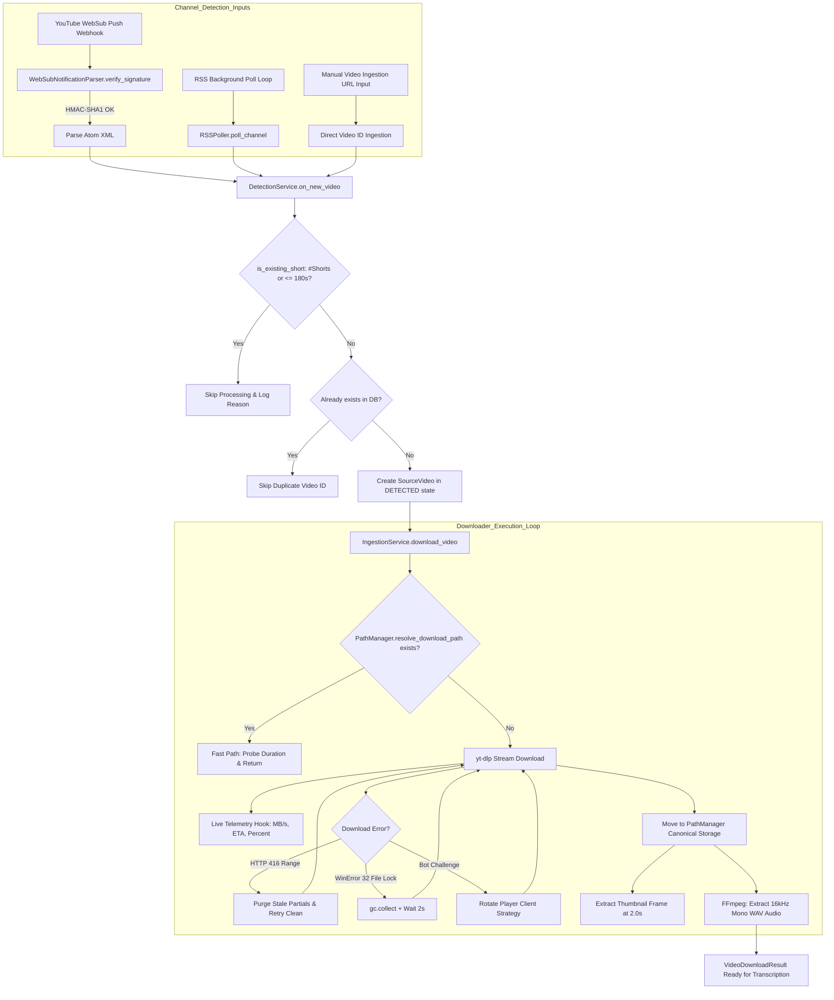

# Module Reference: 09 Media Ingestion, Video Downloader & Channel Detection

> **Path:** `shorts_engine/services/ingestion/` & `shorts_engine/services/detection/`  
> **Source Files:**
> - [`shorts_engine/services/ingestion/downloader.py`](file:///d:/Projects/YT%20AUTOMATION/shorts_engine/services/ingestion/downloader.py)
> - [`shorts_engine/services/detection/detector.py`](file:///d:/Projects/YT%20AUTOMATION/shorts_engine/services/detection/detector.py)
> - [`shorts_engine/services/detection/filter.py`](file:///d:/Projects/YT%20AUTOMATION/shorts_engine/services/detection/filter.py)
> - [`shorts_engine/services/detection/rss_poller.py`](file:///d:/Projects/YT%20AUTOMATION/shorts_engine/services/detection/rss_poller.py)
> - [`shorts_engine/services/detection/websub.py`](file:///d:/Projects/YT%20AUTOMATION/shorts_engine/services/detection/websub.py)

---

## 1. Module Purpose & Responsibilities

This subsystem handles incoming source video detection, anti-bot resilient downloading, audio extraction, and existing Shorts filtering:
1. **Dual Detection Modes (WebSub Push + RSS Polling):**
   - **WebSub Push (PubSubHubbub):** Subscribes to YouTube's hub (`https://pubsubhubbub.appspot.com/subscribe`), verifies incoming hub challenges, authenticates push payloads via timing-safe HMAC-SHA1 (`X-Hub-Signature`), and auto-renews leases at 80% lifetime (`websub.py:50-228`).
   - **RSS Atom Fallback Poller:** Polls YouTube's public XML feeds (`https://www.youtube.com/feeds/videos.xml?channel_id={id}`) every $N$ minutes using standard library XML parsing (`rss_poller.py:23-95`).
2. **Pre-Ingestion Shorts Filter:** Inspects incoming titles and metadata to detect and skip existing YouTube Shorts (`#Shorts` hashtag in title/tags or duration $\le 180$s), saving compute resources (`filter.py:13-42`, `rss_poller.py:118-125`).
3. **Resilient Video Download Engine:** Wraps `yt-dlp` with:
   - Dynamic player client rotation across 3 strategies (`['android', 'web']`, `['ios', 'mweb']`, `['android_creator', 'web_creator']`) to bypass bot detection challenges (`downloader.py:220-224, 376-380`).
   - Automated YouTube cookie file discovery (`cookies.txt` in storage or root) (`downloader.py:226-238`).
   - Jittered exponential backoff retries (`downloader.py:381-384`).
   - Real-time stream telemetry reporting to `job_progress_tracker` (MB downloaded, MB total, speed, ETA) (`downloader.py:192-218`).
4. **Stale Fragment & Error Recovery:**
   - Automatically purges orphaned `*.part*` and `*.temp*` download fragments older than 2 hours to prevent CDN token expiration HTTP 416 range errors (`downloader.py:79-98, 355-367`).
   - Mitigates Windows `WinError 32` file-locking issues via forced garbage collection (`gc.collect()`) and handle release waits (`downloader.py:304, 369-375`).
5. **ASR Audio Extraction & Thumbnail Generation:** Executes supervised FFmpeg extraction to convert downloaded MP4 video into a standardized 16kHz mono 16-bit PCM WAV track (`-vn -acodec pcm_s16le -ar 16000 -ac 1`) and extracts 2.0s poster frames into flat and hierarchical paths (`downloader.py:112-134, 309-330`).

---

## 2. Public Interfaces & Signatures

### 2.1 `shorts_engine.services.ingestion.downloader`
- `VideoDownloadResult(video_id, title, duration_sec, video_path, audio_path, metadata)` (`downloader.py:21-43`).
- `IngestionService(output_dir: Optional[Path] = None, max_retries: int = 3)`:
  - `purge_stale_temp_files(max_age_hours=24.0) -> int` (`downloader.py:57-77`).
  - `purge_stale_fragments(max_age_hours=2.0) -> int` (`downloader.py:79-98`).
  - `extract_audio(video_path: Path, audio_path: Path) -> Path`: Extracts 16kHz mono WAV (`downloader.py:112-134`).
  - `probe_duration_sec(file_path: Path) -> int`: FFprobe duration extractor (`downloader.py:136-150`).
  - `download_video(video_id_or_url: str) -> VideoDownloadResult`: Core download pipeline with client rotation and retry logic (`downloader.py:151-386`).
  - `get_metadata(video_id_or_url: str) -> Dict[str, Any]` (`downloader.py:387-392`).

### 2.2 `shorts_engine.services.detection.detector.DetectionService`
- `__init__(db_session: Session)` (`detector.py:24-29`).
- `on_new_video(channel_youtube_id: str, video_id: str) -> Optional[SourceVideo]`: Idempotently creates `SourceVideo` in `DETECTED` status and updates `channel.last_seen_video_id` (`detector.py:36-77`).
- `subscribe_channel(youtube_channel_id: str) -> bool` (`detector.py:79-81`).
- `check_lease_renewals() -> list`: Triggers 80% lease checks (`detector.py:83-85`).
- `build_rss_loop(session_factory, on_new_video_callback=None) -> RSSPollLoop` (`detector.py:87-97`).

### 2.3 `shorts_engine.services.detection.filter`
- `is_existing_short(title: str, duration_sec: Optional[float] = None, tags: Optional[List[str]] = None) -> Tuple[bool, str]`: Validates against `#Shorts` and $\le 180$s threshold (`filter.py:13-42`).

### 2.4 `shorts_engine.services.detection.rss_poller`
- `RSSPoller(timeout_sec=10)`:
  - `fetch_feed(channel_id: str) -> List[Tuple[str, datetime]]` (`rss_poller.py:42-95`).
  - `poll_channel(channel: Channel, db: Session) -> List[str]` (`rss_poller.py:96-143`).
- `RSSPollLoop(db_session_factory, on_new_video_callback)`: Blocking daemon loop running every `settings.RSS_POLL_INTERVAL_MINUTES` (`rss_poller.py:145-177`).

### 2.5 `shorts_engine.services.detection.websub`
- `WebSubSubscriber(hub_url=None, callback_url=None, secret=None)`:
  - `subscribe(channel_id: str, lease_seconds=None) -> bool` (`websub.py:61-113`).
  - `verify_challenge(...) -> Optional[str]` (`websub.py:114-130`).
- `WebSubNotificationParser(secret=None)`:
  - `verify_signature(body: bytes, x_hub_signature: Optional[str]) -> bool`: HMAC-SHA1 constant-time verification (`websub.py:140-168`).
  - `parse_notification(body: bytes) -> List[Tuple[str, str]]` (`websub.py:169-188`).
- `WebSubLeaseRenewer`: Renews leases when `elapsed / lease_seconds >= 0.8` (`websub.py:190-228`).

---

## 3. Ingestion & Detection Lifecycle Topology

---

## 4. Invariants, Safe Zones & Guardrails

1. **Anti-Bot Strategy Cycling:** If YouTube challenges a request (`confirm you're not a bot`), the client rotates across `android`, `ios`, and `creator` clients on successive attempts with randomized jitter backoff (`downloader.py:220-224, 376-384`).
2. **HTTP 416 Range Error Elimination:** When YouTube CDN media streaming tokens expire mid-download, yt-dlp receives HTTP 416. `IngestionService` catches this, unlinks all associated `.part*` files, and forces `continuedl=False` and `nopart=True` to restart cleanly (`downloader.py:355-367`).
3. **Windows Handle Locking Workaround:** `shutil.move()` operations on Windows frequently collide with lingering media handles. The system performs 3-attempt retries combined with `gc.collect()` to release handles safely (`downloader.py:299-306, 370-375`).
4. **Timing-Safe Push Authentication:** `WebSubNotificationParser` compares computed HMAC-SHA1 signatures against the `X-Hub-Signature` header strictly via `hmac.compare_digest()` to eliminate timing attack vulnerabilities (`websub.py:163`).
