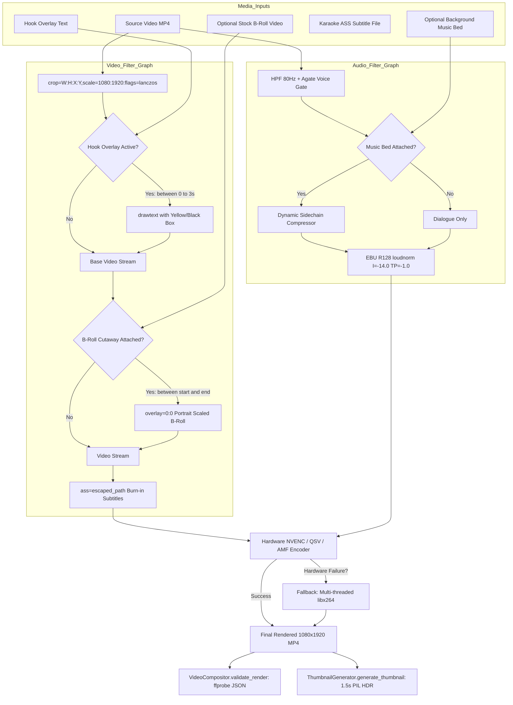

# Module Reference: 10 Video Compositor, Sub-Frame Trimmer & Thumbnail Generator

> **Path:** `shorts_engine/services/rendering/`  
> **Source Files:**
> - [`shorts_engine/services/rendering/compositor.py`](file:///d:/Projects/YT%20AUTOMATION/shorts_engine/services/rendering/compositor.py)
> - [`shorts_engine/services/rendering/trimmer.py`](file:///d:/Projects/YT%20AUTOMATION/shorts_engine/services/rendering/trimmer.py)
> - [`shorts_engine/services/rendering/thumbnail_generator.py`](file:///d:/Projects/YT%20AUTOMATION/shorts_engine/services/rendering/thumbnail_generator.py)

---

## 1. Module Purpose & Responsibilities

This subsystem executes the final video assembly, compositing, visual enhancements, and precision trimming:
1. **Hardware-Accelerated Video Encoding:** Probes hardware acceleration capabilities using 1-frame probe tests (`_test_hardware_encoder()`), prioritizing NVIDIA NVENC (`h264_nvenc`), Intel QuickSync (`h264_qsv`), and AMD AMF (`h264_amf`) before falling back gracefully to multi-threaded CPU `libx264` (`compositor.py:90-138`).
2. **Multi-Input FFmpeg Compositor Graph:** Assembles 1080x1920 vertical video (`compositor.py:145-350`):
   - Portrait cropping & Lanczos scaling (`CropPlan.to_ffmpeg_filter()`).
   - Dynamic 0-3s opening hook text banner (`drawtext enable='between(t,0,3)'`) (`compositor.py:219-225`).
   - Picture-in-picture stock B-roll cutaway insertion (`overlay=0:0:enable='between(t,start,end)'`) (`compositor.py:230-235`).
   - Sub-second synchronized burned-in ASS subtitles (`ass='<escaped_path>'`) (`compositor.py:236-240`).
   - Studio audio mastering with voice-activated background music sidechain ducking (`compositor.py:242-250`).
3. **Sub-Frame Trimming & Atomic Re-Rendering:** Allows operators to adjust clip boundaries via UI. Snaps requested start/end seconds to natural word silence gaps ($\pm 1.5$s tolerance), re-generates ASS subtitles, recalculates active-speaker CV crop, re-renders video, and executes technical QA re-validation in a single atomic transaction (`trimmer.py:30-80, 91-261`).
4. **Automated Render Validation:** Uses `ffprobe` JSON parsing to strictly verify output dimensions (1080x1920), valid duration ($>0.0$s), presence of audio stream, and non-zero filesize (`compositor.py:428-502`).
5. **Zero-Cost Viral Thumbnail / Cover Generator:** Extracts high-impact frames from the hook window (1.5s), boosts contrast and saturation (+15%), adds dark gradient masks for YouTube Shorts UI dead-zones (top 15% header, bottom 22% metadata), and overlays high-CTR yellow/black drop-shadow typography (`thumbnail_generator.py:30-185`).

---

## 2. Public Interfaces & Signatures

### 2.1 `shorts_engine.services.rendering.compositor`
- `escape_ffmpeg_filter_path(path: Path) -> str`: Escapes forward slashes, colons (`D\\:/`), and single quotes for FFmpeg filter syntax (`compositor.py:20-32`).
- `get_best_video_encoder() -> Tuple[str, List[str]]`: Auto-detects and validates best encoder (`compositor.py:104-138`).
- `RenderValidationResult(is_valid, duration_sec, width, height, has_audio, file_size_bytes, error)` (`compositor.py:50-85`).
- `VideoCompositor(output_dir: Optional[Path] = None)`:
  - `render_short(...) -> Path`: Core rendering pipeline (`compositor.py:145-427`).
  - `validate_render(video_path: Path) -> RenderValidationResult`: FFprobe stream inspector (`compositor.py:428-502`).

### 2.2 `shorts_engine.services.rendering.trimmer`
- `snap_to_word_boundary(words: List[WordSegment], target_start_sec: float, target_end_sec: float, tolerance_sec=1.5, min_silence_gap_sec=0.20) -> Tuple[float, float]` (`trimmer.py:30-80`).
- `ClipTrimmerService(db: Session)`:
  - `trim_clip(clip_id: str, start_sec: float, end_sec: float, snap_words=True, caption_style_preset=None) -> Dict[str, Any]` (`trimmer.py:91-261`).

### 2.3 `shorts_engine.services.rendering.thumbnail_generator.ThumbnailGenerator`
- `extract_frame_ffmpeg(video_path: Path, output_path: Path, timestamp_sec=1.5) -> bool` (`thumbnail_generator.py:36-55`).
- `generate_thumbnail(video_path: Path, output_path=None, hook_text=None, timestamp_sec=1.5) -> Path`: PIL HDR enhancement and typography overlay (`thumbnail_generator.py:59-178`).

---

## 3. Compositor Filter Graph & Render Architecture

---

## 4. Invariants, Fallback Strategies & Guardrails

1. **Hardware-to-CPU Encoder Fallback:** When a GPU hardware encoder (`h264_nvenc`, `h264_qsv`, `h264_amf`) crashes or aborts during FFmpeg execution, `compositor.py` dynamically catches the non-zero exit code, caches `_CACHED_ENCODER = ('libx264', ...)`, and re-executes immediately using software `libx264` (`compositor.py:356-414`).
2. **Subprocess Watchdog Execution:** Video rendering commands run under `SubprocessWatchdog.run()` with a timeout of $\max(180\text{s}, \text{duration} \times 6)$, auto-cleaning corrupted partial output files on timeout (`compositor.py:351-354`).
3. **Windows Path Escaping in Filters:** FFmpeg filter parameters cannot parse standard Windows drive colons or unescaped backslashes. `escape_ffmpeg_filter_path()` standardizes backslashes to `/` and escapes colons to `\\:` (`compositor.py:20-32`).
4. **Safe UI Dead-Zone Gradient Overlays:** The thumbnail generator overlays subtle gradient darkening on the bottom 22% ($y \ge 1497\text{px}$) and top 15% ($y \le 288\text{px}$) of the cover image to guarantee readability under native YouTube/TikTok player interface overlays (`thumbnail_generator.py:105-111`).
