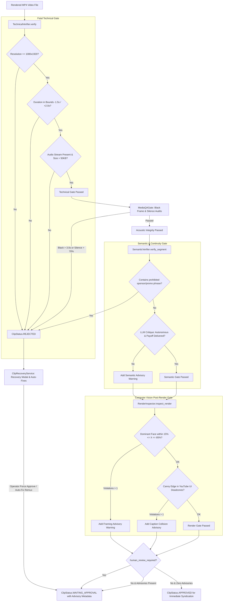

# Module Reference: 11 Quality Gates, Multimodal Render Inspection & Clip Recovery

> **Path:** `shorts_engine/services/quality_gate/` & `shorts_engine/services/quality/`  
> **Source Files:**
> - [`shorts_engine/services/quality/media_qa.py`](file:///d:/Projects/YT%20AUTOMATION/shorts_engine/services/quality/media_qa.py)
> - [`shorts_engine/services/quality_gate/technical_check.py`](file:///d:/Projects/YT%20AUTOMATION/shorts_engine/services/quality_gate/technical_check.py)
> - [`shorts_engine/services/quality_gate/semantic_check.py`](file:///d:/Projects/YT%20AUTOMATION/shorts_engine/services/quality_gate/semantic_check.py)
> - [`shorts_engine/services/quality_gate/render_inspector.py`](file:///d:/Projects/YT%20AUTOMATION/shorts_engine/services/quality_gate/render_inspector.py)
> - [`shorts_engine/services/quality_gate/review_queue.py`](file:///d:/Projects/YT%20AUTOMATION/shorts_engine/services/quality_gate/review_queue.py)
> - [`shorts_engine/services/quality_gate/recovery.py`](file:///d:/Projects/YT%20AUTOMATION/shorts_engine/services/quality_gate/recovery.py)

---

## 1. Module Purpose & Responsibilities

This subsystem provides multi-tier automated quality assurance, visual/acoustic defect detection, human review state orchestration, and failure remediation:
1. **Fatal Technical Gate:** Verifies container integrity, strict 1080x1920 9:16 portrait dimensions, audio stream presence, minimum filesize (>50KB), and duration bounds (with 2.0s container muxing tolerance) (`technical_check.py:16-92`).
2. **Deep Acoustic & Media QA:**
   - **Continuous Black Frame Detection:** Runs FFmpeg `blackdetect=d=2.0:pix_th=0.10` to reject renders with $>3.0$s of blank screens (`media_qa.py:101-106, 174-198`).
   - **Audio Dropout & Mute Detection:** Runs FFmpeg `silencedetect=noise=-50dB:d=3.0` to detect dropped or muted dialogue exceeding 70% of duration (`media_qa.py:109-119, 199-222`).
3. **Multimodal Post-Render CV Inspection:**
   - Samples keyframes at 10%, 30%, 50%, 70%, 90% timeline intervals (`render_inspector.py:38-42`).
   - Checks that the primary face stays within safe horizontal bounds (`0.15 <= norm_x <= 0.85`) (`render_inspector.py:57-64`).
   - Employs OpenCV Canny edge detection in YouTube Shorts UI dead zones (bottom title/channel area $Y > 80\%$, right-side buttons $X > 85\%, Y > 40\%$) to detect subtitle collisions (`render_inspector.py:65-93`).
4. **Semantic Narrative Verification:** Uses `LLMRouter` with `SemanticVerificationSchema` to evaluate standalone autonomy and narrative resolution, hard-rejecting prohibited sponsor/promo phrases (`thanks to our sponsor`, `in the next episode`, `check out part 1`) (`semantic_check.py:26-111`).
5. **State Machine & Advisory Routing:** Transitions clips to `WAITING_APPROVAL` with actionable advisory warnings when non-fatal framing/semantic alerts occur, or auto-promotes to `APPROVED` when all checks pass in unattended mode (`review_queue.py:34-104`).
6. **Universal Failure Recovery & Auto-Fix:** Diagnoses failures, allows operator force-approvals with audit notes, executes automated remediation passes (`technical_clamp`, `reanchor_dialogue`, `caption_safe_rerender`), and opens local video locations in OS file explorers (`recovery.py:34-410`).

---

## 2. Public Interfaces & Signatures

### 2.1 `shorts_engine.services.quality.media_qa.MediaQAGate`
- `QAResult(passed: bool, violations: List[str], metrics: Dict[str, Any])` (`media_qa.py:27-40`).
- `inspect_file(video_path: Path) -> QAResult`: Full container, black-screen, and silence audit (`media_qa.py:60-127`).

### 2.2 `shorts_engine.services.quality_gate.technical_check.TechnicalVerifier`
- `verify(video_path: Path, min_duration_sec=None, max_duration_sec=None) -> Tuple[bool, Dict[str, Any]]`: Fast ffprobe container validation (`technical_check.py:16-92`).

### 2.3 `shorts_engine.services.quality_gate.semantic_check.SemanticVerifier`
- `verify_segment(segment_text: str, hook_text: str, payoff_text: str) -> Tuple[bool, Dict[str, Any]]`: Semantic cohesion and sponsor phrase detection (`semantic_check.py:44-126`).

### 2.4 `shorts_engine.services.quality_gate.render_inspector.RenderInspector`
- `inspect_render(video_path: Path) -> Tuple[bool, Dict[str, Any]]`: Canny edge collision and face centering verification (`render_inspector.py:22-104`).

### 2.5 `shorts_engine.services.quality_gate.review_queue.QualityGateManager`
- `evaluate_clip(rendered_video_path, segment_text, hook_text, payoff_text, human_review_required=True, ...) -> Tuple[ClipStatus, Dict[str, Any]]` (`review_queue.py:24-104`).

### 2.6 `shorts_engine.services.quality_gate.recovery.ClipRecoveryService`
- `diagnose_clip(clip: Clip) -> Dict[str, Any]`: Structured diagnosis and recommended fixes (`recovery.py:34-130`).
- `re_evaluate_clip(clip: Clip, db: Session) -> Tuple[ClipStatus, Dict[str, Any]]`: Live gate re-evaluation (`recovery.py:131-184`).
- `force_approve_clip(clip: Clip, db: Session, operator_name="operator", note=None) -> Tuple[ClipStatus, Dict[str, Any]]` (`recovery.py:185-220`).
- `apply_auto_fix(clip: Clip, fix_type: str, db: Session) -> Dict[str, Any]`: Executes `technical_clamp`, `reanchor_dialogue`, or `caption_safe_rerender` (`recovery.py:221-371`).
- `open_in_folder(file_path: Path) -> Dict[str, Any]`: Triggers native `explorer.exe /select,...` (`recovery.py:372-410`).

---

## 3. Quality Gate Architecture & State Machine

---

## 4. Invariants & Remediation Capabilities

1. **Fatal Technical Separation:** Technical gate failures (wrong dimensions, 0 bytes, missing audio track) are non-negotiably fatal and immediately set `status = REJECTED` without incurring unnecessary LLM or CV compute costs (`review_queue.py:54-57`).
2. **Non-Fatal Advisory Routing:** In conversational podcasts, in-media-res topic introductions often trigger conservative LLM warnings. Rather than rejecting them, `QualityGateManager` routes them to `WAITING_APPROVAL` with visible UI badges (`review_queue.py:84-96`).
3. **Lossless Technical Duration Clamping:** `apply_auto_fix(..., fix_type="technical_clamp")` runs stream-copy remuxing (`-c:v copy -c:a copy -t <max>`) without re-encoding, instantaneously fixing audio-tail container overruns (`recovery.py:246-270`).
4. **Verbatim Dialogue Re-Anchoring:** `apply_auto_fix(..., fix_type="reanchor_dialogue")` scans the original word-level transcript within the candidate's exact millisecond bounds, replacing synthesized text with genuine spoken dialogue (`recovery.py:271-303`).
