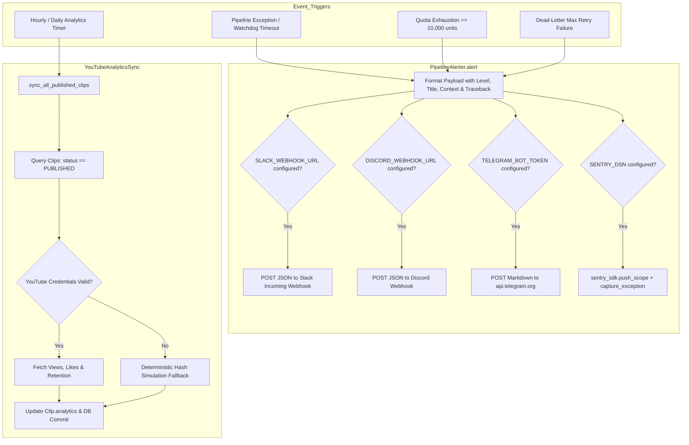

# Module Reference: 13 Telemetry, Multi-Channel Alerting & Analytics Synchronization

> **Path:** `shorts_engine/services/monitoring/`  
> **Source Files:**
> - [`shorts_engine/services/monitoring/alerter.py`](file:///d:/Projects/YT%20AUTOMATION/shorts_engine/services/monitoring/alerter.py)
> - [`shorts_engine/services/monitoring/analytics_sync.py`](file:///d:/Projects/YT%20AUTOMATION/shorts_engine/services/monitoring/analytics_sync.py)

---

## 1. Module Purpose & Responsibilities

This subsystem provides cross-platform notification broadcasting and performance metric synchronization:
1. **Multi-Channel Webhook & Alert Dispatch:** Broadcasts exceptions, fatal pipeline failures, quota threshold exhaustion, and dead-letter queue events to Slack, Discord, Telegram, and Sentry (`alerter.py:19-132`).
2. **Sentry Error Tracking:** Connects to Sentry without re-initializing the runtime SDK, attaching contextual tags (`alert_level`, `alert_title`), custom metadata key-value payloads, and call-stacks via `sentry_sdk.capture_exception()` (`alerter.py:109-130`).
3. **YouTube Analytics Performance Sync:** Queries all `PUBLISHED` clips and syncs real-time performance telemetry (view counts, like counts, comment counts, average retention percentage) back into `Clip.analytics` JSON columns (`analytics_sync.py:20-67`).
4. **Deterministic Metric Fallback:** When running offline or in development mode, computes realistic deterministic engagement metrics using MD5 hash seeds derived from `clip_id` (`analytics_sync.py:68-90`).

---

## 2. Public Interfaces & Signatures

### 2.1 `shorts_engine.services.monitoring.alerter.PipelineAlerter`
- `alert(title: str, message: str, level: str = "ERROR", context: Optional[Dict[str, Any]] = None, exc: Optional[Exception] = None) -> bool`:
  - Dispatches concurrently to Slack, Discord, Telegram, and Sentry (`alerter.py:27-132`).

### 2.2 `shorts_engine.services.monitoring.analytics_sync.YouTubeAnalyticsSync`
- `__init__(db: Session)` (`analytics_sync.py:23-24`).
- `sync_all_published_clips() -> Dict[str, Any]`: Batch-syncs all published clips and aggregates totals (`analytics_sync.py:26-66`).
- `_fetch_clip_metrics(clip_id: str, yt_id: Optional[str] = None) -> Dict[str, Any]` (`analytics_sync.py:68-90`).

---

## 3. Alerting & Analytics Architecture

---

## 4. Invariants & Dispatch Safety

1. **Local Log Guarantee:** Even if all external webhooks fail or are unconfigured, `PipelineAlerter` always logs errors locally using standard Python logging (`logger.error` / `logger.warning`) (`alerter.py:46-52`).
2. **Timeout Clamping on Webhooks:** All outbound webhook requests (`urllib.request.urlopen`) enforce strict 5-second network timeouts (`timeout=5`) to prevent pipeline worker hangs (`alerter.py:65, 80, 103`).
3. **Sentry Scope Isolation:** Exception capturing uses `sentry_sdk.push_scope()` to ensure tag isolation (`alert_level`, `alert_title`) without leaking state across threads (`alerter.py:114-120`).
