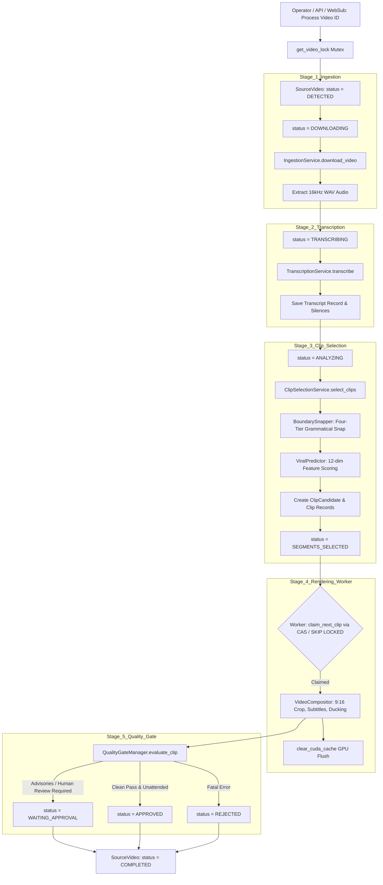

# Module Reference: 14 Pipeline Orchestration, Job Lifecycle & Background Worker

> **Path:** `shorts_engine/orchestration/` & `shorts_engine/services/worker/`  
> **Source Files:**
> - [`shorts_engine/orchestration/lifecycle.py`](file:///d:/Projects/YT%20AUTOMATION/shorts_engine/orchestration/lifecycle.py)
> - [`shorts_engine/orchestration/runner.py`](file:///d:/Projects/YT%20AUTOMATION/shorts_engine/orchestration/runner.py)
> - [`shorts_engine/services/worker/runner.py`](file:///d:/Projects/YT%20AUTOMATION/shorts_engine/services/worker/runner.py)

---

## 1. Module Purpose & Responsibilities

This subsystem provides deterministic, resilient pipeline execution, checkpoint resumption, thread/process concurrency control, and background rendering:
1. **End-to-End Pipeline Orchestration:** `PipelineRunner` coordinates the sequential execution stages: Download $\to$ Transcription $\to$ Clip Selection $\to$ Reframing $\to$ Subtitling $\to$ Rendering $\to$ Quality Gate Evaluation (`orchestration/runner.py:105-899`).
2. **State Machine & Lifecycle Manager:** Enforces strict stage transitions on `SourceVideo` (`DETECTED` $\to$ `DOWNLOADING` $\to$ `TRANSCRIBING` $\to$ `ANALYZING` $\to$ `SEGMENTS_SELECTED` $\to$ `COMPLETED`) and `Clip` (`CANDIDATE` $\to$ `RENDERING` $\to$ `WAITING_APPROVAL` / `APPROVED` $\to$ `PUBLISHING` $\to$ `PUBLISHED` / `REJECTED` / `FAILED`) with state-lock verification (`orchestration/lifecycle.py:13-58`).
3. **Resumption from Checkpoints:** If a pipeline fails or is terminated mid-flight, re-running the pipeline checks existing database records and storage paths (downloaded media, transcription JSON, candidate segments), resuming from the latest completed checkpoint without repeating costly download or transcription passes (`orchestration/runner.py:200-450`).
4. **Cooperative Cancellation & Mutex Locking:**
   - Per-video process mutex locks (`get_video_lock()`) prevent duplicate concurrent executions of the same source video (`orchestration/runner.py:82-88`).
   - Cooperative cancellation registry (`register_cancellation()`, `is_video_cancelled()`) enables operators to safely cancel running jobs via the dashboard UI (`orchestration/runner.py:63-75, 90-102`).
5. **Decoupled Background Worker Loop:** `WorkerRunner` runs independently of web requests:
   - Dialect-aware optimistic locking: Uses PostgreSQL `SELECT ... FOR UPDATE SKIP LOCKED` for non-blocking multi-worker concurrency, or atomic Compare-And-Swap (CAS) on `rendered_path = 'CLAIMED:worker_id'` in SQLite (`worker/runner.py:48-102`).
   - Reconciles stale worker claims abandoned by crashed worker processes or dead PIDs (`worker/runner.py:127-185`).
   - Flushes PyTorch CUDA VRAM and IPC caches (`clear_cuda_cache()`) between renders to prevent GPU out-of-memory errors (`worker/runner.py:34-46`).

---

## 2. Public Interfaces & Signatures

### 2.1 `shorts_engine.orchestration.lifecycle.LifecycleManager`
- `transition_video(video: SourceVideo, target_status: SourceVideoStatus, expected_status: SourceVideoStatus = None) -> bool` (`orchestration/lifecycle.py:17-36`).
- `transition_clip(clip: Clip, target_status: ClipStatus, expected_status: ClipStatus = None) -> bool` (`orchestration/lifecycle.py:38-57`).

### 2.2 `shorts_engine.orchestration.runner`
- `register_cancellation(video_id: str) -> None`: Signals active background thread to abort (`orchestration/runner.py:63-68`).
- `is_video_cancelled(video_id: str) -> bool`: Polled cooperatively between pipeline stages (`orchestration/runner.py:70-74`).
- `get_video_lock(video_id: str) -> threading.Lock`: Mutex isolation (`orchestration/runner.py:82-88`).
- `release_video_lock(video_id: str) -> bool`: Forces lock release and cancellation (`orchestration/runner.py:90-102`).
- `PipelineRunner(db_session: Session)`:
  - `run_pipeline_for_video(video_id_or_url: str, force_rerun: bool = False, ...) -> PipelineResult` (`orchestration/runner.py:105-899`).

### 2.3 `shorts_engine.services.worker.runner`
- `clear_cuda_cache() -> None`: Clears GPU VRAM via PyTorch (`worker/runner.py:34-46`).
- `claim_next_clip(db: Session, worker_id: Optional[str] = None) -> Optional[Clip]`: Dialect-aware row lock (`worker/runner.py:48-102`).
- `is_pid_alive(pid: int) -> bool`: Process verification (`worker/runner.py:104-125`).
- `reconcile_stale_claims(db: Session, max_age_minutes: float = 15.0) -> int`: Auto-recovery for abandoned tasks (`worker/runner.py:127-185`).
- `WorkerRunner(db_factory, worker_id=None)`: Main daemon rendering loop (`worker/runner.py:188-501`).

---

## 3. Orchestration & State Transition Topology

---

## 4. Invariants & Multi-Worker Concurrency Controls

1. **Dialect-Aware Concurrency Control:**
   - On PostgreSQL, `claim_next_clip` issues `SELECT ... FOR UPDATE SKIP LOCKED` so concurrent worker processes immediately skip rows being processed by peers without lock contention (`worker/runner.py:56-73`).
   - On SQLite, an atomic update with conditional comparison (`filter(Clip.id == candidate.id, Clip.rendered_path == current_val).update(...)`) guarantees single-worker acquisition (`worker/runner.py:75-101`).
2. **Cooperative Cancellation Checkpoints:** Between every major pipeline phase (after download, after transcription, and before clip selection), `PipelineRunner` verifies `is_video_cancelled(video_id)`. If true, execution halts cleanly without corrupting database state (`orchestration/runner.py:240-245, 320-325`).
3. **Dead Worker Auto-Reconciliation:** If a worker process terminates abruptly (e.g. OOM or power loss), `reconcile_stale_claims()` checks the recorded PID via `is_pid_alive()`. If dead or older than 15 minutes, the claim marker is unlinked, restoring the clip to pending rendering status (`worker/runner.py:127-185`).
