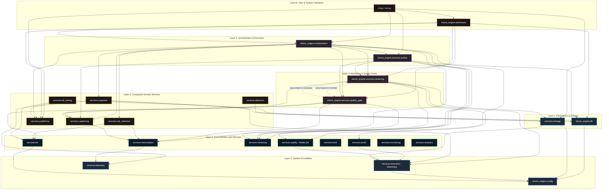

# Module Import Graph & Call Topology

> **As-Implemented Dependency & Import Topology**  
> Generated from AST static analysis of all Python modules across `shorts_engine/`, `cli.py`, and `run.py`.  
> Date: 2026-09-24

---

## 1. Subsystem Layer Architecture

The codebase organizes strictly into seven functional tiers based on real import relationships:

---

## 2. Package Dependency Out-Degree Matrix

This table lists every internal package, its out-degree (number of internal packages it imports), and the exact list of targets:

| Package | Out-Degree | Internal Target Packages Imported |
| :--- | :--- | :--- |
| **`shorts_engine.config`** | 0 | *(None - Pure leaf foundation)* |
| **`shorts_engine.services.execution`** | 0 | *(None - Depends only on psutil and standard library)* |
| **`shorts_engine.services.telemetry`** | 0 | *(None - In-memory and SSE progress tracker)* |
| **`shorts_engine.db`** | 1 | `shorts_engine.config` |
| **`shorts_engine.services.analytics`** | 1 | `shorts_engine.db` |
| **`shorts_engine.services.broll`** | 1 | `shorts_engine.config` |
| **`shorts_engine.services.llm`** | 1 | `shorts_engine.config` |
| **`shorts_engine.services.reframing`** | 1 | `shorts_engine.config` |
| **`run.py`** | 2 | `cli`, `shorts_engine.config` |
| **`shorts_engine.services.audio`** | 2 | `shorts_engine.config`, `shorts_engine.services.execution` |
| **`shorts_engine.services.captioning`** | 2 | `shorts_engine.config`, `shorts_engine.services.transcription` |
| **`shorts_engine.services.detection`** | 2 | `shorts_engine.config`, `shorts_engine.db` |
| **`shorts_engine.services.monitoring`** | 2 | `shorts_engine.config`, `shorts_engine.db` |
| **`shorts_engine.services.publishing`** | 2 | `shorts_engine.config`, `shorts_engine.db` |
| **`shorts_engine.services.quality`** | 2 | `shorts_engine.config`, `shorts_engine.services.execution` |
| **`shorts_engine.services.storage`** | 2 | `shorts_engine.config`, `shorts_engine.services.execution` |
| **`shorts_engine.services.transcription`** | 2 | `shorts_engine.config`, `shorts_engine.services.telemetry` |
| **`shorts_engine.services.clip_selection`** | 3 | `shorts_engine.config`, `shorts_engine.services.llm`, `shorts_engine.services.transcription` |
| **`shorts_engine.services.ab_testing`** | 4 | `shorts_engine.config`, `shorts_engine.db`, `shorts_engine.services.llm`, `shorts_engine.services.publishing` |
| **`shorts_engine.services.ingestion`** | 5 | `shorts_engine.config`, `shorts_engine.services.execution`, `shorts_engine.services.rendering`, `shorts_engine.services.storage`, `shorts_engine.services.telemetry` |
| **`shorts_engine.services.quality_gate`** | 7 | `shorts_engine.config`, `shorts_engine.db`, `shorts_engine.services.captioning`, `shorts_engine.services.llm`, `shorts_engine.services.reframing`, `shorts_engine.services.rendering` *(lazy)*, `shorts_engine.services.transcription` |
| **`shorts_engine.services.rendering`** | 9 | `shorts_engine.config`, `shorts_engine.db`, `shorts_engine.services.audio`, `shorts_engine.services.captioning`, `shorts_engine.services.execution`, `shorts_engine.services.quality_gate` *(lazy)*, `shorts_engine.services.reframing`, `shorts_engine.services.storage`, `shorts_engine.services.transcription` |
| **`cli.py`** | 10 | `shorts_engine.config`, `shorts_engine.dashboard`, `shorts_engine.db`, `shorts_engine.orchestration`, `shorts_engine.services.detection`, `shorts_engine.services.ingestion`, `shorts_engine.services.monitoring`, `shorts_engine.services.publishing`, `shorts_engine.services.storage`, `shorts_engine.services.worker` |
| **`shorts_engine.services.worker`** | 10 | `shorts_engine.config`, `shorts_engine.db`, `shorts_engine.services.captioning`, `shorts_engine.services.monitoring`, `shorts_engine.services.quality`, `shorts_engine.services.quality_gate`, `shorts_engine.services.reframing`, `shorts_engine.services.rendering`, `shorts_engine.services.storage`, `shorts_engine.services.transcription` |
| **`shorts_engine.orchestration`** | 17 | `shorts_engine.config`, `shorts_engine.db`, `shorts_engine.services.broll`, `shorts_engine.services.captioning`, `shorts_engine.services.clip_selection`, `shorts_engine.services.detection`, `shorts_engine.services.ingestion`, `shorts_engine.services.monitoring`, `shorts_engine.services.publishing`, `shorts_engine.services.quality`, `shorts_engine.services.quality_gate`, `shorts_engine.services.reframing`, `shorts_engine.services.rendering`, `shorts_engine.services.storage`, `shorts_engine.services.telemetry`, `shorts_engine.services.transcription`, `shorts_engine.services.worker` |
| **`shorts_engine.dashboard`** | 19 | `shorts_engine.config`, `shorts_engine.db`, `shorts_engine.orchestration`, `shorts_engine.services.ab_testing`, `shorts_engine.services.analytics`, `shorts_engine.services.captioning`, `shorts_engine.services.clip_selection`, `shorts_engine.services.detection`, `shorts_engine.services.ingestion`, `shorts_engine.services.llm`, `shorts_engine.services.monitoring`, `shorts_engine.services.publishing`, `shorts_engine.services.quality_gate`, `shorts_engine.services.reframing`, `shorts_engine.services.rendering`, `shorts_engine.services.storage`, `shorts_engine.services.telemetry`, `shorts_engine.services.transcription`, `shorts_engine.services.worker` |

---

## 3. Dependency Cycles & Tightly Coupled Areas

### Cycle Found: `rendering` <--> `quality_gate`
- **Location 1:** [`shorts_engine/services/rendering/trimmer.py:24-25`](file:///d:/Projects/YT%20AUTOMATION/shorts_engine/services/rendering/trimmer.py#L24-L25) imports:
  - `shorts_engine.services.quality_gate.technical_check.TechnicalVerifier`
  - `shorts_engine.services.quality_gate.render_inspector.RenderInspector`
- **Location 2:** [`shorts_engine/services/quality_gate/recovery.py:306`](file:///d:/Projects/YT%20AUTOMATION/shorts_engine/services/quality_gate/recovery.py#L306) imports:
  - `shorts_engine.services.rendering.compositor.VideoCompositor` (inline inside `auto_fix_clip()`).
- **Architectural Impact:**
  - This cycle is actively mitigated in code by using an **inline/deferred import** at line 306 in `recovery.py`. However, it demonstrates coupling between trimming/re-rendering logic and quality-check logic.
  - **Refactoring Recommendation:** Move shared inspection contracts into an independent interface module (`shorts_engine.services.quality_contracts`).
