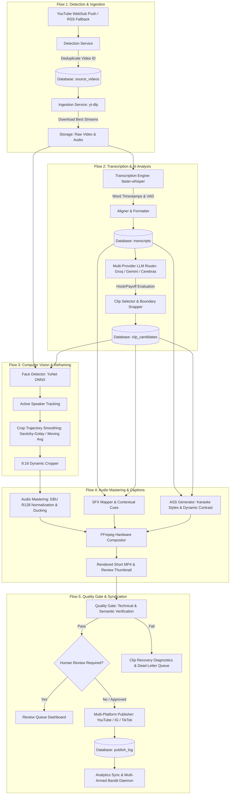

# Phase 3: End-to-End System Flows & Comprehensive Failure Map

---

## 1. System Topology & Architectural Flows

The YouTube Shorts Automation Platform is engineered as a distributed, decoupled multi-stage processing pipeline. The system transitions jobs across explicit state machines persisted in PostgreSQL / SQLite, orchestrated via asynchronous worker loops and coordinated by an operator dashboard.

---

## 2. Detailed Flow Analysis & Failure Map

### Flow 1: Detection, Deduplication & Media Ingestion
- **Modules Involved:**
  - `shorts_engine/services/detection/rss_poller.py`
  - `shorts_engine/services/detection/websub.py`
  - `shorts_engine/services/detection/filter.py`
  - `shorts_engine/services/ingestion/downloader.py`
  - `shorts_engine/services/storage/path_manager.py`

#### Failure Mode Analysis:
1. **Network Partition / Upstream WebSub Drop:**
   - *Failure Mechanism:* WebSub hubs may fail to deliver callbacks or experience HTTP timeouts.
   - *Mitigation & Status:* Resilient dual-path detection. Scheduled RSS polling fallback runs every 300s to sweep feeds. `last_seen_video_id` prevents reprocessing already registered media.
2. **YouTube Bot-Block & PO Token Throttling:**
   - *Failure Mechanism:* YouTube bot detection returns HTTP 429 or `Sign in to confirm you're not a bot`.
   - *Mitigation & Status:* `downloader.py` integrates cookies extraction (`--cookies` / `--cookies-from-browser`), dynamic user-agent rotation, and exponential backoff retry.
3. **Corrupted Stream Downloads & Partial File Residuals:**
   - *Failure Mechanism:* Worker crashes mid-download leaving orphaned `.part` or truncated MP4 files.
   - *Mitigation & Status:* `PathManager.cleanup_orphaned_temps()` scans and purges unreferenced temporary fragments on initialization. Pre-flight FFprobe validation verifies container integrity before advancing state.

---

### Flow 2: Audio Transcription & LLM Clip Selection
- **Modules Involved:**
  - `shorts_engine/services/transcription/engine.py`
  - `shorts_engine/services/transcription/aligner.py`
  - `shorts_engine/services/llm/router.py`
  - `shorts_engine/services/llm/quota_tracker.py`
  - `shorts_engine/services/clip_selection/selector.py`
  - `shorts_engine/services/clip_selection/boundaries.py`

#### Failure Mode Analysis:
1. **GPU OOM & CUDA Allocation Failure in Faster-Whisper:**
   - *Failure Mechanism:* High-resolution or long audio files can cause CUDA out-of-memory during batched inference.
   - *Mitigation & Status:* Automatic fallback to CPU / INT8 quantization mode (`compute_type="int8"`). Audio pre-segmentation using Silero VAD strips silence before transcription.
2. **Provider API Quota Exhaustion & Rate Limiting (429):**
   - *Failure Mechanism:* Primary Groq LPU quota exhausted during peak processing.
   - *Mitigation & Status:* Tiered multi-provider circuit breaker router (`Groq` $\to$ `Gemini` $\to$ `Cerebras` $\to$ `Deterministic Heuristic`). Real-time token consumption tracked in `quota_tracker.py` with sliding window windows.
3. **Hallucinated or Malformed JSON from LLM:**
   - *Failure Mechanism:* LLM outputs markdown formatting, preamble, or timestamps outside source duration bounds.
   - *Mitigation & Status:* Strict JSON schema validation with Pydantic. Automatic retry with prompt re-anchoring. Boundary clamping against actual audio duration bounds.

---

### Flow 3: Computer Vision & 9:16 Adaptive Reframing
- **Modules Involved:**
  - `shorts_engine/services/reframing/detector.py`
  - `shorts_engine/services/reframing/active_speaker.py`
  - `shorts_engine/services/reframing/smoothing.py`
  - `shorts_engine/services/reframing/cropper.py`

#### Failure Mode Analysis:
1. **Missed Faces in B-Roll, Slides, or Oblique Angles:**
   - *Failure Mechanism:* YuNet face detector returns zero detections for cinematic b-roll or presentation slides.
   - *Mitigation & Status:* Confidence thresholding with fallback to rule-based center-weighted 9:16 crop window to prevent pipeline failure.
2. **Camera Shake & High-Frequency Cropping Jitter:**
   - *Failure Mechanism:* Frame-by-frame face bounding box fluctuations produce jarring panning in vertical format.
   - *Mitigation & Status:* Smoothing pipeline applying Savitzky-Golay filtering and moving average interpolation to ensure cinematic camera trajectory.

---

### Flow 4: Audio Mastering, Kinetic Captions & FFmpeg Compositing
- **Modules Involved:**
  - `shorts_engine/services/audio/mastering.py`
  - `shorts_engine/services/captioning/ass_generator.py`
  - `shorts_engine/services/captioning/contrast_sampler.py`
  - `shorts_engine/services/rendering/compositor.py`
  - `shorts_engine/services/rendering/trimmer.py`

#### Failure Mode Analysis:
1. **Audio Clipping & Inaudible Voice over Background Music:**
   - *Failure Mechanism:* SFX cues or background music overpower spoken dialogue.
   - *Mitigation & Status:* Multi-track EBU R128 loudness normalization (`-14 LUFS`) with dynamic sidechain ducking (-18dB attenuation during dialogue segments).
2. **Caption Unreadability over Dynamic Backgrounds:**
   - *Failure Mechanism:* Light caption text rendered over white background footage.
   - *Mitigation & Status:* `ContrastSampler` samples pixel luminance underneath the subtitle bounding box to dynamically select high-contrast outline and font colors.
3. **FFmpeg Subprocess Hang & Deadlock:**
   - *Failure Mechanism:* Pipe buffer exhaustion or codec deadlock freezes rendering workers indefinitely.
   - *Mitigation & Status:* `SubprocessWatchdog` wraps FFmpeg execution with configurable timeouts, CPU/RAM monitoring, and process group termination (`kill_process_tree`).

---

### Flow 5: Quality Gate, Multi-Platform Syndication & Feedback Loops
- **Modules Involved:**
  - `shorts_engine/services/quality_gate/technical_check.py`
  - `shorts_engine/services/quality_gate/semantic_check.py`
  - `shorts_engine/services/quality_gate/recovery.py`
  - `shorts_engine/services/publishing/manager.py`
  - `shorts_engine/services/publishing/youtube.py`
  - `shorts_engine/services/publishing/instagram.py`
  - `shorts_engine/services/publishing/tiktok.py`
  - `shorts_engine/services/ab_testing/winner_daemon.py`

#### Failure Mode Analysis:
1. **Architectural Circular Import Cycle (P1):**
   - *Failure Mechanism:* `shorts_engine.services.rendering` imports `shorts_engine.services.quality_gate`, which in turn imports `rendering`.
   - *Vulnerability:* Cyclic dependencies introduce import order sensitivity and failure during module refactoring or lazy initialization.
2. **Double-Pass Media QA Latency Overhead (P2):**
   - *Failure Mechanism:* `MediaQA` executes two independent FFmpeg passes (`_detect_black_frames` and `_detect_audio_silence`), reading and decoding the video file twice.
   - *Mitigation Required:* Consolidate into a single-pass filtergraph (`-vf blackdetect ... -af silencedetect ...`).
3. **Hardcoded Machine Paths in Control Center Batch Scripts (P2):**
   - *Failure Mechanism:* Batch files in `Shorts_Engine_Control_Center/` contain absolute fallback paths (`D:\Projects\YT AUTOMATION`).
   - *Mitigation Required:* Replace with relative traversal based on script directory `%~dp0`.
4. **Analytics Sync Short ID Fallback Bug (P2):**
   - *Failure Mechanism:* In `analytics_sync.py`, `_fetch_clip_metrics` falls back to `source_video.youtube_video_id` instead of strictly checking the clip's `publish_log.youtube_video_id`.
   - *Mitigation Required:* Strictly query `publish_log` by `clip_id`.
