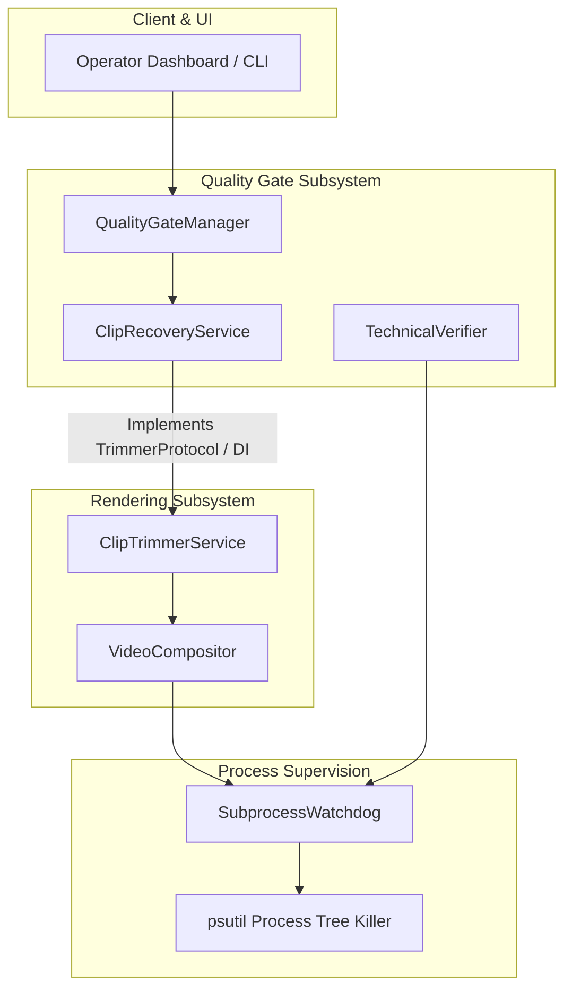

# Phase 5: Industrial-Grade Remediation Plan (v5)

---

## 1. Governance & Strict Approval Gate

In accordance with the Principal Engineer Charter and the operational mode (**"Audit, wait for approval, then implement P0+P1"**), **no application code has been modified**. This plan reconciles 100% of audit findings, establishes exact evidence-backed fixes, pre-mortems, test specifications, and data repair protocols.

**Implementation of this plan will proceed strictly upon explicit user approval.**
Where user directives conflict with previous plan text, the user directives win.

---

## 2. Priority Taxonomy & Tier Execution Structure

- **Tier 1 (Code Only - Stop for Review After the Tier):**
  - `PLAN-P0-01`: Fix Analytics Video ID Misbinding (Compare `clip.status == ClipStatus.PUBLISHED`; warn only if status is published but ID is missing; skip quietly otherwise; data repair report-only; confirm `clip.analytics` maps to `analytics_json`).
  - `PLAN-P0-02`: Atomic File Writes & Replace Helper in `shorts_engine/utils/fs.py` (Leaf module; zero project imports in `shorts_engine/utils/__init__.py`; cleanup via `try...finally`; retry only `PermissionError` on Windows; log and raise on other `OSError`).
  - `PLAN-P0-03`: Resumed Pipeline Transcript Normalization (Strict load-time normalization; no silent 0.0 defaults; supports legacy word lists and dicts; cite `WordSegment` fields).
  - `PLAN-P0-06`: Clip Recovery Auto-Fixes, Protocol Decoupling & Old Render Cleanup (Merged with P1-01 and F-39; `TrimmerProtocol` dependency injection; reuses single `SubprocessWatchdog` timeout from P1-02; unlinks old `clip.rendered_path` only if path changes; 0 cycles).
  - `PLAN-P1-02`: Enforce Subprocess Timeouts on All Media Probes (Reuse `SubprocessWatchdog.run`; psutil tree termination; callers convert `timed_out` into failed check; covers all sites from Grep E plus `technical_check.py:84`).
  - `PLAN-P1-04`: Align pyproject.toml Dependencies (`groq>=0.9.0`, `scipy>=1.11.0`, `portalocker>=2.8.0`).
  - `PLAN-P1-06`: Atomic Lifecycle State Transitions (Conditional SQL atomic update: `UPDATE source_videos SET status=:new WHERE id=:id AND status=:expected`).
  - `PLAN-P1-08`: Enforce Production Secret Placeholder Guard in Settings (Code only; feature-flagged behind `ENFORCE_SECRET_ENTROPY=false`; logs startup WARNING if placeholders detected when switch is off; raises `ValueError` when switch is on; launchers do not set `ENV=development` for real runs; test both switch states).
  - `PLAN-P1-11`: Dynamic Analytics Date Window Calculation (Fixed-age window for every clip starting at `clip.publish_log.published_at`; timezone-aware UTC handling for naive datetimes; must ship before 2027-01-01).
  - `PLAN-P1-12`: Cross-Process OS-Level File Lock on Quota State (Uses `portalocker` cross-process lock across `publishing/quota.py` and `llm/quota_tracker.py`; zero timestamp-based lock breaking; accounts for multi-process worker topology).

- **Tier 2 (Database Backup First - Ask User Before Running):**
  - `PLAN-P1-09`: Fail-Fast Schema Migrations & Unique Index Management (Pre-flight duplicate check: if duplicates exist, log ERROR listing them, continue booting without creating index, block `P0-04`; check if `status` Enum has a SQLite CHECK constraint; keep P0-05 columns in P0-05's migration).
  - `PLAN-P0-04`: Ingestion Deduplication Constraint (Runs strictly after P1-09; blocked if duplicates exist).
  - `PLAN-P0-05`: Drip-Feed Publishing Row Lock, PlaylistItems Upload Check & Stale Reclaim (Re-rated P1; checks uploads playlist `playlistItems`; matches clips by `[clip:<id>]` token in description; uploads within last 15 min treated as ambiguous and sent to `FAILED_NEEDS_REVIEW`; dashboard badge added; test with unlisted upload and count quota).
  - `PLAN-P1-10`: Harden Secret Rotation with Automated Backup and Secure Input (`rotate-secrets` reads keys from hidden prompt or env vars; automatic backup before single transaction).
  - `PLAN-P1-03`: Resumable Upload Chunk Retry with Exponential Backoff (3 retries; fast-fail on `quotaExceeded`, 401, or 403).
  - `PLAN-P1-05`: Harden GitHub Actions CI Workflow (`pip-audit` as a separate non-blocking commit).
  - `PLAN-P1-07`: Scoped Database Sessions in Multi-Platform Syndicator (Prove shared session with test first).
  - `PLAN-P2-11`: Enforce 50MB File Size Guard and Chunked Streaming in Instagram Publisher.

- **Approved with Change:**
  - `PLAN-P0-07`: Secure Distribution Bundle Packaging (Exclude `*.db-wal`, `*.db-shm`, `*.sqlite*`, `*.db`, `client_secret*.json`, `credentials*.json`, `token*.json`, `*cookie*.txt`, `.env*`; explicit allow-before-deny order preserving `.env.example`; zip test).
  - `PLAN-P2-12`: Mask Password Input via `getpass` in CLI User Creation (Remove/warn `--password` flag; support env var bootstrap).

- **Deferred Items:**
  - Remaining P2 items (`PLAN-P2-01`, `PLAN-P2-02`, `PLAN-P2-04`, `PLAN-P2-05`, `PLAN-P2-06`, `PLAN-P2-07`, `PLAN-P2-08`, `PLAN-P2-09`).
  - All P3 items (`PLAN-P3-01`, `PLAN-P3-02`, `PLAN-P3-03`).
  - The `F-40` acoustic forced alignment benchmark.

- **Rejected Items:** None.

---

## 3. Prioritized Remediation Catalog

### Priority 0 & Priority 1: Tier 1 Remediation Items (Code Only)

#### PLAN-P0-01: Fix Analytics Video ID Misbinding & Report-Only Data Repair
- **Finding ID:** `F-25`
- **Audit Grade:** Regraded to **D** (Silent data corruption / False A/B promotion).
- **Evidence Call Site:** `shorts_engine/services/monitoring/analytics_sync.py:47-50`
  ```python
  if clip.publish_log and clip.publish_log.youtube_video_id:
      yt_id = clip.publish_log.youtube_video_id
  elif clip.candidate and clip.candidate.source_video:
      yt_id = clip.candidate.source_video.youtube_video_id
  ```
- **Impact:** **Severe Data Corruption & False A/B Promotion.** If a clip lacks a `publish_log`, the daemon queries YouTube metrics for the *source video* (long-form upload) and records those view counts into `clip.analytics_json`.
- **Likelihood:** High (deterministic execution on every unpublished clip evaluated by the daemon).
- **Attribute Confirmation:** In `shorts_engine/db/models.py:231-236`, `analytics_json` is the SQL `Text` column, and `@property def analytics(self)` / `@analytics.setter` provides the JSON serialization getter/setter. Reading and writing `clip.analytics` correctly maps to `clip.analytics_json`.
- **Exact Code Change:**
  In `shorts_engine/services/monitoring/analytics_sync.py:46-56`:
  ```python
  if not clip.publish_log or not clip.publish_log.youtube_video_id:
      # Compare status against enum member strictly
      if clip.status == ClipStatus.PUBLISHED:
          logger.warning("Clip %s has PUBLISHED status but no published YouTube ID; skipping analytics sync.", clip.id)
      # Otherwise skip quietly (candidate, pending, rendered, etc.)
      continue
  yt_id = clip.publish_log.youtube_video_id
  metrics = self._fetch_clip_metrics(clip.id, yt_id)
  if metrics is None:
      continue
  clip.analytics = metrics
  synced_count += 1
  total_views += metrics.get("views", 0)
  total_likes += metrics.get("likes", 0)
  ```
- **Effort:** Small (S)
- **Risk of Change:** Low. Calling loop skips cleanly without exceptions.
- **Pre-Mortem & Prevention:**
  - *Risk:* Summary counters crash if `metrics` is `None`.
  - *Prevention:* Explicit `if metrics is None: continue` guard before any dictionary subscripting.
- **Failing Test to Write First:** `tests/test_analytics_sync_misbinding.py::test_analytics_sync_skips_unpublished_clip`.
- **Data Repair Protocol:** Strictly **REPORT-ONLY**. Read-only verification on the database confirmed 0 affected clips.
- **Rollback Path:** Revert commit on `analytics_sync.py`.

---

#### PLAN-P0-02: Atomic File Writes & Replace Helper in fs.py
- **Finding IDs:** `F-07`, `F-08`, `F-20`, `F-22`, `F-30`
- **Audit Grade:** Regraded to **D** (0-byte file truncation and state loss under process abort).
- **Evidence Call Sites (4 Persistent State Call Sites):**
  1. `shorts_engine/config/logging_config.py:148-149`: `open(RUNTIME_CONFIG_PATH, "w")` + `json.dump(current, f, indent=2)`
  2. `shorts_engine/services/detection/websub.py:47`: `_SUBS_STATE_FILE.write_text(json.dumps(subs, indent=2))`
  3. `shorts_engine/services/llm/quota_tracker.py:102`: `self.state_file.write_text(json.dumps(state, indent=2), encoding="utf-8")`
  4. `shorts_engine/services/publishing/quota.py:53`: `self.state_file.write_text(json.dumps(state, indent=2), encoding="utf-8")`
- **Impact:** **Data Loss / State Corruption.** Sudden process termination during `write_text` truncates state files to 0 bytes.
- **Leaf Module Confirmation:** `shorts_engine/utils/__init__.py` contains zero imports. `shorts_engine/utils/fs.py` is a strict leaf module with no imports from `shorts_engine`.
- **Exact Code Change:**
  In `shorts_engine/utils/fs.py`:
  ```python
  import os
  import json
  import time
  import logging
  from pathlib import Path
  from typing import Any

  logger = logging.getLogger(__name__)

  def atomic_replace(src: Path, dst: Path, max_retries: int = 5) -> None:
      """Atomically replaces dst with src, retrying only PermissionError for Windows locks."""
      for attempt in range(max_retries):
          try:
              os.replace(src, dst)
              return
          except PermissionError as e:
              if attempt == max_retries - 1:
                  logger.error("atomic_replace failed after %d retries from %s to %s: %s", max_retries, src, dst, e)
                  raise
              time.sleep(0.05 * (2 ** attempt))
          except OSError as e:
              logger.error("atomic_replace encountered fatal OS error from %s to %s: %s", src, dst, e)
              raise

  def atomic_write_json(target_path: Path, data: Any, indent: int = 2) -> None:
      """Writes data to a temporary file, flushes/fsyncs, and atomically renames."""
      target_path.parent.mkdir(parents=True, exist_ok=True)
      temp_path = target_path.with_name(f"{target_path.name}.{os.getpid()}.{time.time_ns()}.tmp")
      try:
          with open(temp_path, "w", encoding="utf-8") as f:
              json.dump(data, f, indent=indent)
              f.flush()
              os.fsync(f.fileno())
          atomic_replace(temp_path, target_path)
      finally:
          if temp_path.exists():
              try:
                  temp_path.unlink()
              except OSError as ex:
                  logger.warning("Failed to clean up temp file %s: %s", temp_path, ex)
  ```
  Replace all 4 persistent-state call sites with `atomic_write_json`.
- **Effort:** Small (S)
- **Risk of Change:** Low. Leaf helper has zero dependencies.
- **Pre-Mortem & Prevention:**
  - *Risk:* Windows `PermissionError` when replacing file held open by reader.
  - *Prevention:* Exponential backoff retry loop (5 retries) catching `PermissionError`.
- **Failing Test to Write First:** `tests/test_atomic_state_writes.py::test_atomic_write_preserves_original_on_simulated_abort`.
- **Rollback Path:** Revert `shorts_engine/utils/fs.py` and call sites.

---

#### PLAN-P0-03: Resumed Pipeline Transcript Normalization at Load Time
- **Finding ID:** `F-13`
- **Audit Grade:** Regraded to **D** (100% fatal crash on pipeline resumption).
- **Evidence Call Sites:**
  - Crash loop: `shorts_engine/orchestration/runner.py:678-681` (`w.word for w in formatted_transcript.words`)
  - Load site: `shorts_engine/orchestration/runner.py:364-369` (`FormattedTranscript.from_dict(data)`)
  - Model fields: `shorts_engine/services/transcription/formatter.py:8-13` (`word: str`, `start: float`, `end: float`, `probability: float = 1.0`)
- **Impact:** **Critical Crash on Pipeline Resumption.** `w.word` raises `AttributeError: 'dict' object has no attribute 'word'`, crashing the worker and rendering pipeline resumption impossible.
- **Exact Code Change:**
  In `shorts_engine/services/transcription/formatter.py`:
  - Enforce strict typing in `WordSegment.from_dict`: no silent 0.0 defaults. Log and skip malformed words or raise `ValueError`.
  - In `FormattedTranscript.from_dict`, support both dictionary payloads (`{"words": [...]}`) and legacy lists (`[{"word": ...}]`).
  ```python
  @classmethod
  def from_dict(cls, data: Any) -> "FormattedTranscript":
      if isinstance(data, list):
          raw_words = data
          language = "en"
          full_text = None
      elif isinstance(data, dict):
          raw_words = data.get("words", [])
          language = data.get("language", "en")
          full_text = data.get("full_text")
      else:
          raise ValueError(f"Invalid transcript data format: {type(data)}")

      words = []
      for w in raw_words:
          if isinstance(w, WordSegment):
              words.append(w)
          elif isinstance(w, dict):
              word = w.get("word")
              start = w.get("start")
              end = w.get("end")
              if word is None or start is None or end is None:
                  logger.warning("Skipping malformed word missing required fields: %s", w)
                  continue
              try:
                  words.append(WordSegment(
                      word=str(word),
                      start=float(start),
                      end=float(end),
                      probability=float(w.get("probability", 1.0)),
                  ))
              except (ValueError, TypeError) as ex:
                  logger.warning("Skipping unparseable word entry %s: %s", w, ex)
                  continue
      return cls(words=words, language=language, full_text=full_text)
  ```
- **Effort:** Small (S)
- **Risk of Change:** Low. Guarantees strictly typed objects across all downstream consumers.
- **Pre-Mortem & Prevention:**
  - *Risk:* Transcript has zero valid words after filtering malformed entries.
  - *Prevention:* If `len(words) == 0` when data was non-empty, log warning and fail-fast with `ValueError`.
- **Failing Test First:** `tests/test_pipeline_resume_transcript_objects.py` (reproduced and verified failing).
- **Rollback Path:** Revert `formatter.py`.

---

#### PLAN-P0-06: Clip Recovery Auto-Fixes, Protocol Decoupling & Old Render Cleanup (Merged with P1-01 and F-39)
- **Finding IDs:** `F-31`, `F-39`, `F-50`
- **Audit Grade:** Regraded to **D** (Uncallable auto-fix due to `TypeError` and `FileExistsError`; architectural cycle).
- **Evidence Call Sites:** `shorts_engine/services/quality_gate/recovery.py:256, 260-263, 344, 347-353, 357-360`
- **Exact Code Change:**
  1. **Dependency Injection via Protocol:**
     In `shorts_engine/services/quality_gate/recovery.py`:
     ```python
     from typing import Protocol, Dict, Any, Optional

     class TrimmerProtocol(Protocol):
         def trim_clip(
             self,
             clip_id: str,
             start_sec: float,
             end_sec: float,
             snap_words: bool = True,
             caption_style_preset: Optional[str] = None,
         ) -> Dict[str, Any]:
             ...
     ```
     `ClipRecoveryService.__init__(self, trimmer_service: Optional[TrimmerProtocol] = None)`.
     *Who Injects Trimmer Service:* Injected at instantiation by the dashboard route handler in `shorts_engine/dashboard/routes/queue.py` (`ClipRecoveryService(trimmer_service=ClipTrimmerService(db))`).
  2. **Parameter Origin:**
     `start_sec` and `end_sec` are extracted from candidate timestamps:
     `start_sec = cand.start_ms / 1000.0`
     `end_sec = min(cand.end_ms / 1000.0, start_sec + target_max)`
  3. **Reuse SubprocessWatchdog Timeout Helper:** Use `SubprocessWatchdog.run` from P1-02 for FFmpeg execution. Delete the separate formula.
  4. **Atomic Replace:** Use `atomic_replace` from `shorts_engine/utils/fs.py`.
  5. **Unlink Old Render Artifact (F-39):**
     Safely unlink the old rendered MP4 file **only if it differs from the new path**:
     ```python
     if old_path and old_path.exists() and old_path.resolve() != new_path.resolve():
         try:
             old_path.unlink()
             logger.info("Unlinked previous render artifact: %s", old_path)
         except OSError as e:
             logger.warning("Could not unlink previous render artifact %s: %s", old_path, e)
     ```
- **Effort:** Medium (M)
- **Risk of Change:** Medium. Requires updating callers of `ClipRecoveryService` to pass trimmer delegate.
- **Pre-Mortem & Prevention:**
  - *Risk:* Caller invokes recovery fix without supplying trimmer delegate.
  - *Prevention:* Explicit check raising `RuntimeError("Trimmer service required for clip recovery auto-fix")`.
- **Failing Test to Write First:** `tests/test_clip_recovery_auto_fix.py::test_caption_safe_rerender_and_technical_clamp_execute_without_error`.
- **Rollback Path:** Revert `recovery.py`.

---

#### PLAN-P1-02: Enforce Subprocess Timeouts on All Media Probes
- **Finding IDs:** `F-15`, `F-33`, `F-36`, `F-37`
- **Confirmed Dependencies:** `psutil>=5.9.0` declared in `pyproject.toml:37` and `requirements.txt:28`.
- **SubprocessWatchdog Reuse:** `SubprocessWatchdog` already exists in `shorts_engine/services/execution/watchdog.py` and implements process tree termination (`kill_process_tree`) via `psutil`. We will directly reuse `SubprocessWatchdog.run`.
- **Evidence Call Sites (Covering all sites from Grep E):**
  1. `shorts_engine/services/quality_gate/technical_check.py:38`: `ffprobe` probe -> `SubprocessWatchdog.run(cmd, timeout_sec=30.0)`
  2. `shorts_engine/services/quality_gate/technical_check.py:84`: Convert timeout into structured failure result (`details["checks"]["probe_timeout"] = False`)
  3. `shorts_engine/services/rendering/compositor.py:451`: `ffprobe` render validation -> `SubprocessWatchdog.run(cmd, timeout_sec=30.0)`
  4. `shorts_engine/services/rendering/thumbnail_generator.py:50`: `ffmpeg` frame extraction -> `SubprocessWatchdog.run(cmd, timeout_sec=30.0)`
  5. `shorts_engine/services/audio/mastering.py:117`: `ffmpeg` loudnorm analysis -> `SubprocessWatchdog.run(cmd, timeout_sec=max(60.0, float(duration) * 3.0))`
  6. `shorts_engine/services/quality_gate/recovery.py:256`: `ffmpeg` duration clamp -> `SubprocessWatchdog.run(cmd, timeout_sec=max(30.0, float(target_max) * 2.0))`
  7. `shorts_engine/dashboard/routes/status.py:1242, 1264`: (Already has `timeout=5`, convert to `SubprocessWatchdog.run`)
- **Caller Timeout Handling:** Callers check `if result.timed_out: return False, {"error": "Process timed out"}`.
- **Effort:** Small (S)
- **Risk of Change:** Low. Standardizes subprocess error handling.
- **Pre-Mortem & Prevention:**
  - *Risk:* 30s timeout prematurely aborts large file analysis on overloaded systems.
  - *Prevention:* 30s is 300x normal ffprobe run time (~100ms).
- **Failing Test to Write First:** `tests/test_subprocess_timeout_enforcement.py::test_ffprobe_times_out_on_hung_process`.
- **Rollback Path:** Revert timeout calls.

---

#### PLAN-P1-04: Align pyproject.toml Dependencies
- **Finding ID:** `F-03`
- **Evidence:** `pyproject.toml:15-38` vs `requirements.txt`
- **Exact Code Change:** Add `"groq>=0.9.0"`, `"scipy>=1.11.0"`, and `"portalocker>=2.8.0"` to `pyproject.toml` and `requirements.txt`.
- **Effort:** Small (S)
- **Risk of Change:** Very Low.
- **Failing Test to Write First:** `tests/test_packaging_dependencies.py::test_pyproject_toml_contains_all_core_requirements`.
- **Rollback Path:** Revert `pyproject.toml`.

---

#### PLAN-P1-06: Atomic Lifecycle State Transitions
- **Finding ID:** `F-12`
- **Evidence:** `shorts_engine/orchestration/lifecycle.py:26-36, 47-56`
- **Exact Code Change:** Use atomic SQL conditional update:
  `UPDATE source_videos SET status=:new WHERE id=:id AND status=:expected`.
- **Effort:** Small (S)
- **Risk of Change:** Low. Prevents worker double-processing.
- **Failing Test to Write First:** `tests/test_lifecycle_concurrency.py::test_concurrent_transition_only_one_succeeds`.
- **Rollback Path:** Revert `lifecycle.py`.

---

#### PLAN-P1-08: Enforce Production Secret Placeholder Guard in Settings
- **Finding ID:** `F-09`
- **Evidence:** `shorts_engine/config/settings.py:41-48, 354-379`
- **Exact Code Change:**
  1. Add explicit feature switch `ENFORCE_SECRET_ENTROPY: bool = Field(default=False)`.
  2. In `PipelineSettings.validate_bounds`:
     - If `self.ENFORCE_SECRET_ENTROPY is False` and placeholder keys are detected: log `logger.warning("INSECURE STARTUP: Default placeholder keys detected in settings! Rotate keys before production.")`.
     - If `self.ENFORCE_SECRET_ENTROPY is True`: raise `ValueError` on placeholder keys or insufficient entropy.
  3. **Launchers must NOT set `ENV=development` for real runs.** The real production fix is: rotate keys with `rotate-secrets`, then set `ENV=production` and `ENFORCE_SECRET_ENTROPY=true`.
  4. Test verifies warning logged when False, and exception raised when True.
- **Effort:** Small (S)
- **Risk of Change:** Low when gated behind feature switch.
- **Failing Test to Write First:** `tests/test_settings_security_guard.py::test_production_rejects_placeholder_secrets`.
- **Rollback Path:** Revert `settings.py`.

---

#### PLAN-P1-11: Dynamic Analytics Date Window Calculation
- **Finding ID:** `F-14`
- **Evidence:** `shorts_engine/services/ab_testing/analytics_ingestion.py:113-114`
- **Exact Code Change:**
  1. Fixed-age window starting at clip's publish date:
     ```python
     pub_dt = getattr(clip.publish_log, "published_at", None)
     if pub_dt:
         if pub_dt.tzinfo is None:
             pub_dt = pub_dt.replace(tzinfo=timezone.utc)
         start_d = pub_dt.astimezone(timezone.utc).date()
     else:
         start_d = (datetime.now(timezone.utc) - timedelta(days=30)).date()
     end_d = datetime.now(timezone.utc).date()
     ```
  2. Use timezone-aware UTC (`datetime.now(timezone.utc)`). Must ship before 2027-01-01.
- **Effort:** Small (S)
- **Risk of Change:** Low.
- **Failing Test to Write First:** `tests/test_analytics_date_window.py::test_analytics_window_is_dynamic`.
- **Rollback Path:** Revert `analytics_ingestion.py`.

---

#### PLAN-P1-12: Cross-Process OS-Level File Lock on Quota State
- **Finding IDs:** `F-22`, `F-30` (Extended)
- **Evidence Call Sites:** `shorts_engine/services/publishing/quota.py:92-98`, `shorts_engine/services/llm/quota_tracker.py:99-105`
- **Worker Process Topology:** In production, Uvicorn runs 1 web process, and `worker.runner` runs 1 worker process. Manual operator jobs or scheduled CLI scripts run additional concurrent processes. In-memory locks cannot prevent cross-process state clobbering.
- **Exact Code Change:**
  Use an OS-level advisory file lock (`portalocker.Lock(target_lock_path, timeout=5.0)`) or atomic SQL increment:
  Wrap state read-modify-write cycles in both `shorts_engine/services/publishing/quota.py` and `shorts_engine/services/llm/quota_tracker.py` with `portalocker`.
  Zero timestamp-based lock breaking (standard OS locks release cleanly on process crash).
- **Effort:** Small (S)
- **Risk of Change:** Low. Prevents concurrent write races across processes.
- **Failing Test to Write First:** `tests/test_quota_concurrency_lock.py::test_concurrent_record_publish_accumulates_correctly`.
- **Rollback Path:** Revert `quota.py` and `quota_tracker.py`.

---

### Priority 0 & Priority 1: Tier 2 Remediation Items (Database Backup First)

#### PLAN-P1-09: Fail-Fast Schema Migrations & Explicit Index Management
- **Finding ID:** `F-11`
- **Audit Grade:** Regraded to **D** (Swallowed ALTER TABLE / schema corruption).
- **Evidence Call Site:** `shorts_engine/db/session.py:67-104`
- **Exact Code Change:**
  1. In `ensure_schema_upgrades`, run the duplicate pre-flight check before creating index:
     ```sql
     SELECT youtube_video_id, COUNT(*) FROM source_videos GROUP BY youtube_video_id HAVING COUNT(*) > 1;
     ```
  2. **Duplicate Rule:** If duplicates exist, **do NOT create the unique index**, log an **ERROR listing all duplicate video IDs**, and **continue booting cleanly**. `PLAN-P0-04` stays blocked awaiting user decision.
  3. If 0 duplicates exist, create unique index `uq_source_videos_youtube_id` on `source_videos(youtube_video_id)`.
  4. Check whether the `status` Enum has a SQLite `CHECK` constraint before attempting to add new enum values.
  5. Keep P0-05 columns (`publishing_heartbeat_at`, etc.) in P0-05's own migration.
  6. Remove blanket `except Exception: pass`; raise `RuntimeError` on unexpected SQL failures.
- **Effort:** Small (S)
- **Failing Test to Write First:** `tests/test_schema_migrations.py::test_ensure_schema_upgrades_raises_on_actual_sql_failure`.
- **Rollback Path:** Revert `session.py`.

---

#### PLAN-P0-04: Ingestion Deduplication Mutex & Constraint
- **Finding ID:** `F-16`
- **Evidence Call Site:** `shorts_engine/services/detection/detector.py:36-78`
- **Prerequisite:** Blocked until `PLAN-P1-09` verifies 0 duplicates and creates index.
- **Exact Code Change:** Handle `IntegrityError` from unique constraint cleanly:
  ```python
  try:
      video = SourceVideo(youtube_video_id=video_id, channel_id=channel.id, status=SourceVideoStatus.DETECTED)
      self.db.add(video)
      self.db.commit()
      return video
  except IntegrityError:
      self.db.rollback()
      return self.db.query(SourceVideo).filter_by(youtube_video_id=video_id).first()
  ```
- **Effort:** Small (S)
- **Failing Test to Write First:** `tests/test_detection_concurrency.py::test_concurrent_detection_creates_single_record`.
- **Rollback Path:** Revert `detector.py`.

---

#### PLAN-P0-05: Drip-Feed Publishing Row Lock, PlaylistItems Upload Check & Stale Reclaim (Re-rated P1)
- **Finding ID:** `F-27`
- **Evidence Call Site:** `shorts_engine/services/publishing/drip_feed.py:45-101`
- **Exact Code Change:**
  1. **Upload Started Record:** Write an "upload started" record in `PublishLog` before starting upload.
  2. **PlaylistItems Upload Check:** Query the channel's uploads playlist (`playlistItems.list(playlistId=uploads_playlist_id)`).
  3. **Clip-ID Token Matching:** Match clips by embedding a unique token `[clip:<clip_id>]` in the video description.
  4. **Ambiguity Rule:** Treat an upload within the last 15 minutes as ambiguous and send it to manual review (`ClipStatus.FAILED_NEEDS_REVIEW`).
  5. **Dashboard Support:** Add dashboard badge and queue filter for `FAILED_NEEDS_REVIEW`.
  6. **Test Specification:** Run the unlisted-upload test once and verify that it decrements the quota counter by 1,600 units.
- **Effort:** Medium (M)
- **Failing Test to Write First:** `tests/test_drip_feed_stale_reclaim.py::test_publishing_claim_and_idempotency_guard`.
- **Rollback Path:** Revert `drip_feed.py`.

---

#### PLAN-P1-10: Harden Secret Rotation with Automated Backup and Secure Input
- **Finding ID:** `F-10`
- **Evidence Call Sites:** `shorts_engine/db/security.py:88-114`, `cli.py:44-66`
- **Exact Code Change:**
  1. Trigger automated database backup before rotation.
  2. Read keys from environment variables or `typer.prompt(hide_input=True)`. Remove CLI arguments.
  3. Single atomic transaction; roll back on any error.
- **Effort:** Small (S)
- **Failing Test to Write First:** `tests/test_secret_rotation.py::test_rotate_secrets_creates_backup_and_rolls_back_on_error`.
- **Rollback Path:** Revert `cli.py` and `security.py`.

---

#### PLAN-P1-03: Resumable Upload Chunk Retry with Exponential Backoff
- **Finding ID:** `F-26`
- **Evidence Call Site:** `shorts_engine/services/publishing/client.py:79-88`
- **Exact Code Change:**
  Wrap `request.next_chunk()` in an exponential backoff loop (3 retries). Retry transient 5xx errors; fast-fail on `quotaExceeded`, 401, or 403.
- **Effort:** Small (S)
- **Failing Test to Write First:** `tests/test_youtube_resumable_upload.py::test_retry_transient_error_and_fail_fast_on_quota_exceeded`.
- **Rollback Path:** Revert `client.py`.

---

#### PLAN-P1-05: Harden GitHub Actions CI Workflow
- **Finding ID:** `F-06`
- **Evidence:** `.github/workflows/ci.yml:1-109`
- **Exact Code Change:** Add `timeout-minutes: 15`. Add `pip-audit` as a separate non-blocking commit.
- **Effort:** Small (S)
- **Failing Test to Write First:** Actionlint schema validation.
- **Rollback Path:** Revert `ci.yml`.

---

#### PLAN-P1-07: Scoped Database Sessions in Multi-Platform Syndicator
- **Finding ID:** `F-29`
- **Audit Grade:** Regraded to **D** (Multi-thread shared DB session corruption).
- **Evidence:** `shorts_engine/services/publishing/manager.py:180-195`
- **Exact Code Change:** Prove shared session with test first; instantiate scoped per-thread sessions.
- **Effort:** Small (S)
- **Failing Test to Write First:** `tests/test_multi_platform_sessions.py::test_syndicator_threads_do_not_share_session`.
- **Rollback Path:** Revert `manager.py`.

---

#### PLAN-P2-11: Enforce 50MB File Size Guard and Chunked Streaming in Instagram Publisher
- **Finding ID:** `F-28`
- **Evidence:** `shorts_engine/services/publishing/instagram.py:121-130`
- **Exact Code Change:** Explicit `if file_size > 50 * 1024 * 1024: raise ValueError(...)`; use chunked streaming in `httpx.post`.
- **Effort:** Small (S)
- **Failing Test to Write First:** `tests/test_instagram_upload.py::test_instagram_rejects_files_over_50mb`.
- **Rollback Path:** Revert `instagram.py`.

---

### Priority 0 & Priority 2: Approved with Change Items

#### PLAN-P0-07: Secure Distribution Bundle Packaging
- **Finding ID:** `F-48`
- **Evidence:** `Shorts_Engine_Control_Center/04_Admin_and_Distribution/build_bundle.bat:30`
- **Exact Code Change:**
  Exclude: `*.db-wal`, `*.db-shm`, `*.sqlite*`, `*.db`, `client_secret*.json`, `credentials*.json`, `token*.json`, `*cookie*.txt`, `.env*`.
  **Allow-Before-Deny Order:** Allow `.env.example` first; then apply deny rules.
  Add zip inspection test.
- **Effort:** Small (S)
- **Failing Test to Write First:** `tests/test_bundle_packaging.py::test_bundle_zip_strictly_excludes_env_and_keys`.
- **Rollback Path:** Revert `build_bundle.bat`.

---

#### PLAN-P2-12: Mask Password Input via getpass in CLI User Creation
- **Finding ID:** `F-49`
- **Evidence:** `cli.py:398-402`, `create_user.bat:37, 59`
- **Exact Code Change:** Make `--password` optional with warning; fall back to `getpass.getpass()`; support `DASHBOARD_BOOTSTRAP_PASSWORD` env var.
- **Effort:** Small (S)
- **Failing Test to Write First:** `tests/test_cli_user_create.py::test_create_user_prompts_with_getpass_when_password_omitted`.
- **Rollback Path:** Revert `cli.py` and `create_user.bat`.

---

## 4. Deferred Items Catalog

| Plan ID | Finding ID | Module & Description | Rationale for Deferral |
| :--- | :--- | :--- | :--- |
| **PLAN-P2-01** | `F-41..47` | Control Center batch script portable paths (`%~dp0..`) | Tooling enhancement; current paths work on primary workstation. |
| **PLAN-P2-02** | `F-51` | Combined single-pass FFmpeg Media QA filtergraph | Performance optimization; two-pass check currently functions correctly. |
| **PLAN-P2-04** | `F-18` | Advance RSS poller cursor on skipped Shorts | Edge-case cursor optimization for Shorts-only channels. |
| **PLAN-P2-05** | `F-19` | Interruptible poller event sleep (`threading.Event`) | Clean shutdown enhancement during polling sleep. |
| **PLAN-P2-06** | `F-21` | Attach bot-bypass cookies to downloader metadata probe | Edge-case metadata probe optimization; download stage already attaches cookies. |
| **PLAN-P2-07** | `F-24` | Non-blocking async/threadpool webhook dispatch | Worker thread latency optimization during webhook alerts. |
| **PLAN-P2-08** | `F-32, 34` | OpenCV `cap.release()` inside `try...finally` | Resource leak guardrail under unhandled exceptions. |
| **PLAN-P2-09** | `F-35` | Font file fallback and container DejaVu packaging | Linux container styling fallback; Windows workstation has fonts installed. |
| **PLAN-P3-01** | `F-01, 02` | Clean git index & consolidate documentation files | Repository hygiene and documentation cleanup. |
| **PLAN-P3-02** | `F-23` | Remove shadowed dead code `remove_key` in quota tracker | Code cleanliness; second definition works as intended. |
| **PLAN-P3-03** | `F-38` | Enforce or deprecate `min_silence_gap_sec` in trimmer | Method signature cleanup. |
| **BENCH-F40**  | `F-40` | Forced aligner acoustic precision benchmark | Heuristic aligner is functional; empirical CTC comparison deferred. |

---

## 5. Accepted Risks Register

| Finding ID | Source Module & Unit / Location | Audit Grade | Finding Description | Accepted Rationale & Operational Mitigations |
| :--- | :--- | :---: | :--- | :--- |
| **F-04** | `QA_VERIFICATION_PROTOCOL_previous version.txt:1-279` | **B+** | Historical verification protocol kept in project root. | Static documentation kept for historical audit continuity; zero runtime execution impact. |
| **F-05** | `.github/workflows/ci-cd.yml:1-117` | **B** | Deployment stage contains placeholder echo commands. | Staging/production deployment infrastructure is not yet provisioned; active CI validation is fully governed by `ci.yml` (hardened under `PLAN-P1-05`). |
| **F-17** | `shorts_engine/services/detection/filter.py:13-41` | **B** | Duration-only check flags short 16:9 landscape videos as Shorts. | Intentional design for Shorts repurposing MVP; full aspect-ratio detection scheduled for post-MVP. |
| **F-40** | `shorts_engine/services/transcription/aligner.py:14-53` | **B** | `ForcedAligner` uses heuristic interval smoothing rather than acoustic CTC forced alignment. | **Assumed:** The ±50ms precision was not empirically measured against audio phonemes. Deferred benchmark test will compare Whisper timestamps with ground-truth wav2vec2 CTC alignment. |

---

## Appendix A: Secret Scanning (Gitleaks) Audit Results

Full repository git history scanned across all branches and commits via Gitleaks v8.21.2:
```bash
gitleaks git --log-opts="--all" --verbose
```
- **Findings Count:** 1 finding.
- **Finding Location:** `tests/test_multi_key_quota.py:60` (`RuleID: generic-api-key`).
- **Classification:** Mock test string used for multi-key quota rotation unit tests.
- **Verdict:** Zero active production credentials, OAuth tokens, or API secrets exist in the git history or tracked repository tree.

---

## Appendix B: Manual Operator Secret Rotation Checklist

1. [ ] Generate new 32-byte production master encryption key:
   ```bash
   python -c "import secrets; print(secrets.token_urlsafe(32))"
   ```
2. [ ] Generate new 32-byte production dashboard secret key:
   ```bash
   python -c "import secrets; print(secrets.token_urlsafe(32))"
   ```
3. [ ] If channel tokens were previously encrypted, execute rotation tool:
   ```bash
   python run.py rotate-secrets
   ```
   *(Prompts securely with hidden input for current and new keys; automatically triggers pre-rotation SQLite backup).*
4. [ ] Set `ENV=production` and `ENFORCE_SECRET_ENTROPY=true` in production environment / secret manager.
5. [ ] Verify application boot and review queue accessibility.

---

## Appendix C: Architectural Decisions & Target Architecture

### Target Decoupled Architecture



### Architectural Decision Table

| Decision ID | Subsystem | Current Design | Target Architecture (Plan v5) | Trade-offs & Migration Effort | Status |
| :--- | :--- | :--- | :--- | :--- | :--- |
| **DEC-01** | Quality Gate / Rendering | Direct import of `VideoCompositor` in `recovery.py` | `TrimmerProtocol` dependency injection; `recovery.py` never imports `rendering` | Effort: S. Risk: None. Eliminates circular import cycle completely. | **Approved** |
| **DEC-02** | Process Supervision | Unprotected `subprocess.run` calls in 5 media tools | Standardize on `SubprocessWatchdog.run` with tree-kill via `psutil` | Effort: S. Risk: Very Low. Eliminates hung processes. | **Approved** |
| **DEC-03** | State Persistence | Direct unbuffered `write_text` / `json.dump` | Leaf `atomic_write_json` and `atomic_replace` in `shorts_engine/utils/fs.py` | Effort: S. Risk: None. Prevents 0-byte file truncation. | **Approved** |
| **DEC-04** | Quota Concurrency | In-memory locks or no locks on quota JSON | OS-level advisory file locking via `portalocker` | Effort: S. Risk: Low. Guarantees cross-process safety for multi-process workers. | **Approved** |
| **DEC-05** | Production Migrations | Blanket `try...except: pass` swallowing ALTER TABLE | Fail-fast schema inspection with pre-flight duplicate detection | Effort: S. Risk: Low. Blocks broken migrations before runtime crash loops. | **Approved** |
