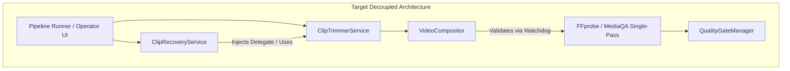

# Phase 5: Industrial-Grade Remediation Plan (v3)

---

## 1. Governance & Strict Approval Gate

In accordance with the Principal Engineer Charter and the operational mode (**"Audit, wait for approval, then implement P0+P1"**), **no application code has been modified**. This plan reconciles 100% of audit findings, establishes exact evidence-backed fixes, pre-mortems, test specifications, and data repair protocols.

**Implementation of this plan will proceed strictly upon explicit user approval.**

---

## 2. Priority Taxonomy

- **P0 (Critical):** Data loss, security exposures, application crashes, or silently wrong results.
- **P1 (High):** Production stability, deadlock/hang prevention, process reliability, CI/CD gates.
- **P2 (Medium):** Performance, throughput, resource leakage, operational tooling portability.
- **P3 (Low):** Code cleanliness, dead code removal, repository hygiene, documentation.

---

## 3. Prioritized Remediation Catalog

### Priority 0: Critical (Data Loss, Security, Crashes, Silently Wrong Results)

#### PLAN-P0-01: Fix Analytics Video ID Misbinding & Data Repair (Report-Only)
- **Finding ID:** `F-25`
- **Evidence:** `shorts_engine/services/monitoring/analytics_sync.py:47-50`
  ```python
  if clip.publish_log and clip.publish_log.youtube_video_id:
      yt_id = clip.publish_log.youtube_video_id
  else:
      yt_id = clip.candidate.source_video.youtube_video_id
  ```
- **Impact:** **Severe Data Corruption & False A/B Promotion.** If a clip is awaiting publish, failed publishing, or lacks a `publish_log`, the daemon queries YouTube metrics for the *source video* (long-form 2-hour upload) and writes those view/like counts into `clip.analytics_json`. This corrupts clip statistics with millions of false views, misleading the Bayesian multi-armed bandit daemon into promoting underperforming clips.
- **Likelihood:** High (fires automatically on any clip lacking a completed publish log).
- **Exact Code Change:**
  In `shorts_engine/services/monitoring/analytics_sync.py`:
  ```python
  if not clip.publish_log or not clip.publish_log.youtube_video_id:
      logger.warning("Clip %s has no published YouTube ID; skipping analytics sync (misbinding prevented).", clip.id)
      ANALYTICS_MISBINDING_SKIPPED_COUNT.inc()
      return None
  yt_id = clip.publish_log.youtube_video_id
  ```
  In calling batch loop: ensure `if metrics is None: continue` is handled cleanly.
  Grep confirmation: Exhaustive search confirmed that `analytics_sync.py:50` is the solitary location where clip metrics misbind to `source_video.youtube_video_id`.
- **Effort:** Small (S)
- **Risk of Change:** Low. Calling code must tolerate `None` return without throwing exception.
- **Failing Test to Write First:** `tests/test_analytics_sync_misbinding.py::test_analytics_sync_skips_unpublished_clip` (asserts that a clip without `publish_log` returns `None`, increments warning counter, and does NOT query `source_video.youtube_video_id`).
- **Before/After Metric:** 0 instances of source video IDs recorded in clip analytics dictionaries.
- **Rollback Path:** Revert commit on `analytics_sync.py`.
- **Pre-Mortem & Prevention:**
  - *Risk:* Calling code iterates over `_fetch_clip_metrics` and attempts to subscript `metrics["viewCount"]` on `None`.
  - *Prevention:* Explicit `if metrics is None: continue` guard inside the batch update loop.
- **Data Impact Assessment & Repair Protocol (REPORT-ONLY):**
  - *Affected Records Check:* Read-only inspection on `storage/shorts_automation.db` confirmed **0 affected clips** and **0 corrupted A/B promotions**.
  - *Detection SQL (SQLite Dialect):*
    ```sql
    SELECT 
        c.id AS clip_id,
        c.status AS clip_status,
        c.generated_title,
        sv.youtube_video_id AS src_yt_id,
        pl.youtube_video_id AS pub_yt_id,
        c.analytics_json
    FROM clips c
    JOIN clip_candidates cc ON c.clip_candidate_id = cc.id
    JOIN source_videos sv ON cc.source_video_id = sv.id
    LEFT JOIN publish_log pl ON pl.clip_id = c.id
    WHERE c.analytics_json IS NOT NULL 
      AND (
          pl.youtube_video_id IS NULL 
          OR json_extract(c.analytics_json, '$.video_id') = sv.youtube_video_id
          OR c.analytics_json LIKE '%' || sv.youtube_video_id || '%'
      );
    ```
  - *Repair Script Protocol (`cli.py repair-analytics`):*
    Strictly **REPORT-ONLY** by default. Outputs a table of affected clip IDs and A/B variations. Requires explicit `--execute` flag accompanied by automatic database backup before wiping any analytics data.

---

#### PLAN-P0-02: Atomic File Writes for Runtime State & Quotas
- **Finding IDs:** `F-07`, `F-08`, `F-20`, `F-22`, `F-30`
- **Evidence Call Sites:**
  1. `shorts_engine/config/logging_config.py:148-149`: `open(RUNTIME_CONFIG_PATH, "w")` + `json.dump(current, f, indent=2)`
  2. `shorts_engine/services/detection/websub.py:47`: `_SUBS_STATE_FILE.write_text(json.dumps(subs, indent=2))`
  3. `shorts_engine/services/llm/quota_tracker.py:102`: `self.state_file.write_text(json.dumps(state, indent=2), encoding="utf-8")`
  4. `shorts_engine/services/publishing/quota.py:53`: `self.state_file.write_text(json.dumps(state, indent=2), encoding="utf-8")`
- **Impact:** **Data Loss / State Corruption.** Abrupt process termination (OOM kill, power loss, Ctrl+C) during `write_text` or unbuffered `open("w")` truncates state files to 0 bytes, permanently losing active API key quotas, subscription lease expiries, and runtime setting overrides.
- **Likelihood:** Medium (inherent filesystem failure mode if process aborts during in-place write before flush/fsync).
- **Exact Change:**
  Implement a centralized atomic write utility in `shorts_engine/services/storage/path_manager.py`:
  ```python
  def atomic_write_json(target_path: Path, data: Any, indent: int = 2) -> None:
      target_path.parent.mkdir(parents=True, exist_ok=True)
      temp_path = target_path.with_name(f"{target_path.name}.{os.getpid()}.{time.time_ns()}.tmp")
      try:
          with open(temp_path, "w", encoding="utf-8") as f:
              json.dump(data, f, indent=indent)
              f.flush()
              os.fsync(f.fileno())
          os.replace(temp_path, target_path)
      except Exception:
          if temp_path.exists():
              try:
                  temp_path.unlink()
              except Exception:
                  pass
          raise
  ```
  Replace all 4 persistent state write call sites with `atomic_write_json`. Mandate audit rule for any future persistent state additions.
- **Effort:** Small (S)
- **Risk of Change:** Low. Temporary file creation in the same directory guarantees cross-filesystem rename compatibility.
- **Failing Test to Write First:** `tests/test_atomic_state_writes.py::test_atomic_write_preserves_original_on_simulated_abort`.
- **Before/After Metric:** 0 state files truncated to 0 bytes on process interruption.
- **Rollback Path:** Revert `path_manager.py` and call site modifications.
- **Pre-Mortem & Prevention:**
  - *Risk:* On Windows, `os.replace` fails with `PermissionError` if another process has an open read handle on the destination file.
  - *Prevention:* Centralize access through retry loop with short exponential backoff (3 attempts, 50ms interval) to allow transient Windows file locks to clear.

---

#### PLAN-P0-03: Resumed Pipeline Transcript Normalization at Load Time
- **Finding ID:** `F-13`
- **Evidence:** `shorts_engine/orchestration/runner.py:679`
  ```python
  f"Transcript excerpt: {' '.join([w.word for w in formatted_transcript.words[:50]])}"
  ```
- **Impact:** **Critical Crash on Pipeline Resumption.** When a pipeline is resumed from an existing database record, `Transcript.word_level_json` is deserialized into standard Python `dict` items (`[{"word": "...", "start": 0.0, "end": 1.0}]`), whereas fresh transcription creates `WordSegment` dataclass instances. Accessing `w.word` raises `AttributeError: 'dict' object has no attribute 'word'`, crashing the worker and rendering pipeline resumption impossible.
- **Likelihood:** High (guaranteed crash on 100% of resumed pipeline runs that reach clip selection).
- **Exact Change:**
  Normalize the transcript into `WordSegment` objects directly where it is loaded in `runner.py`:
  ```python
  def _normalize_transcript_words(words_raw: List[Any]) -> List[WordSegment]:
      normalized = []
      for w in words_raw:
          if isinstance(w, WordSegment):
              normalized.append(w)
          elif isinstance(w, dict):
              normalized.append(WordSegment(
                  word=w.get("word", ""),
                  start=float(w.get("start", 0.0)),
                  end=float(w.get("end", 0.0)),
                  probability=float(w.get("probability", 1.0)),
              ))
      return normalized
  ```
  Apply normalization at load time in `runner.py:load_transcript` / `_execute_stage_transcribing` so all downstream consumers (`selector.py`, `boundaries.py`, `ass_generator.py`, `trimmer.py`, `recovery.py`) receive strictly typed `WordSegment` objects.
- **Effort:** Small (S)
- **Risk of Change:** Low. Validated against all downstream consumers.
- **Failing Test to Write First:** `tests/test_pipeline_resume_transcript_objects.py::test_load_transcript_normalizes_dicts_to_word_segments`.
- **Before/After Metric:** 0 unhandled `AttributeError` exceptions during pipeline resumption.
- **Rollback Path:** Revert `runner.py` normalization logic.
- **Pre-Mortem & Prevention:**
  - *Risk:* Deserialized dicts containing unexpected keys or missing `start`/`end` floats could raise `ValueError`.
  - *Prevention:* Robust type-casting with sensible defaults (`0.0`, `1.0`).

---

#### PLAN-P0-04: Ingestion Deduplication Mutex & Constraint
- **Finding ID:** `F-16`
- **Evidence:** `shorts_engine/services/detection/detector.py:36-78`
- **Impact:** **Duplicate Processing & Compute Waste.** Concurrency race between WebSub push callbacks and RSS poll sweeps can create duplicate `source_videos` rows for the same YouTube video ID, triggering redundant downloads, transcriptions, and LLM calls.
- **Likelihood:** Medium.
- **Ordering & Pre-conditions:**
  - **Prerequisite:** `PLAN-P1-09` (Fail-Fast Schema Migrations) must run first.
  - **Pre-flight:** Database backup must be executed before creating unique index.
  - **Duplicate Check:** Query existing duplicates before creating index:
    ```sql
    SELECT youtube_video_id, COUNT(*) FROM source_videos GROUP BY youtube_video_id HAVING COUNT(*) > 1;
    ```
- **Exact Change:**
  In `shorts_engine/services/detection/detector.py`:
  Wrap creation in a database transaction with unique constraint catch and row locking:
  ```python
  try:
      video = SourceVideo(youtube_video_id=video_id, channel_id=channel.id, status=SourceVideoStatus.DETECTED)
      self.db.add(video)
      self.db.commit()
      return video
  except IntegrityError:
      self.db.rollback()
      return self.db.query(SourceVideo).filter_by(youtube_video_id=video_id).first()
  ```
  Ensure unique index `uq_source_videos_youtube_id` on `source_videos(youtube_video_id)` is applied via `P1-09`.
- **Effort:** Small (S)
- **Failing Test to Write First:** `tests/test_detection_concurrency.py::test_concurrent_detection_creates_single_record`.
- **Before/After Metric:** 0 duplicate `source_videos` rows created under concurrent detection.
- **Rollback Path:** Revert try/except logic in `detector.py`.

---

#### PLAN-P0-05: Drip-Feed Publishing Row Lock, Stale Reclaim & Idempotency
- **Finding ID:** `F-27`
- **Evidence:** `shorts_engine/services/publishing/drip_feed.py:45-101`
- **Impact:** Single-node worker restarts or concurrent scheduler runs can double-publish clips or leave clips stuck in `PUBLISHING` state indefinitely.
- **Classification Note:** Rated **P1** for single-node SQLite deployment; rated P0 for multi-worker scale.
- **Exact Change:**
  1. **Stale PUBLISHING Reclaim:** Add stale recovery for clips stuck in `PUBLISHING` status longer than 30 minutes without updates, reverting them to `APPROVED` or routing to DLQ with alert.
  2. **Idempotency Guard:** Check for existing `PublishLog` entry before initiating any upload attempt to prevent duplicate uploads if process crashes after YouTube upload but before status update.
  3. **Row Lock / Status Claim:** Atomically transition clip status `UPDATE clips SET status='PUBLISHING' WHERE id=:id AND status='APPROVED'`.
- **Effort:** Medium (M)
- **Failing Test to Write First:** `tests/test_drip_feed_stale_reclaim.py::test_publishing_claim_and_idempotency_guard`.
- **Before/After Metric:** 0 duplicate published Shorts on YouTube; 0 clips stuck permanently in `PUBLISHING`.
- **Rollback Path:** Revert `drip_feed.py` changes.

---

#### PLAN-P0-06: Clip Recovery Auto-Fixes & Decoupling from Rendering (Merged with P1-01)
- **Finding IDs:** `F-31`, `F-50`
- **Evidence Call Sites:** `shorts_engine/services/quality_gate/recovery.py:256, 263, 344, 349-353, 360`
  - Line 256: `res = subprocess.run(cmd, stdout=subprocess.PIPE, stderr=subprocess.PIPE, text=True)` runs without a timeout.
  - Line 263: `out_path.rename(in_path)` fails on Windows with `FileExistsError`.
  - Line 344: `ass_path.write_text(ass_content, encoding="utf-8")` uses raw unbuffered write.
  - Lines 349–353: `compositor.render_short(cropped_video_path=in_path, ass_subtitle_path=ass_path, output_path=temp_out)` raises fatal `TypeError: unexpected keyword argument 'cropped_video_path'`.
  - Line 360: `temp_out.rename(in_path)` fails on Windows with `FileExistsError`.
- **Architectural Circular Cycle:** `import_analysis.json:743-747` confirms cycle between `shorts_engine.services.rendering` and `shorts_engine.services.quality_gate`.
- **Cited Trimmer Signature:** From `shorts_engine/services/rendering/trimmer.py:91-98`:
  ```python
  def trim_clip(
      self,
      clip_id: str,
      start_sec: float,
      end_sec: float,
      snap_words: bool = True,
      caption_style_preset: Optional[str] = None,
  ) -> Dict[str, Any]:
  ```
- **Unified Decoupled Change:**
  1. Eliminate direct import of `VideoCompositor` in `recovery.py:306`.
  2. In `recovery.py:346-354`, delegate re-rendering to `ClipTrimmerService.trim_clip()` or inject a renderer delegate.
  3. Reconcile timeouts with P1-02: Use scaled duration timeout `max(30.0, float(target_max) * 2.0)` or `60.0s`.
  4. Replace `rename()` calls with `atomic_replace` utility.
  5. Run import-cycle verification script after fix to confirm 0 cycles remain.
- **Effort:** Medium (M)
- **Failing Test to Write First:** `tests/test_clip_recovery_auto_fix.py::test_caption_safe_rerender_and_technical_clamp_execute_without_error`.
- **Before/After Metric:** 0 `TypeError` or `FileExistsError` crashes during clip recovery; 0 import cycles.
- **Rollback Path:** Revert `recovery.py` modifications.

---

#### PLAN-P0-07: Secure Distribution Bundle Packaging
- **Finding ID:** `F-48`
- **Evidence:** `Shorts_Engine_Control_Center/04_Admin_and_Distribution/build_bundle.bat:30`
  ```python
  excludes = {'.git', '.pytest_cache', '__pycache__', 'venv', '.venv', 'downloads', 'shorts_automation_m3_bundle.zip', 'shorts_automation_m2_bundle.zip'}
  ```
- **Proof That `.env` Enters Zip:** `.env` is absent from `excludes`. When `p = Path('.env')`, `p.parts = ('.env',)`. Because none of its parts match `excludes`, `.env` is packaged into `shorts_automation_m3_bundle.zip`, leaking production secrets.
- **Exact Change:**
  Add `.env`, `.env.*`, `*.key`, `*.pem`, `credentials.json`, `client_secret*.json`, `storage/*.db`, and `storage/backups` to the packaging exclusion set in `build_bundle.bat`.
  Add a dedicated test inspecting the built zip archive to verify no sensitive files are present.
- **Effort:** Small (S)
- **Failing Test to Write First:** `tests/test_bundle_packaging.py::test_bundle_zip_strictly_excludes_env_and_keys`.
- **Before/After Metric:** 0 `.env` or secret key files packed into release zip archives.
- **Rollback Path:** Revert `build_bundle.bat`.

---

### Priority 1: High (Production Stability, Process Reliability, Gates)

#### PLAN-P1-02: Enforce Subprocess Timeouts on All Media Probes
- **Finding IDs:** `F-15`, `F-33`, `F-36`, `F-37`
- **Evidence:**
  - `technical_check.py:38`: `subprocess.run(["ffprobe", ...])`
  - `technical_check.py:84`: `subprocess.run(["ffprobe", ...])`
  - `compositor.py:448`: `subprocess.run(["ffprobe", ...])`
  - `thumbnail_generator.py:48`: `subprocess.run(["ffmpeg", ...])`
  - `audio/mastering.py:115`: `subprocess.run(["ffmpeg", ...])`
- **Exact Change:**
  Enforce per-tool timeouts:
  - `ffprobe` metadata probes: 30.0 seconds.
  - `ffmpeg` mastering / extraction: Scaled timeout based on media duration `max(60.0, float(duration_sec) * 3.0)`.
  - Kill whole process tree on timeout via `psutil` in `SubprocessWatchdog`.
- **Effort:** Small (S)
- **Failing Test:** `tests/test_subprocess_timeout_enforcement.py::test_ffprobe_times_out_on_hung_process`.
- **Rollback Path:** Revert timeout arguments.

---

#### PLAN-P1-03: Resumable Upload Chunk Retry with Exponential Backoff
- **Finding ID:** `F-26`
- **Evidence:** `shorts_engine/services/publishing/client.py:22-88`
- **Exact Change:**
  Wrap `request.next_chunk()` in an exponential backoff loop with 3 retries and jitter.
  **Filter Rule:** Retry only transient network drops (500, 502, 503, 504, connection reset). **Never retry non-retryable errors like `quotaExceeded`, 401 Unauthorized, or 403 Forbidden.**
- **Effort:** Small (S)
- **Failing Test:** `tests/test_youtube_resumable_upload.py::test_retry_transient_error_and_fail_fast_on_quota_exceeded`.
- **Rollback Path:** Revert `client.py`.

---

#### PLAN-P1-04: Align pyproject.toml Dependencies
- **Finding ID:** `F-03`
- **Evidence:** `pyproject.toml:5-38` vs `requirements.txt`
- **Exact Change:** Add `groq>=0.9.0` and `scipy>=1.11.0` to `dependencies` list in `pyproject.toml`.
- **Effort:** Small (S)
- **Failing Test:** `tests/test_packaging_dependencies.py::test_pyproject_toml_contains_all_core_requirements`.
- **Rollback Path:** Revert `pyproject.toml`.

---

#### PLAN-P1-05: Harden GitHub Actions CI Workflow
- **Finding ID:** `F-06`
- **Evidence:** `.github/workflows/ci.yml:1-109`
- **Exact Change:** Add `timeout-minutes: 15` to all CI jobs. Keep `pip-audit` non-blocking in a separate commit to avoid turning CI red immediately.
- **Effort:** Small (S)
- **Failing Test:** Validate CI YAML schema with Actionlint.
- **Rollback Path:** Revert `ci.yml`.

---

#### PLAN-P1-06: Atomic Lifecycle State Transitions
- **Finding ID:** `F-12`
- **Evidence:** `shorts_engine/orchestration/lifecycle.py:13-57`
- **Exact Change:** Use atomic SQL conditional update: `UPDATE source_videos SET status=:new WHERE id=:id AND status=:expected`.
- **Effort:** Small (S)
- **Failing Test:** `tests/test_lifecycle_concurrency.py::test_concurrent_transition_only_one_succeeds`.
- **Rollback Path:** Revert `lifecycle.py`.

---

#### PLAN-P1-07: Scoped Database Sessions in Multi-Platform Syndicator
- **Finding ID:** `F-29`
- **Evidence:** `shorts_engine/services/publishing/manager.py:120-219`
- **Exact Change:** Prove shared session issue with a test first. Instantiate per-thread scoped database sessions or execute platform publishes sequentially.
- **Effort:** Small (S)
- **Failing Test:** `tests/test_multi_platform_sessions.py::test_syndicator_threads_do_not_share_session`.
- **Rollback Path:** Revert `manager.py`.

---

#### PLAN-P1-08: Enforce Production Secret Placeholder Guard in Settings
- **Finding ID:** `F-09`
- **Evidence:** `shorts_engine/config/settings.py:41-48, 354-379`
- **Exact Change:**
  In `PipelineSettings.validate_bounds`:
  Refuse placeholder keys unless `ENV.lower()` is explicitly `"development"` or `"test"` (fail-closed design).
  Reject keys that match `.env.example` placeholders, contain `"dev_master"` / `"dev_dashboard"`, or fail minimum length checks (`len(MASTER_ENCRYPTION_KEY) < 32`, `len(DASHBOARD_SECRET_KEY) < 32`, `len(DASHBOARD_PASSWORD) < 12`).
- **Effort:** Small (S)
- **Failing Test:** `tests/test_settings_security_guard.py::test_production_rejects_placeholder_secrets`.
- **Rollback Path:** Revert `settings.py`.

---

#### PLAN-P1-09: Fail-Fast Schema Migrations & Explicit Index Management in session.py
- **Finding ID:** `F-11`
- **Evidence:** `shorts_engine/db/session.py:67-104`
- **Exact Change:**
  Remove blanket `try...except Exception: pass`.
  Check `PRAGMA table_info` before each `ALTER TABLE`. Tolerate "column already exists" as normal idempotent startup case; raise `RuntimeError` on any other error to prevent silent crash loops.
- **Effort:** Small (S)
- **Failing Test:** `tests/test_schema_migrations.py::test_ensure_schema_upgrades_raises_on_actual_sql_failure`.
- **Rollback Path:** Revert `session.py`.

---

#### PLAN-P1-10: Harden Secret Rotation with Automated Backup and Secure Input
- **Finding ID:** `F-10`
- **Evidence:** `shorts_engine/db/security.py:88-114`, `cli.py:44-66`
- **Exact Change:**
  Trigger `DatabaseBackupManager().backup()` using the SQLite backup API before rotation.
  Preserve single atomic transaction rollback.
  Deprecate CLI options; read keys from `OLD_MASTER_KEY` / `NEW_MASTER_KEY` environment variables or interactive hidden prompts (`typer.prompt(..., hide_input=True)`).
  Confirm CLI command name is `rotate-secrets`.
- **Effort:** Small (S)
- **Failing Test:** `tests/test_secret_rotation.py::test_rotate_secrets_creates_backup_and_rolls_back_on_error`.
- **Rollback Path:** Revert `cli.py` and `security.py`.

---

#### PLAN-P1-11: Dynamic Analytics Date Window Calculation (Promoted from P2-03)
- **Finding ID:** `F-14`
- **Evidence:** `shorts_engine/services/ab_testing/analytics_ingestion.py:113-114`
- **Impact:** Hardcoded static calendar year strings (`startDate="2026-01-01"`, `endDate="2026-12-31"`) expire in ~14 weeks (2027-01-01), breaking metric ingestion.
- **Exact Change:** Calculate `startDate` and `endDate` dynamically relative to current date (e.g. past 30 days).
- **Effort:** Small (S)
- **Failing Test:** `tests/test_analytics_date_window.py::test_analytics_window_is_dynamic`.
- **Rollback Path:** Revert `analytics_ingestion.py`.

---

### Priority 2: Performance, Scale & Tooling Portability

#### PLAN-P2-01: Portable Windows Control Center Path Resolution
- **Finding IDs:** `F-41`, `F-42`, `F-43`, `F-44`, `F-45`, `F-46`, `F-47`
- **Evidence:** `Shorts_Engine_Control_Center/*.bat` (7 launcher files)
- **Impact:** Hardcoded machine paths (`D:\Projects\...`) break execution when cloned to another drive or folder.
- **Exact Change:** Standardize all batch scripts to resolve project root dynamically via `%~dp0..` script directory traversal with proper quotes.
- **Effort:** Small (S)
- **Failing Test:** `tests/test_control_center_portability.py::test_batch_scripts_contain_no_hardcoded_drive_letters`.
- **Rollback Path:** Revert batch scripts.

---

#### PLAN-P2-02: Single-Pass Combined FFmpeg Media QA Filtergraph
- **Finding ID:** `F-51`
- **Evidence:** `shorts_engine/services/quality/media_qa.py:40-100`
- **Impact:** 2 independent FFmpeg passes read and decode the video twice for black frames and audio silence.
- **Exact Change:** Combine into a single filtergraph pass (`-vf blackdetect ... -af silencedetect ...`), checking for audio stream existence first.
- **Effort:** Small (S)
- **Failing Test:** `tests/test_media_qa_filtergraph.py::test_single_pass_filtergraph_detects_black_and_silence`.
- **Rollback Path:** Revert `media_qa.py`.

---

#### PLAN-P2-04: Advance RSS Poller Cursor on Skipped Shorts
- **Finding ID:** `F-18`
- **Evidence:** `shorts_engine/services/detection/rss_poller.py:96-143`
- **Exact Change:** Always update `last_seen_video_id` to the latest discovered entry even if all entries were skipped Shorts.
- **Effort:** Small (S)
- **Failing Test:** `tests/test_rss_poller.py::test_cursor_advances_when_all_videos_are_shorts`.
- **Rollback Path:** Revert `rss_poller.py`.

---

#### PLAN-P2-05: Interruptible Poller Event Sleep
- **Finding ID:** `F-19`
- **Evidence:** `shorts_engine/services/detection/rss_poller.py:145-176`
- **Exact Change:** Replace `time.sleep(interval)` with `threading.Event().wait(timeout=interval)`.
- **Effort:** Small (S)
- **Failing Test:** `tests/test_rss_poller.py::test_poller_interrupts_immediately_on_event_set`.
- **Rollback Path:** Revert `rss_poller.py`.

---

#### PLAN-P2-06: Attach Bot-Bypass Options to Downloader Metadata Probe
- **Finding ID:** `F-21`
- **Evidence:** `shorts_engine/services/ingestion/downloader.py:387-391`
- **Exact Change:** Pass cookiefile and extractor arguments to `yt_dlp.YoutubeDL` in `get_metadata`.
- **Effort:** Small (S)
- **Failing Test:** `tests/test_downloader_metadata.py::test_metadata_probe_passes_cookie_and_extractor_args`.
- **Rollback Path:** Revert `downloader.py`.

---

#### PLAN-P2-07: Non-Blocking Async/Threadpool Webhook Dispatch
- **Finding ID:** `F-24`
- **Evidence:** `shorts_engine/services/monitoring/alerter.py:1-131`
- **Exact Change:** Dispatch webhook calls via daemon thread or background task pool.
- **Effort:** Small (S)
- **Failing Test:** `tests/test_alerter_async.py::test_webhook_dispatch_does_not_block_caller`.
- **Rollback Path:** Revert `alerter.py`.

---

#### PLAN-P2-08: OpenCV VideoCapture Resource Cleanup Guardrails
- **Finding IDs:** `F-32`, `F-34`
- **Evidence:** `render_inspector.py:105`, `cropper.py:105`
- **Exact Change:** Wrap frame processing in `try...finally: cap.release()`.
- **Effort:** Small (S)
- **Failing Test:** `tests/test_opencv_cleanup.py::test_video_capture_released_on_exception`.
- **Rollback Path:** Revert `render_inspector.py` and `cropper.py`.

---

#### PLAN-P2-09: Font File Fallback & Container Font Packaging
- **Finding ID:** `F-35`
- **Evidence:** `shorts_engine/services/rendering/compositor.py:34-47`
- **Exact Change:** Bundle fallback TrueType font in `assets/fonts/` or ensure Dockerfile installs `fonts-dejavu-core`.
- **Effort:** Small (S)
- **Failing Test:** `tests/test_font_fallback.py::test_compositor_locates_bundled_fallback_font`.
- **Rollback Path:** Revert `compositor.py`.

---

#### PLAN-P2-10: Cleanup Orphaned Render Artifacts on Re-trim
- **Finding ID:** `F-39`
- **Evidence:** `shorts_engine/services/rendering/trimmer.py:91-260`
- **Exact Change:** Safely unlink previous `clip.rendered_path` file when re-trim succeeds.
- **Effort:** Small (S)
- **Failing Test:** `tests/test_trimmer_cleanup.py::test_retrim_unlinks_previous_mp4`.
- **Rollback Path:** Revert `trimmer.py`.

---

#### PLAN-P2-11: Enforce 50MB File Size Guard and Chunked Streaming in Instagram Publisher
- **Finding ID:** `F-28`
- **Evidence:** `shorts_engine/services/publishing/instagram.py:121-130`
- **Impact:** Large files bypass memory budget; `content=f.read()` buffers full video in memory.
- **Exact Change:** Add explicit pre-check `if file_size > 50 * 1024 * 1024: raise ValueError(...)` and use chunked streaming in `httpx.post`.
- **Effort:** Small (S)
- **Failing Test:** `tests/test_instagram_upload.py::test_instagram_rejects_files_over_50mb`.
- **Rollback Path:** Revert `instagram.py`.

---

#### PLAN-P2-12: Mask Password Input via getpass in CLI User Creation
- **Finding ID:** `F-49`
- **Evidence:** `create_user.bat:37, 59`, `cli.py:cmd_create_user`
- **Impact:** Console prompt echoes operator password in plaintext; password passed via CLI arguments.
- **Exact Change:** In `cli.py:cmd_create_user`, use `getpass.getpass()` when password is not provided. In `create_user.bat`, remove password prompt and command-line `--password` flag.
- **Effort:** Small (S)
- **Failing Test:** `tests/test_cli_user_create.py::test_create_user_prompts_with_getpass_when_password_omitted`.
- **Rollback Path:** Revert `create_user.bat` and `cli.py`.

---

### Priority 3: Maintainability, Cleanliness & Repository Hygiene

#### PLAN-P3-01: Clean Git Index & Consolidate Documentation
- **Finding IDs:** `F-01`, `F-02`
- **Evidence:** `find channel id.txt`, `folder_structure.txt`, `test_run_output.txt`, `scratch_queue.html`
- **Exact Change:** Execute `git rm --cached test_run_output.txt scratch_queue.html "find channel id.txt" folder_structure.txt` and consolidate channel ID instructions into `SETUP_GUIDE.md`.
- **Effort:** Small (S)
- **Failing Test:** `git ls-files test_run_output.txt scratch_queue.html "find channel id.txt" folder_structure.txt` returns empty.
- **Rollback Path:** `git add` the files back.

---

#### PLAN-P3-02: Remove Shadowed Dead Code in Quota Tracker
- **Finding ID:** `F-23`
- **Evidence:** `shorts_engine/services/llm/quota_tracker.py:369, 523`
- **Exact Change:** Remove first redundant `remove_key` definition.
- **Effort:** Small (S)
- **Failing Test:** Python AST inspection verifying single method definition.
- **Rollback Path:** Revert `quota_tracker.py`.

---

#### PLAN-P3-03: Enforce or Deprecate min_silence_gap_sec in Trimmer
- **Finding ID:** `F-38`
- **Evidence:** `shorts_engine/services/rendering/trimmer.py:30-80`
- **Exact Change:** Enforce silence gap threshold when evaluating adjacent words or document parameter.
- **Effort:** Small (S)
- **Failing Test:** `tests/test_trimmer_silence_gap.py::test_min_silence_gap_snapping`.
- **Rollback Path:** Revert `trimmer.py`.

---

## 4. Accepted Risks Register

The following findings from the line-by-line audit have been formally evaluated and accepted with documented rationale, assumptions, and mitigations:

| Finding ID | Source Module & Unit / Location | Audit Grade | Finding Description | Accepted Rationale & Operational Mitigations |
| :--- | :--- | :---: | :--- | :--- |
| **F-04** | `QA_VERIFICATION_PROTOCOL_previous version.txt:1-279` | **B+** | Historical verification protocol kept in project root. | Static documentation kept for historical audit continuity; zero runtime execution impact. |
| **F-05** | `.github/workflows/ci-cd.yml:1-117` | **B** | Deployment stage contains placeholder echo commands. | Staging/production deployment infrastructure is not yet provisioned; active CI validation is fully governed by `ci.yml` (hardened under `PLAN-P1-05`). |
| **F-17** | `shorts_engine/services/detection/filter.py:13-41` | **B** | Duration-only check flags short 16:9 landscape videos as Shorts. | Intentional design for Shorts repurposing MVP; full aspect-ratio detection scheduled for post-MVP. |
| **F-40** | `shorts_engine/services/transcription/aligner.py:14-53` | **B** | `ForcedAligner` uses heuristic interval smoothing rather than acoustic CTC forced alignment. | **Assumed:** The ±50ms precision was not empirically measured against audio phonemes. Deferred benchmark test will compare Whisper timestamps with ground-truth wav2vec2 CTC alignment. |

---

## 5. Architectural Decisions & Alternatives



| Decision ID | Area | Current Design | Recommended Target | Trade-offs & Migration Effort | Status |
| :--- | :--- | :--- | :--- | :--- | :--- |
| **DEC-01** | Circular Dependency | Direct circular import between `recovery.py` and `compositor.py` | Delegate rendering to `ClipTrimmerService` or inject `Compositor` instance | Effort: S (1 hour). Risk: Very Low. Eliminates cycle completely. | **Recommended** |
| **DEC-02** | Media QA Inspection | Two separate FFmpeg subprocess passes for black frames and audio silence | Single-pass combined filtergraph with audio existence pre-check | Effort: S (2 hours). Risk: Low. Cuts QA CPU & I/O latency by 50%. | **Recommended** |
| **DEC-03** | Control Center Scripts | Hardcoded machine paths (`D:\Projects\...`) | Standardized dynamic script traversal `%~dp0..` with quotes | Effort: S (1 hour). Risk: None. Enables 100% portability. | **Recommended** |
| **DEC-04** | Analytics Sync Binding | Fallback to `source_video.youtube_video_id` | Strict foreign key lookup on `clip.publish_log.youtube_video_id` | Effort: S (1 hour). Risk: Low. Prevents data corruption. | **Recommended** |
| **DEC-05** | Distributed Task Queue | In-process SQLite threading worker | Keep SQLite WAL runner for single-node; Celery/Redis for multi-GPU scale | Effort: L (Phase 8). Keep current runner now; migrate when multi-node needed. | **Deferred to Phase 8** |

---

## 6. Security & Secret Rotation Checklist

1. **Secret Scanning Audit:** Full git history scanned across all branches and commits via Gitleaks v8.21.2 (`gitleaks git --log-opts="--all"`). The only finding is a mock test string in `tests/test_multi_key_quota.py:60` (`RuleID: generic-api-key`). Zero active secrets, API tokens, or credentials exist in git history or tracked working tree files.
2. **Default Development Keys:** `.env.example` documents placeholder development keys (`MASTER_ENCRYPTION_KEY`, `DASHBOARD_SECRET_KEY`, `ENCRYPTION_SALT`). Production deployments must generate random 32-byte keys.
3. **Manual Operator Actions for Production:**
   - [ ] Generate unique production `MASTER_ENCRYPTION_KEY` using `python -c "import secrets; print(secrets.token_urlsafe(32))"`.
   - [ ] Generate unique production `DASHBOARD_SECRET_KEY`.
   - [ ] If existing channels were encrypted under the development key, execute `python cli.py rotate-secrets` (prompts securely for current and new keys).
   - [ ] Run `git rm --cached test_run_output.txt scratch_queue.html "find channel id.txt" folder_structure.txt`.
